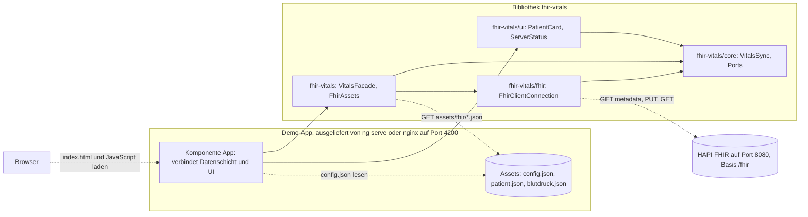

# FHIR-Starter: Angular-Bibliothek für Vitalparameter

Startpunkt für den Workshop WW2 (#WW26-MiHUB) der Forschungsgruppe Digital Health an der TU Dresden.

## 1 Worum es geht

Dieses Repository enthält `fhir-vitals`, eine Bibliothek mit wiederverwendbarem Code für das Web-Framework Angular, und die Demo-App `demo-app`, die diese Bibliothek nutzt.
Die Demo-App zeigt einen synthetischen Patienten und speichert auf Wunsch eine Blutdruckmessung auf einem FHIR-Server, also einem Server für Gesundheitsdaten nach dem Standard HL7 FHIR R4.
Im Workshop entsteht daraus Schritt für Schritt eine Bibliothek für Vitalparameter, die sich später in ein Patientenportal einbinden lässt.

## 2 Voraussetzungen

Angular ist ein Framework für Webanwendungen, die im Browser laufen.
Angular-Code ist in TypeScript geschrieben, einer Erweiterung von JavaScript um Typen.
Die Angular CLI (Command Line Interface) ist das Kommandozeilenwerkzeug `ng`.
Sie legt Projekte und Bausteine an, baut sie und startet Tests.
Ein Build übersetzt den TypeScript-Code in JavaScript-Dateien für den Browser und legt sie im Ordner `dist` ab.
Unit-Tests prüfen einzelne Klassen automatisch, ohne die ganze App zu starten.

Docker startet Programme in Containern.
Ein Container ist ein abgeschotteter Prozess mit eigenem Dateisystem.
Er entsteht aus einem Image, einer Vorlage mit Betriebssystemteilen, Programmen und Dateien.
Docker Compose startet mehrere Container gemeinsam nach der Beschreibung in `compose.yaml`.

| Werkzeug | Version | Wozu |
|---|---|---|
| [Node.js](https://nodejs.org) | 22 ab 22.22.3, 24 ab 24.15.0 oder 26. Geprüft mit 22.22.3, das Docker-Image nutzt 22.23.4. | führt die Angular CLI, den Build und die Tests aus. Die Datei `.nvmrc` nennt die Hauptversion 22 für den Versionsmanager [nvm](https://github.com/nvm-sh/nvm). |
| npm | kommt mit Node.js, geprüft mit 10.9.8 | installiert die Pakete, also fremde Programmbibliotheken aus der npm-Registry |
| [Git](https://git-scm.com) | aktuelle Version | lädt das Repository herunter |
| [Docker Desktop](https://docs.docker.com/desktop/) oder [Docker Engine](https://docs.docker.com/engine/install/) mit Compose | geprüft mit Docker 29.9.2 und Compose 5.6.1 | startet Demo-App und FHIR-Server in Containern |
| Google Chrome oder Chromium | aktuelle Version | führt die Unit-Tests aus, ohne ein Fenster zu öffnen |
| Java, JRE oder JDK (optional) | 17 oder neuer, aufrufbar als `java` | nur für die Prüfung mit der Erweiterung FHIR tools, siehe Abschnitt 7. `java -version` zeigt die installierte Version, zum Beispiel `openjdk version "25.0.2"`. |
| [Visual Studio Code](https://code.visualstudio.com) (optional) | aktuelle Version | Editor. Beim Öffnen des Ordners schlägt er die Erweiterungen Angular Language Service und FHIR tools vor. Er prüft außerdem die FHIR-Beispieldateien beim Tippen, siehe Abschnitt 7. |

Die installierte Node.js-Version zeigt `node -v`, zum Beispiel `v22.22.3`.

## 3 Schnellstart

Zuerst das Repository klonen und in den Ordner wechseln:

```bash
git clone https://github.com/forschungsgruppe-digital-health/angular-fhir-vitals.git
cd angular-fhir-vitals
```

Git meldet `Cloning into 'angular-fhir-vitals'...`.
Danach gibt es den Ordner `angular-fhir-vitals` mit unter anderem `package.json` und `README.md`.

### Variante A: ohne Docker

`npm start` startet den Entwicklungsserver von Angular.
Er liefert die Demo-App auf Port 4200 aus und lädt die Seite nach jeder Änderung neu.

```bash
npm ci
npm start
```

Die Ausgabe von `npm ci` beschreibt Abschnitt 4.
Nach `npm start` erscheint `Local: http://localhost:4200/`.
Danach http://localhost:4200 im Browser öffnen.
Die Seite zeigt den Patienten „Herr K.“ und den Status „nicht erreichbar“, weil kein FHIR-Server läuft.
`Strg+C` im Terminal beendet den Entwicklungsserver.

### Variante B: mit Docker, nur die Demo-App

Im Container liefert der Webserver nginx die gebauten Dateien der Demo-App aus.
nginx lauscht im Container auf Port 80.
Docker leitet Port 4200 des eigenen Rechners dorthin weiter.

```bash
docker compose up --build
```

Docker baut das Image und startet den Container.
Danach zeigt http://localhost:4200 dasselbe wie in Variante A.
`Strg+C` im Terminal stoppt den Container.

### Variante C: mit Docker und dem FHIR-Server HAPI FHIR

In `compose.yaml` gehört der Dienst `fhir` zum Compose-Profil `fhir`.
Compose startet und stoppt ihn nur, wenn der Befehl `--profile fhir` enthält.

```bash
docker compose --profile fhir up --build
```

Dieser Befehl startet zusätzlich den FHIR-Server [HAPI FHIR](https://hapifhir.io) auf http://localhost:8080.
HAPI braucht nach dem Start etwa 40 Sekunden.
Bis dahin zeigt die Seite „nicht erreichbar“.
Danach auf der Seite „Erneut verbinden“ klicken.
Die Seite meldet „verbunden, Patient und Blutdruck gespeichert“ und zeigt „Blutdruck vom Server: 104/66 mm[Hg]“.

Zum Beenden in einem zweiten Terminal `docker compose --profile fhir down` ausführen.
Docker meldet dann für beide Container `Removed`.
Ohne `--profile fhir` läuft HAPI weiter, siehe Abschnitt 9.

## 4 Befehle

Alle Befehle im Wurzelverzeichnis des Repositorys ausführen.
Jeder Befehl in diesen Tabellen ist am 05.11.2026 mit den Versionen aus Abschnitt 14 gelaufen.
Die Spalte „Was danach zu sehen ist“ gibt die tatsächliche Ausgabe wieder.

### a) Bibliothek entwickeln

Die Datei `package-lock.json` hält die genauen Versionen aller Pakete fest.
Ein Commit speichert einen Stand des Codes in der Versionsverwaltung Git.
Eine Komponente ist ein Baustein der Oberfläche aus TypeScript-Klasse, HTML-Template und CSS.
Ihr Selektor ist der Name des HTML-Elements, mit dem eine Seite sie einbindet, etwa `<lib-vitals-card>`.
Ein Service ist eine Klasse mit Logik ohne eigene Oberfläche, etwa für Datenzugriffe.
Der Decorator `@Service()` ist eine Markierung über der Klasse.
Angular erzeugt einen so markierten Service selbst und gibt ihn an alle Klassen weiter, die ihn brauchen.
ESLint prüft den Code auf Fehler und Regelverstöße, ohne ihn auszuführen.
Prettier formatiert den Code einheitlich.
Die Bibliothek besteht aus vier Einstiegspunkten, also Teilpaketen mit eigenem Importnamen wie `fhir-vitals/core`.
Jeder Einstiegspunkt bildet eine Schicht mit einer festen Aufgabe.
Abschnitt 5 beschreibt, was in welche Schicht gehört.

| Befehl | Wirkung | Wann nötig | Was danach zu sehen ist |
|---|---|---|---|
| `npm ci` | installiert alle Pakete genau nach `package-lock.json` und löscht vorher einen vorhandenen Ordner `node_modules` | einmal nach dem Klonen und nach jeder Änderung an `package-lock.json` | Nach einigen Sekunden bis etwa einer Minute erscheint `added … packages`. Die Zahl hängt vom Betriebssystem ab. Im Test waren es 597 unter macOS und 603 unter Linux. Davor stehen Warnungen `npm warn deprecated` zu `inflight`, `rimraf` und `glob`. Sie stammen aus dem Testrunner Karma. Danach folgt `14 moderate severity vulnerabilities`, siehe Abschnitt 9. |
| `npm start` | baut die Bibliothek einmal und startet die Demo-App mit dem Entwicklungsserver | zum Ausprobieren | vier Zeilen `Built fhir-vitals…`, eine je Einstiegspunkt, danach `Local: http://localhost:4200/`. Im Browser erscheint die Seite „FHIR-Starter“. `Strg+C` beendet den Entwicklungsserver. |
| Terminal 1: `npm run watch:lib` | baut die Bibliothek mit allen Einstiegspunkten bei jeder gespeicherten Änderung neu | beim Arbeiten an der Bibliothek, zusammen mit Terminal 2 | `Compilation complete. Watching for file changes...`. Nach jeder Änderung folgt ein neuer Block mit `Build at: …`. Der Neubau dauerte im Test 0,1 bis 0,2 Sekunden. |
| Terminal 2: `npm run start:app` | startet nur die Demo-App, ohne die Bibliothek zu bauen | zusammen mit Terminal 1 | `Local: http://localhost:4200/`. Nach einer Änderung in der Bibliothek erscheint `Page reload sent to client(s).`, und der Browser lädt die Seite selbst neu. Vom Speichern bis zum Neuladen verging im Test weniger als eine Sekunde, für Änderungen in `core` ebenso wie in `ui`. |
| `npx ng generate service <name> --project fhir-vitals` | legt einen Angular-Service in der Angular-Datenschicht an | für Logik, die nur Angular braucht, etwa weitere Datenzugriffe mit HttpClient, dem HTTP-Dienst von Angular | Zwei Zeilen `CREATE projects/fhir-vitals/src/lib/<name>.ts` und `…/<name>.spec.ts`. Die Klasse trägt den Decorator `@Service()`. Logik, die auch andere UI-Frameworks brauchen, gehört dagegen als Datei ohne Decorator nach `core`, siehe Abschnitt 5. |
| `npx ng generate component <name> --project fhir-vitals --path projects/fhir-vitals/ui/src/lib` | legt eine Komponente im Einstiegspunkt `fhir-vitals/ui` an | für neue Anzeigen, etwa eine Karte mit Messwerten | Vier Zeilen `CREATE projects/fhir-vitals/ui/src/lib/<name>/<name>.ts`, `.html`, `.css` und `.spec.ts`. Der Selektor beginnt mit `lib-`. Ohne `--path` landet die Komponente in der Angular-Datenschicht, wo sie nicht hingehört. |
| neue Zeile in der Datei `src/public-api.ts` des Einstiegspunkts, zum Beispiel `export * from "./lib/vitals-card/vitals-card";` in `projects/fhir-vitals/ui/src/public-api.ts` | macht den neuen Baustein außerhalb der Bibliothek sichtbar | nach jedem neuen Service, jeder neuen Komponente und jeder neuen Datei in `core` oder `fhir` | Nach dem nächsten Build der Bibliothek klappt in der Demo-App `import { VitalsCard } from "fhir-vitals/ui";`. Ohne diese Zeile meldet der Build `Module '"fhir-vitals/ui"' has no exported member 'VitalsCard'`. |
| `npx ng build fhir-vitals` | baut alle vier Einstiegspunkte der Bibliothek einmal nach `dist/fhir-vitals` | vor `npm run start:app`, wenn `watch:lib` nicht läuft | Nacheinander `Built fhir-vitals/core`, `Built fhir-vitals/fhir`, `Built fhir-vitals` und `Built fhir-vitals/ui`, dann `Built Angular Package`. Der Ordner `dist/fhir-vitals/fesm2022` enthält je Einstiegspunkt eine Datei `.mjs` und eine `.mjs.map`, etwa `fhir-vitals-core.mjs`. |
| `npx ng test fhir-vitals --watch=false` | testet alle Einstiegspunkte der Bibliothek, direkt aus den Quellen | nach Änderungen an der Bibliothek | `TOTAL: 28 SUCCESS`. Dafür muss die Bibliothek vorher nicht gebaut sein. |
| `npm test` | baut die Bibliothek und testet dann Bibliothek und Demo-App nacheinander, ohne Watch-Modus | vor jedem Commit | Die vier Zeilen `Built fhir-vitals…`, dann zwei Blöcke: zuerst `TOTAL: 28 SUCCESS` für die Bibliothek, dann `TOTAL: 1 SUCCESS` für die Demo-App |
| `npm run lint` | prüft den Code mit ESLint, auch die Regeln zwischen den Schichten aus Abschnitt 5 | vor jedem Commit | nur die beiden Kopfzeilen `> angular-fhir-vitals@0.0.0 lint` und `> eslint .`. Folgt keine weitere Ausgabe, hat ESLint nichts zu beanstanden. |
| `npm run format` | formatiert TypeScript, HTML und CSS mit Prettier | vor jedem Commit | eine Zeile je Datei. `(unchanged)` heißt, dass die Datei schon passte. |
| `npm run build` | baut erst die Bibliothek, dann die Demo-App für die Auslieferung | vor einer Auslieferung ohne Docker | vier Zeilen `Built fhir-vitals…`, dann `Application bundle generation complete` und `Output location: …/dist/demo-app` |

### b) Demo-App mit Docker, ohne HAPI FHIR

`compose.yaml` bindet die Datei `projects/demo-app/public/config.json` als Bind-Mount in den Container ein.
Der Container liest damit direkt die Datei auf dem eigenen Rechner.

| Befehl | Wirkung | Wann nötig | Was danach zu sehen ist |
|---|---|---|---|
| `docker compose up --build` | baut das Image und startet die Demo-App auf http://localhost:4200 | beim ersten Start und nach jeder Code-Änderung | Erst die Build-Schritte, dann Zeilen mit `demo-app-1 \|` und `nginx/1.31.8`. Die Seite zeigt Herrn K. und den Status „nicht erreichbar“. `Strg+C` stoppt den Container. |
| `docker compose up --build -d` | startet wie oben, aber im Hintergrund | wenn das Terminal frei bleiben soll | `Container angular-fhir-vitals-demo-app-1 Started` |
| `docker compose logs -f demo-app` | zeigt das Protokoll von nginx und folgt neuen Zeilen | zur Fehlersuche | je Seitenaufruf Zeilen wie `"GET /config.json HTTP/1.1" 200`. `Strg+C` beendet nur die Anzeige. |
| `docker compose ps` | zeigt laufende Container und ihre Ports | zur Kontrolle | eine Zeile `angular-fhir-vitals-demo-app-1 … Up … 127.0.0.1:4200->80/tcp` |
| `docker compose down` | stoppt und entfernt die Demo-App | zum Aufräumen | `Container angular-fhir-vitals-demo-app-1 Removed` und `Network angular-fhir-vitals_default Removed` |
| `projects/demo-app/public/config.json` im Editor ändern und speichern, dann die Seite neu laden | ändert die Adresse des FHIR-Servers ohne Neubau | um einen anderen Server zu nutzen oder ihn abzuschalten | Mit `{ "fhirBaseUrl": null }` oder `""` zeigt der Status „nicht konfiguriert“. Nach Code-Änderungen dagegen erneut mit `--build` starten. |

### c) Demo-App mit Docker und HAPI FHIR

Eine FHIR-Ressource ist ein Datensatz mit festem Aufbau, etwa `Patient` oder `Observation` für eine Messung.
Ein Bundle ist eine Ressource, die mehrere Ressourcen bündelt, etwa ein Suchergebnis.
Sein Feld `total` nennt die Zahl der Treffer.

| Befehl | Wirkung | Wann nötig | Was danach zu sehen ist |
|---|---|---|---|
| `docker compose --profile fhir up --build` | startet Demo-App und HAPI FHIR | für die Arbeit mit einem FHIR-Server | Zeilen mit `demo-app-1 \|` und `fhir-1 \|`. Nach etwa 40 Sekunden meldet HAPI `Started Application in … seconds`. |
| `docker compose --profile fhir logs -f fhir` | zeigt das Protokoll von HAPI und folgt neuen Zeilen | zur Fehlersuche, etwa wenn HAPI nicht startet | Zeilen mit `fhir-1 \|`. Bei jeder Anfrage erscheint eine Zeile `fhirtest.access`. `Strg+C` beendet nur die Anzeige. |
| `curl http://localhost:8080/fhir/metadata` | fragt die Selbstbeschreibung des Servers ab | um zu prüfen, ob HAPI bereit ist | Sobald HAPI bereit ist, JSON mit `"resourceType": "CapabilityStatement"`. Vorher meldet curl einen Verbindungsfehler. Danach auf der Seite „Erneut verbinden“ klicken. |
| http://localhost:8080 im Browser öffnen | öffnet die Weboberfläche von HAPI | um Ressourcen auf dem Server anzusehen | die Testoberfläche mit dem Titel „HAPI FHIR“ |
| `curl "http://localhost:8080/fhir/Observation?subject=Patient/beispiel-01"` | sucht alle Messungen des Beispielpatienten | um das Speichern zu prüfen | ein `Bundle` mit `"total": 1` und der Observation `blutdruck-01` |
| `docker compose --profile fhir down` | stoppt und entfernt beide Container. Ohne `--profile fhir` stoppt `docker compose down` nur die Demo-App, und der HAPI-Container läuft weiter. | zum Aufräumen | `Removed` für `fhir-1`, `demo-app-1` und das Netzwerk. Danach läuft kein Container des Projekts mehr. |

Hinweis für Windows: In Windows PowerShell 5.1 ist `curl` ein Alias für `Invoke-WebRequest` und versteht andere Parameter.
Dort `curl.exe` statt `curl` schreiben.
PowerShell 7 definiert diesen Alias nicht mehr.

### d) Demo-App auf GitHub Pages

GitHub Pages veröffentlicht statische Webseiten direkt aus einem Repository.
Statische Webseiten bestehen aus fertigen Dateien wie HTML, JavaScript und JSON, die der Server unverändert ausliefert.
GitHub Actions führt Workflows aus, also automatische Abläufe, die eine YAML-Datei im Repository beschreibt.
YAML ist ein Textformat für Einstellungen, das die Gliederung durch Einrückung ausdrückt.
Ein Workflow besteht aus Jobs, also Folgen von Schritten, die GitHub jeweils auf einem eigenen Rechner ausführt.
Jede Ausführung eines Workflows heißt Lauf.
Ein Push lädt neue Commits vom eigenen Rechner zu GitHub hoch.
`main` ist der Hauptzweig des Repositorys, englisch Branch.

Der Workflow `.github/workflows/pages.yml` hat zwei Jobs.
Der Job `build` baut bei jedem Push auf `main` die Bibliothek und die Demo-App.
Der Job `deploy` veröffentlicht danach die Demo-App unter https://forschungsgruppe-digital-health.github.io/angular-fhir-vitals/.
Pages liefert die App unter dem Unterpfad `/angular-fhir-vitals/` aus.
Deshalb baut der Workflow sie mit der Option `--base-href`, die Angular diesen Unterpfad mitteilt.

Auf Pages ist der FHIR-Server abgeschaltet.
Der Workflow ersetzt dafür `config.json` im fertigen Build durch `{ "fhirBaseUrl": null }`.
So schickt eine öffentliche Seite keine Anfragen an `localhost` auf dem Rechner der Besucher.
Chrome würde für solche Anfragen ab Version 142 um eine Erlaubnis bitten.
Die Datei `config.json` im Repository bleibt unverändert.

Vor dem ersten Push auf `main` einmalig in den Einstellungen des Repositorys unter Settings, Pages, „Build and deployment“ bei „Source“ den Eintrag „GitHub Actions“ auswählen.
Danach schlägt GitHub Vorlagen für Workflows vor.
Keine davon auswählen, denn `pages.yml` gibt es schon.
Steht bei „Source“ noch „Deploy from a branch“, läuft im Tab Actions bei jedem Push zusätzlich der Workflow „pages build and deployment“.
Die Pages-Adresse zeigt dann dieses README als Webseite statt der Demo-App.
Ist Pages ganz ausgeschaltet, scheitert der Job `build` im Schritt `actions/configure-pages` mit der Meldung `Get Pages site failed`, und der Job `deploy` läuft nicht.
In beiden Fällen die Einstellung nachholen und den Workflow „Deploy demo app to GitHub Pages“ neu starten.
Für einen gescheiterten Lauf geht das im Lauf selbst: im Menü „Re-run jobs“ den Eintrag „Re-run failed jobs“ wählen und im folgenden Dialog „Re-run jobs“ klicken.
Sonst den Workflow wie in der Tabelle unten von Hand starten.

| Befehl | Wirkung | Wann nötig | Was danach zu sehen ist |
|---|---|---|---|
| `git push` auf `main` | startet den Workflow „Deploy demo app to GitHub Pages“ | nach jeder Änderung, die online erscheinen soll | Im Tab Actions des Repositorys erscheint ein Lauf mit den Jobs `build` und `deploy`. Nach dem Lauf zeigt die Pages-Adresse Herrn K. und den Status „nicht konfiguriert“. |
| im Tab Actions links den Workflow „Deploy demo app to GitHub Pages“ wählen, „Run workflow“ klicken, den Branch `main` lassen und im aufgeklappten Feld erneut „Run workflow“ klicken | startet denselben Workflow von Hand | um ohne neuen Commit neu zu veröffentlichen | ein neuer Lauf mit denselben Jobs |

## 5 Projektaufbau

Das Repository ist ein Angular-Workspace, also ein Ordner mit mehreren Angular-Projekten und gemeinsamer Konfiguration.
Assets sind statische Dateien wie JSON oder Bilder, die die App unverändert mit ausliefert.
In der Demo-App liegen sie im Ordner `public`.

```text
angular-fhir-vitals/
├── .github/workflows/pages.yml        Workflow: veröffentlicht die Demo-App auf GitHub Pages
├── projects/
│   ├── fhir-vitals/                   Angular-Bibliothek: ein npm-Paket mit vier Einstiegspunkten
│   │   ├── core/                      "fhir-vitals/core": Ports, Ablauf VitalsSync, Blutdruck-Formatierung
│   │   ├── fhir/                      "fhir-vitals/fhir": Adapter mit fhirclient und mit fetch
│   │   ├── src/                       "fhir-vitals": Angular-Datenschicht mit FhirAssets und VitalsFacade
│   │   ├── ui/                        "fhir-vitals/ui": Komponenten PatientCard und ServerStatus
│   │   ├── …/src/public-api.ts        je Einstiegspunkt: was außerhalb sichtbar ist
│   │   ├── …/src/lib/*.spec.ts        Unit-Tests, neben dem getesteten Code
│   │   ├── ng-package.json            Einstellungen für ng-packagr, das die Bibliothek baut
│   │   ├── core|fhir|ui/ng-package.json  macht den Ordner zu einem eigenen Einstiegspunkt
│   │   ├── tsconfig.spec.json         lässt die Tests direkt gegen die Quellen laufen
│   │   └── package.json               Name, Version und peerDependencies, gemeinsam für alle Einstiegspunkte
│   └── demo-app/                      Demo-App
│       ├── public/config.json         Adresse des FHIR-Servers, wird beim Start gelesen
│       ├── public/assets/fhir/        Beispieldaten patient.json und blutdruck.json
│       ├── src/index.html             HTML-Grundgerüst mit dem Element <app-root>
│       ├── src/main.ts                Startpunkt von Angular
│       ├── src/styles.css             die wenigen globalen Styles
│       └── src/app/                   die einzige Seite: app.ts, app.html, app.config.ts, app.spec.ts
├── dist/                              Build-Ergebnisse, nicht im Repository
├── angular.json                       Projekte und Einstellungen für Build, Server und Tests
├── tsconfig.json                      TypeScript-Einstellungen und die Pfadzuordnung für "fhir-vitals"
├── package.json                       npm-Skripte und Abhängigkeiten des Workspace
├── package-lock.json                  genaue Paketversionen für npm ci
├── Dockerfile                         Image in zwei Stufen: Build mit Node.js, Auslieferung mit nginx
├── .dockerignore                      Dateien, die nicht ins Docker-Image kopiert werden
├── compose.yaml                       Dienste demo-app und fhir
├── .gitignore                         Dateien, die nicht ins Repository gehören, etwa node_modules, dist und .env
├── eslint.config.js                   Regeln für ESLint
├── .prettierrc                        Einstellungen für Prettier
├── .editorconfig                      Einrückung, Zeilenenden und Anführungszeichen für Editoren
├── .nvmrc                             Node.js-Hauptversion für nvm
├── .vscode/extensions.json            empfohlene Erweiterungen für Visual Studio Code
├── .vscode/settings.json              ordnet den FHIR-Beispieldateien das JSON-Schema von FHIR R4 zu
└── LICENSE                            Lizenztext Apache-2.0
```

**Pfadzuordnung.** Die Demo-App importiert die Bibliothek über ihre Paketnamen, also etwa `import { VitalsFacade } from "fhir-vitals";` und `import { PatientCard, ServerStatus } from "fhir-vitals/ui";`.
Genau so sähe der Import im Patientenportal aus, wenn es die Bibliothek als npm-Paket installiert.
Möglich machen das zwei Einträge unter `compilerOptions.paths` in `tsconfig.json`.
`"fhir-vitals": ["./dist/fhir-vitals"]` hat die Angular CLI beim Anlegen der Bibliothek erzeugt.
`"fhir-vitals/*": ["./dist/fhir-vitals/*"]` kommt für die weiteren Einstiegspunkte hinzu.
Beide leiten die Paketnamen auf die gebaute Bibliothek im Ordner `dist` um.
Deshalb muss die Bibliothek gebaut sein, bevor die Demo-App startet.
`npm start` und `npm test` erledigen das automatisch.
Die Tests der Bibliothek brauchen keinen Build, weil `projects/fhir-vitals/tsconfig.spec.json` die Paketnamen auf die Quellen umleitet.

**peerDependencies.** peerDependencies sind Pakete, die eine Bibliothek voraussetzt, die aber die einbindende Anwendung selbst installiert.
So nutzen Bibliothek und Anwendung dieselbe Version.
Die Bibliothek führt `@angular/core`, `@angular/common`, `fhirclient` und `@types/fhir` als peerDependencies.
In der `package.json` im Wurzelverzeichnis stehen diese Pakete unter `dependencies`.

**Schichten der Bibliothek.**
Die Bibliothek trennt Abläufe, Serverzugriff, Angular-Anbindung und Oberfläche in vier Einstiegspunkte.
Jeder Einstiegspunkt bildet eine Schicht mit einer festen Aufgabe.
Der Kern, also `fhir-vitals/core`, enthält die eigentliche Logik.
Ein Port ist eine Schnittstelle, die beschreibt, was der Kern von außen braucht, etwa das Laden einer Ressource.
Mit einem Netzwerk-Port hat dieser Begriff nichts zu tun.
Ein Adapter setzt einen Port mit einer bestimmten Technik um, etwa mit fhirclient oder mit fetch.
Eine Facade ist ein einfacher Zugang für die Oberfläche, der die Einzelheiten dahinter verbirgt.
Ein Signal ist ein Wert, dessen Änderungen Angular verfolgt.
Ein Input ist eine Eigenschaft einer Komponente, die die einbindende Seite setzt.

| Einstiegspunkt | Inhalt | darf importieren | darf nicht importieren |
|---|---|---|---|
| `fhir-vitals/core` | die Ports `ResourceLoader` und `FhirServerConnection`, der Ablauf `VitalsSync` mit Patient laden, Adresse lesen, verbinden, prüfen, speichern und zurücklesen, dazu `formatBloodPressure` und die LOINC-Codes | FHIR-Typen aus `fhir/r4` | Angular, RxJS, Vue, fhirclient, `fetch` und alle anderen Teile der Bibliothek |
| `fhir-vitals/fhir` | die Adapter `FhirClientConnection` mit fhirclient und `FetchResourceLoader` mit fetch | `fhir-vitals/core`, fhirclient, FHIR-Typen aus `fhir/r4` | Angular, RxJS, Vue und die übrigen Teile |
| `fhir-vitals` | die Angular-Datenschicht: `FhirAssets` als Adapter mit HttpClient, dem Dienst von Angular für HTTP-Anfragen, und `VitalsFacade`, die den Zustand von `VitalsSync` als Signal anbietet | `fhir-vitals/core`, `fhir-vitals/fhir`, Angular, RxJS, FHIR-Typen aus `fhir/r4` | `fhir-vitals/ui` und fhirclient direkt |
| `fhir-vitals/ui` | die Komponenten `PatientCard` und `ServerStatus`. Sie bekommen Daten über Inputs und übersetzen die Statuscodes des Kerns in deutsche Texte. | `fhir-vitals/core`, Angular, FHIR-Typen aus `fhir/r4` | die Datenschicht, `fhir-vitals/fhir`, fhirclient, HttpClient und `fetch` |

Die Demo-App ist die einzige Stelle, die Datenschicht und Oberfläche kennt.
Sie verbindet beide.
Die Schichten importieren einander nur über den Paketnamen, etwa `fhir-vitals/core`.
Ein relativer Pfad in eine andere Schicht scheitert beim Build mit dem Fehler `TS6059`.
`npm run lint` prüft die Spalte „darf nicht importieren“.
Ein verbotener Import erscheint dann als Fehler mit Begründung, im Kern zum Beispiel `'@angular/core' import is restricted from being used by a pattern. Dieser Teil bleibt frei von UI-Frameworks, damit auch Vue oder andere ihn nutzen können.`

**Andere UI-Frameworks.**
Vue ist wie Angular ein Framework für Webanwendungen im Browser.
`fhir-vitals/core` und `fhir-vitals/fhir` enthalten keinen Angular-Code.
Im gebauten Paket importiert `fhir-vitals-core.mjs` nichts, und `fhir-vitals-fhir.mjs` importiert nur `fhirclient/browser`.
Eine andere Oberfläche nutzt denselben Ablauf mit `new VitalsSync(new FetchResourceLoader(), connectWithFhirClient)`.
Mit `subscribe()` meldet sie sich für den Zustand an, man sagt auch, sie abonniert ihn.
`VitalsSync` ruft die übergebene Funktion dann bei jeder Änderung auf.
Die Oberfläche überträgt den Zustand in ihre eigene Reaktivität, in Vue zum Beispiel in ein `shallowRef()`, das Gegenstück zu einem Signal.
Eine kleine Vue-App mit genau diesem Aufbau zeigte im Test gegen HAPI Herrn K., den Status `saved` und 104/66 mm[Hg].
Das gebaute JavaScript dieser Vue-App enthielt keinen Code aus Angular.
Die Vue-App gehört nicht zum Repository.
Das Build-Werkzeug Vite baute sie und griff dabei über einen Alias direkt auf die Quellen von `core` und `fhir` zu.
Als verteiltes npm-Paket eignet sich `fhir-vitals` für Vue noch nicht, weil es Angular als peerDependency führt und npm diese mitinstalliert.
Dafür kommen `core` und `fhir` später in eigene Pakete.
Weil alle Schichten einander schon heute nur über Paketnamen importieren, ändern sich dabei im Code vor allem die Importnamen.

## 6 Wie die Teile zusammenspielen

Die Demo-App läuft vollständig im Browser.
Alle Anfragen an die Assets und an HAPI schickt deshalb der Browser.
Durchgezogene Pfeile zeigen, wer wen importiert.
Gestrichelte Pfeile zeigen Anfragen über das Netz.



Ein Ursprung ist die Kombination aus Protokoll, Rechnername und Port, etwa `http://localhost:4200`.
Seite und HAPI haben verschiedene Ursprünge, weil sie auf verschiedenen Ports laufen.
Der Browser lässt die Seite die Antworten von HAPI nur lesen, wenn HAPI das per CORS (Cross-Origin Resource Sharing) erlaubt.
Vor einem PUT fragt der Browser HAPI vorher um Erlaubnis.
HAPI erlaubt in der Voreinstellung des Images alle Ursprünge, auch `http://localhost:4200`.

## 7 Die Beispieldaten und ihre Codes

Beide Dateien liegen unter `projects/demo-app/public/assets/fhir/` und sind im Browser als `assets/fhir/…` erreichbar.
Sie sind synthetisch und passen zum Beispiel „Herr K.“ aus dem Workshop.
Den Typ einer FHIR-Ressource nennt ihr Feld `resourceType`.

**`patient.json`** ist eine Ressource vom Typ [Patient](https://hl7.org/fhir/R4/patient.html) mit der festen ID `beispiel-01`.
Sie enthält eine Kennung `4711`, den Namen „Herr K.“, das Geschlecht `male` und das Geburtsjahr `1959`.

**`blutdruck.json`** ist eine Ressource vom Typ [Observation](https://hl7.org/fhir/R4/observation.html), also eine Messung oder Beobachtung, mit der festen ID `blutdruck-01`.
Sie folgt dem [Blutdruckprofil](https://hl7.org/fhir/R4/bp.html) aus FHIR R4.
Ein Profil legt fest, welche Felder und Codes eine Ressource für einen bestimmten Zweck haben muss.

| Feld | Wert | Bedeutung |
|---|---|---|
| `meta.profile` | `http://hl7.org/fhir/StructureDefinition/bp` | Die Ressource erklärt, dass sie dem Blutdruckprofil folgt. |
| `category` | `vital-signs` | Die Messung gehört zu den [Vitalparametern](https://hl7.org/fhir/R4/observation-vitalsigns.html). |
| `code` | LOINC `85354-9` | das Blutdruck-Panel, englisch „Blood pressure panel with all children optional“ |
| `component[0].code` | LOINC `8480-6` | der systolische Wert, englisch „Systolic blood pressure“ |
| `component[1].code` | LOINC `8462-4` | der diastolische Wert, englisch „Diastolic blood pressure“ |
| `component[0].valueQuantity.code`, `component[1].valueQuantity.code` | UCUM `mm[Hg]` | die Einheit Millimeter Quecksilbersäule |
| `subject`, `performer` | `Patient/beispiel-01` | Die Messung gehört zu Herrn K., und er hat sie selbst gemessen. |
| `effectiveDateTime` | `2026-06-01T07:35:00+02:00` | Zeitpunkt der Messung |

[LOINC](https://loinc.org) ist ein internationales Codesystem für Messungen und Laborwerte.
[UCUM](https://ucum.org) ist ein Codesystem für Maßeinheiten.
Ein Terminologieserver kennt Codesysteme wie LOINC und prüft Codes und Anzeigenamen.
Die Anzeigenamen der drei LOINC-Codes stimmen mit den Angaben des Terminologieservers tx.fhir.org überein.

Die FHIR-Operation `$validate` prüft eine Ressource gegen den Standard und gegen ihre Profile.
Auf dem lokalen HAPI FHIR 8.12.0 ergab sie am 05.11.2026 für beide Dateien keine Fehler.
Es gab nur Warnungen: LOINC ist auf dem lokalen Server unbekannt, und beiden Ressourcen fehlt eine Narrative, also ein lesbarer Text im Feld `text`.
Das gilt auch bei der Prüfung der Observation gegen das Blutdruckprofil.

**Prüfen in Visual Studio Code.**
Ein JSON-Schema beschreibt, welche Felder und Werte eine JSON-Datei haben darf.
HL7 veröffentlicht ein solches Schema für alle Ressourcen von FHIR R4.
Die Datei `.vscode/settings.json` ordnet es allen JSON-Dateien unter `projects/*/public/assets/fhir/` zu.
Visual Studio Code prüft diese Dateien damit schon beim Tippen und schlägt Feldnamen und erlaubte Werte vor.
Ein Verstoß erscheint als Warnung, also mit gelber Wellenlinie und in der Ansicht „Probleme“ (englisch „Problems“).
Steht in `patient.json` bei `gender` zum Beispiel der Wert `mann`, lautet die Meldung `Value is not accepted. Valid values: "male", "female", "other", "unknown".`
Für die beiden Beispieldateien gibt es keine Meldung.
VS Code lädt das Schema beim ersten Öffnen einer solchen Datei von hl7.org.
Dafür muss der Ordner als vertrauenswürdig gelten.
VS Code öffnet einen neuen Ordner zunächst im eingeschränkten Modus, englisch Restricted Mode, und zeigt oben einen Hinweis mit dem Link „Manage“.
In diesem Modus prüft VS Code die FHIR-Dateien nicht gegen das Schema, und die Erweiterung FHIR tools bleibt abgeschaltet.
„Manage“ klicken und im folgenden Fenster „Trust“ wählen.
Danach verschwindet der Hinweis, und die Prüfung beginnt.
Das Schema prüft nur den Aufbau einer Ressource.
Profile wie das Blutdruckprofil und die LOINC-Codes prüft es nicht.

Das übernimmt die empfohlene Erweiterung FHIR tools.
Ein Validator ist ein Programm, das eine Ressource gegen den Standard, ihre Profile und die Codesysteme prüft.
FHIR tools nutzt den offiziellen Validator von HL7 und braucht dafür Java 17 oder neuer.
Zum Prüfen eine Datei wie `patient.json` im Editor öffnen, in den Text rechtsklicken und „FHIR validate resource“ wählen.
Im Explorer links fehlt dieser Eintrag.
Beim ersten Mal meldet VS Code `The first time the jar validator must be downloaded. It may take a while!` und lädt den Validator, eine Datei von etwa 200 MB.
Danach öffnet sich das Terminal „Resource validation“ und zeigt die Ausgabe des Validators.
Diese Angaben stammen aus dem Quelltext der Erweiterung, die Erweiterung selbst lief für dieses README nicht.

## 8 Was beim Start passiert

1. Der Browser lädt `index.html` und das JavaScript der Demo-App vom Entwicklungsserver oder von nginx.
2. `main.ts` startet Angular mit den Einstellungen aus `app.config.ts`. Dort schaltet `provideZoneChangeDetection()` die Änderungserkennung mit zone.js ein. Die Änderungserkennung prüft nach Ereignissen wie Klicks oder Serverantworten, ob sich die Seite ändern muss. zone.js meldet Angular diese Ereignisse. `provideHttpClient(withFetch())` richtet HTTP-Anfragen mit der Fetch-API des Browsers ein.
3. Die Komponente `App` holt sich die `VitalsFacade` aus der Angular-Datenschicht. Die Facade erzeugt den Ablauf `VitalsSync` aus `fhir-vitals/core` und gibt ihm zwei Adapter mit: `FhirAssets` zum Laden der Assets und `connectWithFhirClient` aus `fhir-vitals/fhir` für den Server.
4. `App` ruft `start()` der Facade auf und übergibt eine Funktion, die `config.json` liest. `VitalsSync` liest die Datei beim Start und nicht beim Build, damit sie sich ohne Neubau des Images ändern lässt.
5. `VitalsSync` lädt `assets/fhir/patient.json`. Die Komponente `PatientCard` zeigt Name, Geschlecht, Geburtsdatum und Kennung. Fehlt ein Feld, steht dort „–“.
6. `VitalsSync` liest danach über die übergebene Funktion die Adresse des Servers. Ist `fhirBaseUrl` leer oder `null`, meldet er den Status `not-configured`, und die Komponente `ServerStatus` zeigt „nicht konfiguriert“. Der Ablauf endet dann hier.
7. `VitalsSync` erzeugt mit `connectWithFhirClient` eine `FhirClientConnection`. `isReachable()` fragt `metadata` ab. Antwortet der Server nicht, zeigt die Seite „nicht erreichbar“ und bleibt trotzdem vollständig bedienbar.
8. `VitalsSync` lädt `assets/fhir/blutdruck.json` und ruft `seed()` auf. `seed()` schreibt erst den Patienten und dann die Observation per PUT unter ihrer festen ID. Die Reihenfolge ist nötig, weil HAPI prüft, ob der Verweis `subject` auf einen vorhandenen Patienten zeigt.
9. `VitalsSync` liest die Observation `Observation/blutdruck-01` vom Server zurück. Erst danach zeigt die Seite „verbunden, Patient und Blutdruck gespeichert“ und „Blutdruck vom Server: 104/66 mm[Hg]“. Geht dabei etwas schief, zeigt der Status die Fehlermeldung.
10. Bei jeder Änderung meldet `VitalsSync` den neuen Zustand an alle, die ihn mit `subscribe()` abonniert haben. Die Facade legt ihn in ein Signal, und die Komponenten `PatientCard` und `ServerStatus` zeigen ihn an. Keine der beiden kennt fhirclient oder HttpClient.
11. „Erneut verbinden“ ruft über `reconnect()` die Prüfung der Adresse aus Schritt 6 und die Schritte 7 bis 9 noch einmal auf. `config.json` liest es dabei nicht neu. Ist schon das Laden in Schritt 5 oder 6 gescheitert, versucht es auch dieses noch einmal. Bis ein Lauf zu Ende ist, ist der Knopf gesperrt. Ein zweiter Aufruf während eines Laufs schließt sich diesem Lauf an, statt einen eigenen zu starten. Ein PUT mit gleichem Inhalt legt weder eine neue Ressource noch eine neue Version an. Nach mehreren Starts gibt es deshalb weiterhin genau eine Observation mit `versionId` 1.

## 9 Typische Probleme

**Port belegt.**
Docker meldet `Bind for 127.0.0.1:8080 failed: port is already allocated`.
Der Entwicklungsserver meldet `Port 4200 is already in use. Use '--port' to specify a different port.`
Ein anderes Programm oder ein anderer Container nutzt dann den Port.
`docker ps` zeigt laufende Container und ihre Ports.
Unter macOS und Linux zeigt `lsof -i :8080` das Programm hinter dem Port.
Unter Windows zeigt `netstat -ano | findstr :8080` in der letzten Spalte die Prozessnummer.
`tasklist /fi "PID eq <nummer>"` nennt dazu das Programm.
Das andere Programm beenden oder den Container mit `docker stop <name>` anhalten.
`docker stop` gibt danach den Namen des Containers aus.

**HAPI noch nicht bereit.**
HAPI braucht nach dem Start etwa 40 Sekunden.
Bis dahin zeigt die Seite „nicht erreichbar“.
`curl http://localhost:8080/fhir/metadata` prüft den Stand.
Sobald JSON zurückkommt, auf der Seite „Erneut verbinden“ klicken.
`docker compose --profile fhir logs -f fhir` zeigt, ob HAPI noch startet.
Die Zeile `Started Application in … seconds` markiert das Ende.

**Bibliothek nicht gebaut.**
`npm run start:app` oder `npx ng build demo-app` melden `Could not resolve "fhir-vitals"`.
Der Ordner `dist/fhir-vitals` fehlt dann.
`npx ng build fhir-vitals` oder `npm run watch:lib` ausführen, oder gleich `npm start` nutzen.

**Falsche Node.js-Version.**
Die Angular CLI bricht ab mit `Node.js version … detected. The Angular CLI requires a minimum Node.js version of …`.
`node -v` zeigt die installierte Version.
Node.js 22 ab 22.22.3, 24 ab 24.15.0 oder 26 installieren.
Mit nvm unter macOS oder Linux genügen `nvm install` und `nvm use` im Projektordner, weil `.nvmrc` die Version vorgibt.
Danach zeigt `node -v` eine Version 22.

**HAPI läuft nach `docker compose down` weiter.**
`docker compose down` ohne `--profile fhir` stoppt nur die Demo-App.
Der HAPI-Container läuft weiter, und Docker meldet beim Netzwerk `Resource is still in use`.
Erst `docker compose --profile fhir down` stoppt beide.

**ESLint meldet `… import is restricted from being used by a pattern`.**
Ein Import verletzt eine Regel zwischen den Schichten aus Abschnitt 5.
Die Meldung nennt den Grund, etwa `Die UI spricht nicht selbst mit Servern.`
Den Code in die passende Schicht verschieben.
Eine Komponente bekommt Daten dann über ein Input, und die Demo-App holt sie über die Facade.
Danach zeigt `npm run lint` nur noch die beiden Kopfzeilen.

**Neue Komponente liegt in `src/lib` statt in `ui`.**
`npx ng generate component` ohne `--path` legt die Komponente in der Angular-Datenschicht an.
Die neuen Dateien löschen und den Befehl mit `--path projects/fhir-vitals/ui/src/lib` wiederholen.
Danach erscheinen vier Zeilen `CREATE projects/fhir-vitals/ui/src/lib/<name>/…`.

**Tests finden keinen Browser.**
Karma meldet `No binary for ChromeHeadless browser on your platform. Please, set "CHROME_BIN" env variable.`
Google Chrome oder Chromium installieren.
Liegt der Browser an einem ungewöhnlichen Ort, die Umgebungsvariable `CHROME_BIN` auf die ausführbare Datei setzen.

**`config.json` im Container liefert 404.**
Manche Editoren speichern eine Datei, indem sie sie durch eine neue Datei ersetzen.
Der Bind-Mount hängt dann noch an der alten, gelöschten Datei.
nginx findet `config.json` im Container nicht mehr und antwortet mit 404.
`docker compose restart demo-app` bindet die neue Datei ein.
Docker meldet danach `Container angular-fhir-vitals-demo-app-1 Started`, und die Seite liest `config.json` wieder.

**Warnungen bei `npm ci`.**
Die Warnungen `npm warn deprecated` zu `inflight`, `rimraf` und `glob` stammen aus Karma 6.4.4.
Das Karma-Projekt entwickelt Karma nicht mehr weiter.
Das Patientenportal nutzt Karma trotzdem als Testrunner, deshalb auch dieser Starter.
Die Meldung `14 moderate severity vulnerabilities` betrifft das Paket `minimatch` in der ESLint-Kette.
Beides betrifft nur Entwicklungswerkzeuge und nicht den Code, der im Browser läuft.
`npm audit fix --force` nicht ausführen, weil es Pakete auf unpassende Versionen ändert.

**Daten auf HAPI sind nach einem Neustart weg.**
HAPI läuft hier ohne eigene Datenbank und hält die Daten im Arbeitsspeicher.
Nach jedem Neustart des Containers ist der Server leer.
Die Demo-App schreibt die Beispieldaten beim nächsten Start oder nach „Erneut verbinden“ neu.

## 10 Weiterarbeiten in WW2

Die Bibliothek ist absichtlich klein.
Sie zeigt die Architektur aus Folie 73 im Workshop-Deck an einem einzigen Beispiel, dem Blutdruck:

- **Facade:** `VitalsFacade` ist der einfache Zugang, über den Angular-Komponenten Vitalparameter anzeigen, ohne FHIR zu kennen.
- **Port:** `ResourceLoader` und `FhirServerConnection` in `fhir-vitals/core` beschreiben, was der Ablauf von außen braucht. Mit einem Netzwerk-Port hat dieser Begriff nichts zu tun.
- **FHIR-Adapter:** `FhirClientConnection` in `fhir-vitals/fhir` setzt den Port mit fhirclient um. Ein anderer Adapter kann später den FHIR-Zugang des Patientenportals nutzen.
- **Ablauf:** `VitalsSync` in `fhir-vitals/core` enthält die eigentliche Logik. Er hängt von keinem UI-Framework ab, damit auch eine Oberfläche mit Vue oder einem anderen Framework ihn nutzen kann.

Weitere Schritte im Workshop:

- weitere Vitalparameter aus der [Vital-Signs-Übersicht](https://hl7.org/fhir/R4/observation-vitalsigns.html) ergänzen. Dazu kommen Codes und Formatierung nach `core`, eigene Beispieldateien unter `public/assets/fhir/` und eine Komponente nach `ui`.
- für neue Ressourcen IDs mit mindestens einem Buchstaben wählen, etwa `puls-01`. HAPI lehnt in der Voreinstellung ein PUT mit rein numerischer ID ab.
- neue Komponenten mit `--path projects/fhir-vitals/ui/src/lib` anlegen und in `ui/src/public-api.ts` exportieren
- eine zweite Oberfläche mit Vue oder einem anderen Framework auf `fhir-vitals/core` und `fhir-vitals/fhir` aufbauen, siehe Abschnitt 5
- `core` und `fhir` in eigene npm-Pakete auslagern, sobald eine andere Oberfläche sie als Paket installieren soll
- für Daten, die einen Neustart überleben, HAPI mit PostgreSQL betreiben. Die passende `compose.yaml` steht im Workshop-Material auf Folie 80.
- später die Anmeldung über [SMART App Launch](https://hl7.org/fhir/smart-app-launch/) ergänzen. Das Paket `fhirclient` unterstützt diesen Ablauf mit OAuth 2.0, einem Standard für die Freigabe von Zugriffen.

## 11 Sprachmodelle im Studium

Für das Studium stehen Sprachmodelle über Dienste der Hochschulen zur Verfügung.
Ein Sprachmodell erzeugt Text oder Code aus einer Eingabe, dem sogenannten Prompt.
Stand der Angaben: 05.11.2026.

**Chat AI in der Academic Cloud (GWDG).**
Chat AI ist ein Chat-Dienst der GWDG mit selbst betriebenen und externen Sprachmodellen.
Die Weboberfläche liegt unter https://chat-ai.academiccloud.de.
Die Anmeldung erfolgt mit einem Academic-Cloud-Konto, auch über den föderierten Login der eigenen Hochschule, sofern sie teilnimmt.
Laut GWDG speichert der Dienst bei den selbst betriebenen Modellen keine Chatverläufe auf dem Server.
Der Verlauf bleibt im eigenen Browser.
Anfragen an die OpenAI-Modelle leitet die GWDG laut Datenschutzhinweis an Microsoft (Azure) weiter.
Die externen Modelle stehen außerdem nur bestimmten Einrichtungen offen.
Für Arbeiten im Workshop deshalb die selbst betriebenen Modelle nutzen.
Quellen: [Dienstbeschreibung](https://academiccloud.de/services/chatai/), [Dokumentation](https://docs.hpc.gwdg.de/services/ai-services/chat-ai/index.html), [Datenschutz](https://datenschutz.gwdg.de/services/chatai).

**TUD:AI, die LLM-Dienste von ScaDS.AI Dresden/Leipzig.**
ScaDS.AI Dresden/Leipzig und das ZIH der TU Dresden betreiben die Dienste unter dem Namen TUD:AI.
Der Chat liegt unter https://chat.llm.scads.ai.
Die Programmierschnittstelle, kurz API, ist kompatibel zur OpenAI-API und hat die Basisadresse `https://llm.scads.ai/v1`.
Die [Dokumentation](https://llm.scads.ai/docs/) beschreibt Chat und API.
Der Dienst steht allen offen, die der TU Dresden oder ScaDS.AI Dresden/Leipzig angehören.
Für den Chat ist ein ZIH-Konto der TU Dresden nötig.
Für den Workshop gibt die Betreuung an der TU Dresden Zugang über ein Funktionslogin.
Bei Bedarf bei der Betreuung melden.
Laut Nutzungsrichtlinie gehören keine Daten in den Dienst, deren Schutzbedarf über „normal“ hinausgeht.
Laut Datenschutzerklärung speichert die API weder Anfragen noch Antworten, wohl aber Metadaten zu jeder Anfrage.
Die Chat-Oberfläche speichert Chats, bis die Nutzenden sie löschen.
Quellen: [Nutzungsrichtlinie](https://llm.scads.ai/docs/legal/usage-policy/german/), [Datenschutz API](https://llm.scads.ai/docs/legal/privacy-policy/api/german/), [Datenschutz Chat](https://llm.scads.ai/docs/legal/privacy-policy/chat-ui/german/).

Zugangsdaten und API-Keys nie ins Repository schreiben.
Sie gehören in eine lokale Datei `.env`, die `.gitignore` bereits ausschließt.

Regeln für die Nutzung:

- keine echten oder personenbezogenen Daten in Eingaben
- erzeugten Code lesen, verstehen und testen, bevor er ins Projekt kommt
- die Regeln der eigenen Hochschule und des Moduls zur Nutzung von KI beachten

## 12 Glossar

| Begriff | Erklärung |
|---|---|
| Angular | ein Framework für Webanwendungen, die im Browser laufen |
| Asset | eine statische Datei, die die App unverändert ausliefert, etwa JSON oder Bilder aus dem Ordner `public` |
| Bibliothek | ein Angular-Projekt mit wiederverwendbaren Services und Komponenten, das andere Anwendungen als Paket einbinden |
| Komponente | ein Baustein der Oberfläche aus TypeScript-Klasse, HTML-Template und CSS |
| Service | eine Klasse mit Logik ohne eigene Oberfläche, etwa für Datenzugriffe |
| Decorator | eine Markierung über einer Klasse wie `@Service()` oder `@Component()`. Angular erkennt daran, wie es die Klasse behandeln soll. |
| Dependency Injection | Angular erzeugt benötigte Objekte selbst und reicht sie weiter. Mit `inject(VitalsFacade)` holt sich eine Klasse den Service, statt ihn selbst zu bauen. |
| Einstiegspunkt | ein Teilpaket der Bibliothek mit eigenem Importnamen, etwa `fhir-vitals/core`, und eigener Datei `public-api.ts` |
| Port (Architektur) | eine Schnittstelle, die beschreibt, was ein Ablauf von außen braucht, etwa das Speichern einer Ressource |
| Adapter | eine Umsetzung eines Ports mit einer bestimmten Technik, etwa `FhirClientConnection` mit fhirclient |
| Facade | ein einfacher Zugang für die Oberfläche, der die Einzelheiten dahinter verbirgt, hier `VitalsFacade` |
| Signal | ein Wert, dessen Änderungen Angular verfolgt. Die Seite aktualisiert sich, sobald ein Signal wie `state` der `VitalsFacade` einen neuen Wert bekommt. |
| Promise | ein Platzhalter für ein Ergebnis, das erst später feststeht, etwa die Antwort eines Servers. `await` wartet auf dieses Ergebnis. |
| zone.js | eine Bibliothek, die Angular Ereignisse wie Klicks oder Serverantworten meldet, damit Angular die Seite aktualisiert. Das Patientenportal nutzt sie, deshalb auch die Demo-App. |
| Entwicklungsserver | der Server, den `npm start` oder `npm run start:app` mit `ng serve` startet. Er liefert die App aus und lädt sie nach Änderungen neu. |
| FHIR-Ressource | ein Datensatz nach HL7 FHIR mit festem Aufbau, etwa `Patient` oder `Observation` |
| Profil | eine Vorgabe, welche Felder und Codes eine FHIR-Ressource für einen Zweck haben muss, etwa das Blutdruckprofil |
| LOINC | ein internationales Codesystem für Messungen und Laborwerte |
| UCUM | ein Codesystem für Maßeinheiten wie `mm[Hg]` |
| REST | ein Stil für Schnittstellen über HTTP. Ein FHIR-Client liest Ressourcen mit GET und schreibt sie mit PUT unter `[Basis]/[Typ]/[id]`. |
| JSON | ein Textformat für strukturierte Daten aus Objekten, Listen und Werten |
| JSON-Schema | eine Beschreibung, welche Felder und Werte eine JSON-Datei haben darf. Editoren wie VS Code prüfen Dateien damit beim Tippen. |
| YAML | ein Textformat für Einstellungen, das die Gliederung durch Einrückung ausdrückt, etwa in `compose.yaml` und `pages.yml` |
| Workspace | ein Ordner mit mehreren Angular-Projekten und gemeinsamer Konfiguration in `angular.json` |
| peerDependency | ein Paket, das eine Bibliothek voraussetzt, das aber die einbindende Anwendung installiert |
| Container | ein laufender, abgeschotteter Prozess mit eigenem Dateisystem, gestartet aus einem Image |
| Image | eine Vorlage für Container mit Betriebssystemteilen, Programmen und Dateien |
| Volume | ein Speicherbereich, den Docker selbst verwaltet und in Container einbindet. Compose führt Volumes und Bind-Mounts unter dem Schlüssel `volumes`. |
| Bind-Mount | eine Datei oder ein Ordner des eigenen Rechners, den Docker in einen Container einbindet. `compose.yaml` bindet so `config.json` ein. |
| Profil in Compose | eine Gruppe von Diensten, die nur mit `--profile <name>` startet und stoppt. Der Dienst `fhir` gehört zum Profil `fhir`. |
| Port | eine Nummer, unter der ein Programm auf einem Rechner erreichbar ist, etwa 4200 für die Demo-App und 8080 für HAPI |
| GitHub Actions | ein Dienst von GitHub, der Workflows ausführt, etwa bei jedem Push |
| Workflow | ein automatischer Ablauf aus Jobs und Schritten, beschrieben in einer YAML-Datei unter `.github/workflows/`. Jede Ausführung heißt Lauf. |
| Job | eine Folge von Schritten in einem Workflow, die GitHub auf einem eigenen Rechner ausführt |
| Commit | ein gespeicherter Stand des Codes in der Versionsverwaltung Git |
| Push | lädt neue Commits vom eigenen Rechner zu GitHub hoch |
| Branch | ein Entwicklungszweig in Git. `main` ist der Hauptzweig dieses Repositorys. |
| Restricted Mode | der eingeschränkte Modus von VS Code für Ordner, denen noch nicht vertraut wird. Erweiterungen und das Laden von Schemas sind dann abgeschaltet. |
| Validator | ein Programm, das eine FHIR-Ressource gegen den Standard, ihre Profile und die Codesysteme prüft |
| GitHub Pages | ein Dienst von GitHub, der statische Webseiten aus einem Repository veröffentlicht |
| CORS | eine Regel im Browser. Eine Seite darf Antworten von einem anderen Ursprung, etwa einem anderen Port, nur lesen, wenn der Server das erlaubt. Vor Anfragen wie PUT fragt der Browser den Server vorher um Erlaubnis. |

## 13 Links

Stand aller Links: 05.11.2026.

**Angular und Werkzeuge**

- Angular: https://angular.dev
- Angular CLI: https://angular.dev/tools/cli
- Bibliotheken anlegen: https://angular.dev/tools/libraries/creating-libraries
- Signals: https://angular.dev/guide/signals
- Dependency Injection: https://angular.dev/guide/di
- `@Service()`: https://angular.dev/api/core/Service
- HttpClient: https://angular.dev/guide/http
- Testen mit Karma und Jasmine: https://angular.dev/guide/testing/karma
- TypeScript: https://www.typescriptlang.org/docs/
- RxJS: https://rxjs.dev
- ng-packagr: https://github.com/ng-packagr/ng-packagr
- Karma: https://karma-runner.github.io
- Jasmine: https://jasmine.github.io
- ESLint: https://eslint.org
- angular-eslint: https://github.com/angular-eslint/angular-eslint
- typescript-eslint: https://typescript-eslint.io
- Prettier: https://prettier.io
- Node.js: https://nodejs.org
- npm: https://docs.npmjs.com
- `npm ci`: https://docs.npmjs.com/cli/commands/npm-ci
- nvm: https://github.com/nvm-sh/nvm
- Git: https://git-scm.com
- Visual Studio Code: https://code.visualstudio.com

**FHIR und Terminologie**

- HL7 FHIR R4: https://hl7.org/fhir/R4/
- FHIR R4 RESTful API: https://hl7.org/fhir/R4/http.html
- Ressource Patient: https://hl7.org/fhir/R4/patient.html
- Ressource Observation: https://hl7.org/fhir/R4/observation.html
- Vital Signs: https://hl7.org/fhir/R4/observation-vitalsigns.html
- Profil Blutdruck: https://hl7.org/fhir/R4/bp.html
- Profile in FHIR: https://hl7.org/fhir/R4/profiling.html
- @types/fhir: https://www.npmjs.com/package/@types/fhir
- fhirclient: https://docs.smarthealthit.org/client-js/ und https://github.com/smart-on-fhir/client-js
- SMART App Launch: https://hl7.org/fhir/smart-app-launch/
- HAPI FHIR: https://hapifhir.io
- HAPI FHIR JPA Server Starter: https://github.com/hapifhir/hapi-fhir-jpaserver-starter
- Docker-Image von HAPI FHIR: https://hub.docker.com/r/hapiproject/hapi
- LOINC: https://loinc.org, Codes https://loinc.org/85354-9, https://loinc.org/8480-6 und https://loinc.org/8462-4
- UCUM: https://ucum.org

**Docker, nginx und Browser**

- Docker: https://docs.docker.com/get-started/
- Docker Compose: https://docs.docker.com/compose/
- Profile in Compose: https://docs.docker.com/compose/how-tos/profiles/
- Bind-Mounts: https://docs.docker.com/engine/storage/bind-mounts/
- nginx: https://nginx.org/en/docs/
- CORS: https://developer.mozilla.org/en-US/docs/Web/HTTP/Guides/CORS
- curl unter Windows: https://learn.microsoft.com/en-us/windows/curl/

**GitHub Actions und Pages**

- GitHub Actions: https://docs.github.com/en/actions/get-started/understand-github-actions
- GitHub Pages: https://docs.github.com/en/pages/getting-started-with-github-pages/what-is-github-pages
- Quelle „GitHub Actions“ einstellen: https://docs.github.com/en/pages/getting-started-with-github-pages/configuring-a-publishing-source-for-your-github-pages-site
- Zugriffe auf das lokale Netzwerk in Chrome: https://developer.chrome.com/blog/local-network-access
- Workflow von Hand starten: https://docs.github.com/en/actions/how-tos/manage-workflow-runs/manually-run-a-workflow
- Läufe neu starten: https://docs.github.com/en/actions/how-tos/manage-workflow-runs/re-run-workflows-and-jobs

**Visual Studio Code und FHIR**

- JSON in VS Code und `json.schemas`: https://code.visualstudio.com/docs/languages/json
- Workspace Trust: https://code.visualstudio.com/docs/editing/workspaces/workspace-trust
- JSON-Schema von FHIR R4 (Download-Seite): https://hl7.org/fhir/R4/downloads.html
- Erweiterung FHIR tools: https://marketplace.visualstudio.com/items?itemName=Yannick-Lagger.vscode-fhir-tools und https://github.com/laggery/vscode-fhir-tools

**Sprachmodelle im Studium**

- Chat AI: https://chat-ai.academiccloud.de, https://academiccloud.de/services/chatai/, https://docs.hpc.gwdg.de/services/ai-services/chat-ai/index.html, https://datenschutz.gwdg.de/services/chatai
- TUD:AI: https://chat.llm.scads.ai, https://llm.scads.ai/docs/, https://llm.scads.ai/docs/legal/usage-policy/german/, https://llm.scads.ai/docs/legal/privacy-policy/api/german/, https://llm.scads.ai/docs/legal/privacy-policy/chat-ui/german/

## 14 Versionen

Die Versionen richten sich nach dem Frontend des Patientenportals der Forschungsgruppe.
Gemeint ist das Repository `cross-hub-patientportal`, Ordner `apps/frontend`, Standardzweig mit Stand 27.08.2026.
Die Spalte „Portal“ nennt die installierten Paketversionen aus dessen `package-lock.json`.
Node.js, nginx und HAPI FHIR stammen aus `.nvmrc` und den Dockerfiles des Portals.
Die Versionen des Starters stammen von der npm-Registry, von nodejs.org und von Docker Hub, Stand 05.11.2026.

| Paket | Portal | Starter | Begründung |
|---|---|---|---|
| Angular (`core`, `common`, `compiler`, `forms`, `platform-browser`) | 22.0.5 | 22.2.4 (`~22.2.4`) | Abweichung. Sicherheitskorrekturen gibt es nur in 22.2. Der letzte Patch von 22.0 ist 22.0.8. Für diese Version meldete `npm audit` am 05.11.2026 insgesamt 41 Schwachstellen. Zwei davon sind kritisch. Betroffen ist auch `@angular/core`. Die Tilde hält den Starter auf 22.2. |
| Angular CLI | 22.0.5 | 22.2.6 (`~22.2.6`) | wie oben. Die Angular CLI 22.2.6 hat den Workspace mit `npx @angular/cli@22.2.6 new` angelegt. |
| Build-System | `@angular-devkit/build-angular` 22.0.5 | `@angular/build` 22.2.6 | Standard der CLI für neue Projekte, ohne Webpack |
| ng-packagr | 22.0.1 | 22.2.6 (`~22.2.6`) | passend zu Angular 22.2 |
| TypeScript | 6.0.3 | 6.0.3 (`~6.0.3`) | gleich. Angular 22.2 verlangt mindestens 6.0 und weniger als 6.1. |
| RxJS | 7.8.2 | 7.8.2 (`~7.8.0`) | gleich |
| zone.js | 0.16.2 | 0.16.3 (`~0.16.2`) | Das Portal nutzt zone.js, deshalb auch die Demo-App. Der Bereich `~0.16.2` entspricht dem Portal. Installiert ist der neuere Patch 0.16.3. |
| Testrunner | Karma 6.4.4, Jasmine 5.13.0 | Karma 6.4.4, Jasmine 5.13.0 | gleich |
| ESLint | ESLint 9.39.4, angular-eslint 22.0.0, typescript-eslint 8 | ESLint 10.14.0, angular-eslint 22.0.0, typescript-eslint 8.72.1 | Abweichung. Das ESLint-Team pflegt ESLint 9 seit dem 06.08.2026 nicht mehr. Die Regeln entsprechen denen des Portals. |
| Prettier | 3.9.4 ohne eigene Einstellungen | 3.9.10 mit Standardwerten | wie im Portal: doppelte Anführungszeichen, 80 Zeichen je Zeile. Der Bereich `^3.9.4` entspricht dem Portal. Installiert ist der neuere Patch 3.9.10. |
| @types/fhir | 0.0.44 | 0.0.44 | gleich |
| fhirclient | nicht genutzt | 3.0.1 | Das Portal nutzt einen eigenen FHIR-Zugang über `HttpClient`. Der Starter nutzt `fhirclient`, weil es ohne eigene Infrastruktur auskommt und später SMART App Launch kann. |
| Node.js | 22 (`.nvmrc`) | 22 (`.nvmrc`), Docker `node:22.23.4-alpine` | gleiche Hauptversion. Angular 22.2 verlangt Node.js `^22.22.3`, `^24.15.0` oder `>=26.0.0`. 22.23.4 war am 05.11.2026 die neueste 22er-Version. |
| npm | nicht festgelegt, Lock-Datei Version 3 | 10.9.8 (Feld `packageManager`), Lock-Datei Version 3 | gleiche Version der Lock-Datei |
| nginx | `nginx:1.31-alpine` | `nginx:1.31.8-alpine` | dieselbe Linie mit fester Version |
| HAPI FHIR | `hapiproject/hapi:v8.10.0-2` | `hapiproject/hapi:v8.12.0-2` | neueste Version am 05.11.2026 |

## 15 Lizenz

Der Code steht unter der Apache License 2.0, siehe `LICENSE`.
Die genutzten Pakete haben eigene Lizenzen, etwa `fhirclient` (Apache-2.0) und `@types/fhir` (MIT).

Alle Daten in diesem Repository sind synthetisch.
Es enthält keine echten Patientendaten.
In der Voreinstellung von `config.json` gehen schreibende FHIR-Anfragen nur an den lokalen HAPI FHIR.
