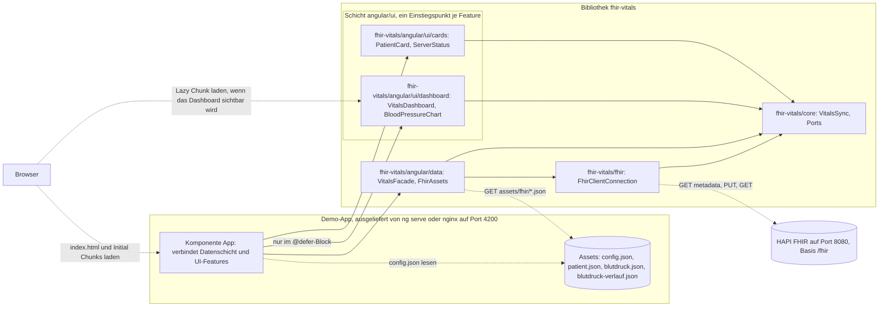

# FHIR-Starter: Angular-Bibliothek für Vitalparameter

Startpunkt für den Workshop WW2 (#WW26-MiHUB) der Forschungsgruppe Digital Health an der TU Dresden.

## 1 Worum es geht

Dieses Repository enthält `fhir-vitals`, eine Bibliothek mit wiederverwendbarem Code für das Web-Framework Angular, und die Demo-App `demo-app`, die diese Bibliothek nutzt.
Die Demo-App zeigt einen synthetischen Patienten und speichert auf Wunsch eine Blutdruckmessung auf einem FHIR-Server, also einem Server für Gesundheitsdaten nach dem Standard HL7 FHIR R4.
Im Workshop entsteht daraus Schritt für Schritt eine Bibliothek für Vitalparameter, die sich später in ein Patientenportal einbinden lässt.
Weiter unten zeigt eine Kachel, also ein Rechteck mit Titel und Inhalt, den Blutdruckverlauf aus sieben synthetischen Messungen als Liniendiagramm.
Sie ist ein minimales Beispiel für das Dashboard, also die Übersicht aus Kacheln, die im Workshop entsteht.
Die Bibliotheken für die Oberfläche sind ein Vorschlag, siehe Abschnitt 10.

## 2 Voraussetzungen

Angular ist ein Framework für Webanwendungen, die im Browser laufen.
Angular-Code ist in TypeScript geschrieben, einer Erweiterung von JavaScript um Typen.
Die Angular CLI (Command Line Interface) ist das Kommandozeilenwerkzeug `ng`.
Sie legt Projekte und Bausteine an, baut sie und startet Tests.
Ein Build übersetzt den TypeScript-Code in JavaScript-Dateien für den Browser und legt sie im Ordner `dist` ab.
Unit-Tests prüfen einzelne Klassen automatisch, ohne die ganze App zu starten.

Docker startet Programme in Containern.
Ein Container ist ein abgeschotteter Prozess mit eigenem Dateisystem.
Er entsteht aus einem Image, einer Vorlage mit Betriebssystemteilen, Programmen und Dateien.
Docker Compose startet mehrere Container gemeinsam nach der Beschreibung in `compose.yaml`.

| Werkzeug | Version | Wozu |
|---|---|---|
| [Node.js](https://nodejs.org) | 22 ab 22.22.3, 24 ab 24.15.0 oder 26. Geprüft mit 22.22.3, das Docker-Image nutzt 22.23.4. | führt die Angular CLI, den Build und die Tests aus. Die Datei `.nvmrc` nennt die Hauptversion 22 für den Versionsmanager [nvm](https://github.com/nvm-sh/nvm). |
| npm | kommt mit Node.js, geprüft mit 10.9.8 | installiert die Pakete, also fremde Programmbibliotheken aus der npm-Registry |
| [Git](https://git-scm.com) | aktuelle Version | lädt das Repository herunter |
| [Docker Desktop](https://docs.docker.com/desktop/) oder [Docker Engine](https://docs.docker.com/engine/install/) mit Compose | geprüft mit Docker 29.9.2 und Compose 5.6.1 | startet Demo-App und FHIR-Server in Containern |
| Google Chrome oder Chromium | aktuelle Version | führt die Unit-Tests aus, ohne ein Fenster zu öffnen |
| Java, JRE oder JDK (optional) | 17 oder neuer, aufrufbar als `java` | nur für die Prüfung mit der Erweiterung FHIR tools, siehe Abschnitt 7. `java -version` zeigt die installierte Version, zum Beispiel `openjdk version "25.0.2"`. |
| [Visual Studio Code](https://code.visualstudio.com) (optional) | aktuelle Version | Editor. Beim Öffnen des Ordners schlägt er die Erweiterungen Angular Language Service und FHIR tools vor. Er prüft außerdem die FHIR-Beispieldateien beim Tippen, siehe Abschnitt 7. |

Die installierte Node.js-Version zeigt `node -v`, zum Beispiel `v22.22.3`.

## 3 Schnellstart

Zuerst das Repository klonen und in den Ordner wechseln:

```bash
git clone https://github.com/forschungsgruppe-digital-health/angular-fhir-vitals.git
cd angular-fhir-vitals
```

Git meldet `Cloning into 'angular-fhir-vitals'...`.
Danach gibt es den Ordner `angular-fhir-vitals` mit unter anderem `package.json` und `README.md`.

### Variante A: ohne Docker

`npm start` startet den Entwicklungsserver von Angular.
Er liefert die Demo-App auf Port 4200 aus und lädt die Seite nach jeder Änderung neu.

```bash
npm ci
npm start
```

Die Ausgabe von `npm ci` beschreibt Abschnitt 4.
Nach `npm start` erscheint `Local: http://localhost:4200/`.
Danach http://localhost:4200 im Browser öffnen.
Oben steht eine Toolbar, also eine Leiste über die ganze Breite, mit dem Titel „FHIR-Starter“.
Darunter nennt ein kurzer Text Angular Material, gridstack und Chart.js einen Vorschlag, der sich austauschen lässt.
Es folgen zwei Karten, also umrandete Kästen mit Überschrift und Inhalt.
Die Karte „Patient“ zeigt Herrn K.
Die Karte „FHIR-Server“ zeigt den Status „nicht erreichbar“, weil kein FHIR-Server läuft.
In einem breiten Fenster stehen beide Karten nebeneinander.
In einem schmalen Fenster stehen sie untereinander.
Darunter folgt die Überschrift „Dashboard“ mit dem Satz „Minimales Beispiel mit einer festen Kachel.“
Danach erscheint die Kachel „Blutdruckverlauf“ mit dem Diagramm der Messungen vom 26.05. bis 01.06.2026.
`Strg+C` im Terminal beendet den Entwicklungsserver.

### Variante B: mit Docker, nur die Demo-App

Im Container liefert der Webserver nginx die gebauten Dateien der Demo-App aus.
nginx lauscht im Container auf Port 80.
Docker leitet Port 4200 des eigenen Rechners dorthin weiter.

```bash
docker compose up --build
```

Docker baut das Image und startet den Container.
Danach zeigt http://localhost:4200 dasselbe wie in Variante A.
`Strg+C` im Terminal stoppt den Container.

### Variante C: mit Docker und dem FHIR-Server HAPI FHIR

In `compose.yaml` gehört der Dienst `fhir` zum Compose-Profil `fhir`.
Compose startet und stoppt ihn nur, wenn der Befehl `--profile fhir` enthält.

```bash
docker compose --profile fhir up --build
```

Dieser Befehl startet zusätzlich den FHIR-Server [HAPI FHIR](https://hapifhir.io) auf http://localhost:8080.
HAPI braucht nach dem Start etwa 40 Sekunden.
Bis dahin zeigt die Seite „nicht erreichbar“.
Danach auf der Seite „Erneut verbinden“ klicken.
Die Seite meldet „verbunden, Patient und Blutdruck gespeichert“ und zeigt „Blutdruck vom Server: 104/66 mm[Hg]“.

Zum Beenden in einem zweiten Terminal `docker compose --profile fhir down` ausführen.
Docker meldet dann für beide Container `Removed`.
Ohne `--profile fhir` läuft HAPI weiter, siehe Abschnitt 9.

## 4 Befehle

Alle Befehle im Wurzelverzeichnis des Repositorys ausführen.
Jeder Befehl in diesen Tabellen ist am 05.11.2026 mit den Versionen aus Abschnitt 14 gelaufen.
Nach dem Einbau des Dashboard-Beispiels liefen am 06.11.2026 unter macOS erneut: `npm ci`, `npm start`, `npx ng build fhir-vitals`, `npx ng test fhir-vitals --watch=false`, `npm test`, `npm run lint`, `npm run format` und `npm run build`, dazu in einer Kopie des Repositorys der neue Befehl für Komponenten im Dashboard.
Nach dem Umzug der Komponenten nach `angular/ui/cards` und `angular/ui/dashboard` liefen am selben Tag erneut: `npx ng build fhir-vitals`, `npx ng test fhir-vitals --watch=false`, `npm test`, `npm run lint`, `npm run format` und `npm run build`.
In einer Kopie des Repositorys liefen dazu `npm start`, beide Befehle für neue Komponenten, der Befehl für UI-Services und der Build mit und ohne die neue Zeile in `public-api.ts`.
Nach dem Umbau der Karten und des Grundgerüsts der Demo-App mit Angular Material liefen am selben Tag erneut: `npx ng build fhir-vitals`, `npx ng test fhir-vitals --watch=false`, `npm test`, `npm run lint`, `npm run format` und `npm run build`.
Dazu lief die Demo-App im Entwicklungsserver, einmal zusammen mit HAPI FHIR aus dem Compose-Profil `fhir`.
Die Spalte „Was danach zu sehen ist“ gibt die tatsächliche Ausgabe wieder.

### a) Bibliothek entwickeln

Die Datei `package-lock.json` hält die genauen Versionen aller Pakete fest.
Ein Commit speichert einen Stand des Codes in der Versionsverwaltung Git.
Eine Komponente ist ein Baustein der Oberfläche aus TypeScript-Klasse, HTML-Template und CSS.
Ihr Selektor ist der Name des HTML-Elements, mit dem eine Seite sie einbindet, etwa `<lib-vitals-card>`.
Ein Service ist eine Klasse mit Logik ohne eigene Oberfläche, etwa für Datenzugriffe.
Der Decorator `@Service()` ist eine Markierung über der Klasse.
Angular erzeugt einen so markierten Service selbst und gibt ihn an alle Klassen weiter, die ihn brauchen.
ESLint prüft den Code auf Fehler und Regelverstöße, ohne ihn auszuführen.
Prettier formatiert den Code einheitlich.
Die Bibliothek besteht aus fünf Einstiegspunkten, also Teilpaketen mit eigenem Importnamen wie `fhir-vitals/core` oder `fhir-vitals/angular/ui/cards`.
Jeder Einstiegspunkt gehört zu einer Schicht mit einer festen Aufgabe.
Abschnitt 5 beschreibt, was in welche Schicht gehört.
Ein Chunk ist eine JavaScript-Datei, die der Build der Demo-App erzeugt.
Initial Chunks lädt der Browser sofort beim Start.
Ein Lazy Chunk kommt erst später dazu, hier mit dem Dashboard.
Ein Budget in `angular.json` ist eine Obergrenze für die Größe.
Ab 500 kB für alle Initial Chunks zusammen gibt der Build eine Warnung aus.
Angular schreibt am Ende des Builds `Application bundle generation complete`.
Bundle meint dort die gebauten JavaScript-Dateien und nicht ein FHIR-Bundle aus Abschnitt 7.

| Befehl | Wirkung | Wann nötig | Was danach zu sehen ist |
|---|---|---|---|
| `npm ci` | installiert alle Pakete genau nach `package-lock.json` und löscht vorher einen vorhandenen Ordner `node_modules` | einmal nach dem Klonen und nach jeder Änderung an `package-lock.json` | Nach einigen Sekunden bis etwa einer Minute erscheint `added … packages`. Die Zahl hängt vom Betriebssystem ab. Am 06.11.2026 meldete npm unter macOS `added 605 packages, and audited 606 packages in 10s`. Unter Linux meldete der Docker-Build am selben Tag mit derselben `package-lock.json` `added 611 packages in 8s`. Davor stehen Warnungen `npm warn deprecated` zu `inflight`, `rimraf` und `glob`. Sie stammen aus dem Testrunner Karma. Danach folgt `14 moderate severity vulnerabilities`, siehe Abschnitt 9. |
| `npm start` | baut die Bibliothek einmal und startet die Demo-App mit dem Entwicklungsserver | zum Ausprobieren | sechs Zeilen `Built fhir-vitals…`, eine für das Paket und eine je Einstiegspunkt, danach `Local: http://localhost:4200/`. Im Browser erscheint die Seite „FHIR-Starter“ mit der Kachel „Blutdruckverlauf“. Die Konsole des Browsers meldet dabei `NG0751`, siehe Abschnitt 9. `Strg+C` beendet den Entwicklungsserver. |
| Terminal 1: `npm run watch:lib` | baut die Bibliothek mit allen Einstiegspunkten bei jeder gespeicherten Änderung neu | beim Arbeiten an der Bibliothek, zusammen mit Terminal 2 | `Compilation complete. Watching for file changes...`. Nach jeder Änderung folgt ein neuer Block mit `Build at: …`. Der Neubau dauerte im Test 0,1 bis 0,2 Sekunden. |
| Terminal 2: `npm run start:app` | startet nur die Demo-App, ohne die Bibliothek zu bauen | zusammen mit Terminal 1 | `Local: http://localhost:4200/`. Nach einer Änderung in der Bibliothek erscheint `Page reload sent to client(s).`, und der Browser lädt die Seite selbst neu. Vom Speichern bis zum Neuladen verging im Test weniger als eine Sekunde, für Änderungen in `core` ebenso wie in `angular/ui`. |
| `npx ng generate service <name> --project fhir-vitals` | legt einen Angular-Service in der Angular-Datenschicht `fhir-vitals/angular/data` an | für Services, die Daten laden oder den Zustand der Daten halten, etwa weitere Datenzugriffe mit HttpClient, dem HTTP-Dienst von Angular | Zwei Zeilen `CREATE projects/fhir-vitals/angular/data/src/lib/<name>.ts` und `…/<name>.spec.ts`. Die Klasse trägt den Decorator `@Service()`. Logik, die auch andere UI-Frameworks brauchen, gehört dagegen als Datei ohne Decorator nach `core`, siehe Abschnitt 5. |
| `npx ng generate service <name> --project fhir-vitals --path projects/fhir-vitals/angular/ui/cards/src/lib` | legt einen UI-Service, also einen Service nur für die Oberfläche, im Einstiegspunkt `fhir-vitals/angular/ui/cards` an | für Logik der Oberfläche, etwa zum Öffnen eines Dialogs, siehe Abschnitt 5 | Zwei Zeilen `CREATE projects/fhir-vitals/angular/ui/cards/src/lib/<name>.spec.ts` und `…/<name>.ts`, jeweils mit der Größe in Bytes. Mit dem Namen `dialog-opener` heißt die Klasse `DialogOpener` und trägt ebenfalls `@Service()`. |
| `npx ng generate component <name> --project fhir-vitals --path projects/fhir-vitals/angular/ui/cards/src/lib` | legt eine Komponente im Einstiegspunkt `fhir-vitals/angular/ui/cards` an | für neue Anzeigen, etwa eine Karte mit Messwerten | Vier Zeilen `CREATE projects/fhir-vitals/angular/ui/cards/src/lib/<name>/<name>.css`, `.spec.ts`, `.ts` und `.html`, jeweils mit der Größe in Bytes. Mit dem Namen `vitals-card` heißt die Klasse `VitalsCard` und der Selektor `lib-vitals-card`. Ohne `--path` landet die Komponente in der Angular-Datenschicht, wo sie nicht hingehört. |
| `npx ng generate component <name> --project fhir-vitals --path projects/fhir-vitals/angular/ui/dashboard/src/lib` | legt eine Komponente im Einstiegspunkt `fhir-vitals/angular/ui/dashboard` an | für weitere Kacheln im Dashboard, siehe Abschnitt 10 | Vier Zeilen `CREATE projects/fhir-vitals/angular/ui/dashboard/src/lib/<name>/<name>.css`, `.spec.ts`, `.ts` und `.html`, jeweils mit der Größe in Bytes. Mit dem Namen `weight-chart` heißt die Klasse `WeightChart` und der Selektor `lib-weight-chart`. |
| neue Zeile in der Datei `src/public-api.ts` des Einstiegspunkts, zum Beispiel `export * from "./lib/vitals-card/vitals-card";` in `projects/fhir-vitals/angular/ui/cards/src/public-api.ts` | macht den neuen Baustein außerhalb der Bibliothek sichtbar | nach jedem neuen Service, jeder neuen Komponente und jeder neuen Datei in `core` oder `fhir` | Nach dem nächsten Build der Bibliothek klappt in der Demo-App `import { VitalsCard } from "fhir-vitals/angular/ui/cards";`. Ohne diese Zeile meldet der Build `TS2305: Module '"fhir-vitals/angular/ui/cards"' has no exported member 'VitalsCard'.` |
| `npx ng build fhir-vitals` | baut das Paket mit allen fünf Einstiegspunkten einmal nach `dist/fhir-vitals` | vor `npm run start:app`, wenn `watch:lib` nicht läuft | Sechs Zeilen `Built …` für `fhir-vitals`, `fhir-vitals/core`, `fhir-vitals/fhir`, `fhir-vitals/angular/data`, `fhir-vitals/angular/ui/cards` und `fhir-vitals/angular/ui/dashboard`, dann `Built Angular Package`. Die Reihenfolge ergibt sich aus den Abhängigkeiten: `core` kommt immer vor den Schichten, die es nutzen, sonst kann sie wechseln. Der Ordner `dist/fhir-vitals/fesm2022` enthält je Einstiegspunkt eine Datei `.mjs` und eine `.mjs.map`, etwa `fhir-vitals-core.mjs` und `fhir-vitals-angular-ui-cards.mjs`. |
| `npx ng test fhir-vitals --watch=false` | testet alle Einstiegspunkte der Bibliothek, direkt aus den Quellen | nach Änderungen an der Bibliothek | `TOTAL: 52 SUCCESS`. Dafür muss die Bibliothek vorher nicht gebaut sein. |
| `npm test` | baut die Bibliothek und testet dann Bibliothek und Demo-App nacheinander, ohne Watch-Modus | vor jedem Commit | Die sechs Zeilen `Built fhir-vitals…`, dann zwei Blöcke: zuerst `TOTAL: 52 SUCCESS` für die Bibliothek, dann `TOTAL: 3 SUCCESS` für die Demo-App. Im zweiten Block stehen vier Warnungen `WARN [web-server]: 404: /base/media/roboto-latin-…`, siehe Abschnitt 9. |
| `npm run lint` | prüft den Code mit ESLint, auch die Regeln zwischen den Schichten aus Abschnitt 5 | vor jedem Commit | nur die beiden Kopfzeilen `> angular-fhir-vitals@0.0.0 lint` und `> eslint .`. Folgt keine weitere Ausgabe, hat ESLint nichts zu beanstanden. |
| `npm run format` | formatiert TypeScript, HTML und CSS mit Prettier | vor jedem Commit | eine Zeile je Datei. `(unchanged)` heißt, dass die Datei schon passte. |
| `npm run build` | baut erst die Bibliothek, dann die Demo-App für die Auslieferung | vor einer Auslieferung ohne Docker | sechs Zeilen `Built fhir-vitals…`, dann eine Tabelle `Initial chunk files` mit der Zeile `Initial total` und `329.44 kB`, geschätzt `89.83 kB` bei der Übertragung. Darunter steht `Lazy chunk files` mit der Zeile `fhir-vitals-angular-ui-dashboard` und `271.24 kB`, geschätzt `76.38 kB`. Eine Warnung zum Budget erscheint nicht. Am Ende folgen `Application bundle generation complete` und `Output location: …/dist/demo-app`. |

### b) Demo-App mit Docker, ohne HAPI FHIR

`compose.yaml` bindet die Datei `projects/demo-app/public/config.json` als Bind-Mount in den Container ein.
Der Container liest damit direkt die Datei auf dem eigenen Rechner.

| Befehl | Wirkung | Wann nötig | Was danach zu sehen ist |
|---|---|---|---|
| `docker compose up --build` | baut das Image und startet die Demo-App auf http://localhost:4200 | beim ersten Start und nach jeder Code-Änderung | Erst die Build-Schritte, dann Zeilen mit `demo-app-1 \|` und `nginx/1.31.8`. Die Seite zeigt Herrn K. und den Status „nicht erreichbar“. `Strg+C` stoppt den Container. |
| `docker compose up --build -d` | startet wie oben, aber im Hintergrund | wenn das Terminal frei bleiben soll | `Container angular-fhir-vitals-demo-app-1 Started` |
| `docker compose logs -f demo-app` | zeigt das Protokoll von nginx und folgt neuen Zeilen | zur Fehlersuche | je Seitenaufruf Zeilen wie `"GET /config.json HTTP/1.1" 200`. `Strg+C` beendet nur die Anzeige. |
| `docker compose ps` | zeigt laufende Container und ihre Ports | zur Kontrolle | eine Zeile `angular-fhir-vitals-demo-app-1 … Up … 127.0.0.1:4200->80/tcp` |
| `docker compose down` | stoppt und entfernt die Demo-App | zum Aufräumen | `Container angular-fhir-vitals-demo-app-1 Removed` und `Network angular-fhir-vitals_default Removed` |
| `projects/demo-app/public/config.json` im Editor ändern und speichern, dann die Seite neu laden | ändert die Adresse des FHIR-Servers ohne Neubau | um einen anderen Server zu nutzen oder ihn abzuschalten | Mit `{ "fhirBaseUrl": null }` oder `""` zeigt der Status „nicht konfiguriert“. Nach Code-Änderungen dagegen erneut mit `--build` starten. |

### c) Demo-App mit Docker und HAPI FHIR

Eine FHIR-Ressource ist ein Datensatz mit festem Aufbau, etwa `Patient` oder `Observation` für eine Messung.
Ein FHIR-Bundle ist eine Ressource vom Typ `Bundle`, die mehrere Ressourcen bündelt, etwa ein Suchergebnis.
Sein Feld `total` nennt die Zahl der Treffer.

| Befehl | Wirkung | Wann nötig | Was danach zu sehen ist |
|---|---|---|---|
| `docker compose --profile fhir up --build` | startet Demo-App und HAPI FHIR | für die Arbeit mit einem FHIR-Server | Zeilen mit `demo-app-1 \|` und `fhir-1 \|`. Nach etwa 40 Sekunden meldet HAPI `Started Application in … seconds`. |
| `docker compose --profile fhir logs -f fhir` | zeigt das Protokoll von HAPI und folgt neuen Zeilen | zur Fehlersuche, etwa wenn HAPI nicht startet | Zeilen mit `fhir-1 \|`. Bei jeder Anfrage erscheint eine Zeile `fhirtest.access`. `Strg+C` beendet nur die Anzeige. |
| `curl http://localhost:8080/fhir/metadata` | fragt die Selbstbeschreibung des Servers ab | um zu prüfen, ob HAPI bereit ist | Sobald HAPI bereit ist, JSON mit `"resourceType": "CapabilityStatement"`. Vorher meldet curl einen Verbindungsfehler. Danach auf der Seite „Erneut verbinden“ klicken. |
| http://localhost:8080 im Browser öffnen | öffnet die Weboberfläche von HAPI | um Ressourcen auf dem Server anzusehen | die Testoberfläche mit dem Titel „HAPI FHIR“ |
| `curl "http://localhost:8080/fhir/Observation?subject=Patient/beispiel-01"` | sucht alle Messungen des Beispielpatienten | um das Speichern zu prüfen | ein FHIR-Bundle mit `"total": 1` und der Observation `blutdruck-01`. Die sieben Messungen aus `blutdruck-verlauf.json` liegen nur in dieser Beispieldatei der Demo-App und nicht auf dem Server. |
| `docker compose --profile fhir down` | stoppt und entfernt beide Container. Ohne `--profile fhir` stoppt `docker compose down` nur die Demo-App, und der HAPI-Container läuft weiter. | zum Aufräumen | `Removed` für `fhir-1`, `demo-app-1` und das Netzwerk. Danach läuft kein Container des Projekts mehr. |

Hinweis für Windows: In Windows PowerShell 5.1 ist `curl` ein Alias für `Invoke-WebRequest` und versteht andere Parameter.
Dort `curl.exe` statt `curl` schreiben.
PowerShell 7 definiert diesen Alias nicht mehr.

### d) Demo-App auf GitHub Pages

GitHub Pages veröffentlicht statische Webseiten direkt aus einem Repository.
Statische Webseiten bestehen aus fertigen Dateien wie HTML, JavaScript und JSON, die der Server unverändert ausliefert.
GitHub Actions führt Workflows aus, also automatische Abläufe, die eine YAML-Datei im Repository beschreibt.
YAML ist ein Textformat für Einstellungen, das die Gliederung durch Einrückung ausdrückt.
Ein Workflow besteht aus Jobs, also Folgen von Schritten, die GitHub jeweils auf einem eigenen Rechner ausführt.
Jede Ausführung eines Workflows heißt Lauf.
Ein Push lädt neue Commits vom eigenen Rechner zu GitHub hoch.
`main` ist der Hauptzweig des Repositorys, englisch Branch.

Der Workflow `.github/workflows/pages.yml` hat zwei Jobs.
Der Job `build` baut bei jedem Push auf `main` die Bibliothek und die Demo-App.
Der Job `deploy` veröffentlicht danach die Demo-App unter https://forschungsgruppe-digital-health.github.io/angular-fhir-vitals/.
Pages liefert die App unter dem Unterpfad `/angular-fhir-vitals/` aus.
Deshalb baut der Workflow sie mit der Option `--base-href`, die Angular diesen Unterpfad mitteilt.

Auf Pages ist der FHIR-Server abgeschaltet.
Der Workflow ersetzt dafür `config.json` im fertigen Build durch `{ "fhirBaseUrl": null }`.
So schickt eine öffentliche Seite keine Anfragen an `localhost` auf dem Rechner der Besucher.
Chrome würde für solche Anfragen ab Version 142 um eine Erlaubnis bitten.
Die Datei `config.json` im Repository bleibt unverändert.

Vor dem ersten Push auf `main` einmalig in den Einstellungen des Repositorys unter Settings, Pages, „Build and deployment“ bei „Source“ den Eintrag „GitHub Actions“ auswählen.
Danach schlägt GitHub Vorlagen für Workflows vor.
Keine davon auswählen, denn `pages.yml` gibt es schon.
Steht bei „Source“ noch „Deploy from a branch“, läuft im Tab Actions bei jedem Push zusätzlich der Workflow „pages build and deployment“.
Die Pages-Adresse zeigt dann dieses README als Webseite statt der Demo-App.
Ist Pages ganz ausgeschaltet, scheitert der Job `build` im Schritt `actions/configure-pages` mit der Meldung `Get Pages site failed`, und der Job `deploy` läuft nicht.
In beiden Fällen die Einstellung nachholen und den Workflow „Deploy demo app to GitHub Pages“ neu starten.
Für einen gescheiterten Lauf geht das im Lauf selbst: im Menü „Re-run jobs“ den Eintrag „Re-run failed jobs“ wählen und im folgenden Dialog „Re-run jobs“ klicken.
Sonst den Workflow wie in der Tabelle unten von Hand starten.

| Befehl | Wirkung | Wann nötig | Was danach zu sehen ist |
|---|---|---|---|
| `git push` auf `main` | startet den Workflow „Deploy demo app to GitHub Pages“ | nach jeder Änderung, die online erscheinen soll | Im Tab Actions des Repositorys erscheint ein Lauf mit den Jobs `build` und `deploy`. Nach dem Lauf zeigt die Pages-Adresse Herrn K. und den Status „nicht konfiguriert“. |
| im Tab Actions links den Workflow „Deploy demo app to GitHub Pages“ wählen, „Run workflow“ klicken, den Branch `main` lassen und im aufgeklappten Feld erneut „Run workflow“ klicken | startet denselben Workflow von Hand | um ohne neuen Commit neu zu veröffentlichen | ein neuer Lauf mit denselben Jobs |

## 5 Projektaufbau

Das Repository ist ein Angular-Workspace, also ein Ordner mit mehreren Angular-Projekten und gemeinsamer Konfiguration.
Assets sind statische Dateien wie JSON oder Bilder, die die App unverändert mit ausliefert.
In der Demo-App liegen sie im Ordner `public`.

```text
angular-fhir-vitals/
├── .github/workflows/pages.yml        Workflow: veröffentlicht die Demo-App auf GitHub Pages
├── projects/
│   ├── fhir-vitals/                   Angular-Bibliothek: ein npm-Paket mit fünf Einstiegspunkten
│   │   ├── core/                      "fhir-vitals/core": Ports, Ablauf VitalsSync, Blutdruck und Messverlauf
│   │   ├── fhir/                      "fhir-vitals/fhir": Adapter mit fhirclient und mit fetch
│   │   ├── angular/                   alles, was Angular braucht, selbst kein Einstiegspunkt
│   │   │   ├── data/                  "fhir-vitals/angular/data": Datenschicht mit FhirAssets und VitalsFacade
│   │   │   └── ui/                    die Angular-Oberfläche, selbst kein Einstiegspunkt
│   │   │       ├── cards/             "fhir-vitals/angular/ui/cards": Komponenten PatientCard und ServerStatus
│   │   │       └── dashboard/         "fhir-vitals/angular/ui/dashboard": minimales Dashboard-Beispiel, eine Kachel
│   │   ├── src/public-api.ts          leerer Platzhalter für den Paketnamen "fhir-vitals"
│   │   ├── …/src/public-api.ts        je Einstiegspunkt: was außerhalb sichtbar ist
│   │   ├── …/src/lib/*.spec.ts        Unit-Tests, neben dem getesteten Code
│   │   ├── ng-package.json            Einstellungen für ng-packagr, das die Bibliothek baut
│   │   ├── …/ng-package.json          macht einen Ordner zu einem eigenen Einstiegspunkt
│   │   ├── tsconfig.spec.json         lässt die Tests direkt gegen die Quellen laufen
│   │   └── package.json               Name, Version und peerDependencies, gemeinsam für alle Einstiegspunkte
│   └── demo-app/                      Demo-App
│       ├── public/config.json         Adresse des FHIR-Servers, wird beim Start gelesen
│       ├── public/assets/fhir/        Beispieldaten patient.json, blutdruck.json und blutdruck-verlauf.json
│       ├── src/index.html             HTML-Grundgerüst mit dem Element <app-root>
│       ├── src/main.ts                Startpunkt von Angular
│       ├── src/styles.css             globale Styles: Schrift und Farben der Seite
│       └── src/app/                   die einzige Seite: app.ts, app.html, app.css, app.config.ts, app.spec.ts
├── dist/                              Build-Ergebnisse, nicht im Repository
├── angular.json                       Projekte und Einstellungen für Build, Server und Tests
├── tsconfig.json                      TypeScript-Einstellungen und die Pfadzuordnung für "fhir-vitals"
├── package.json                       npm-Skripte und Abhängigkeiten des Workspace
├── package-lock.json                  genaue Paketversionen für npm ci
├── Dockerfile                         Image in zwei Stufen: Build mit Node.js, Auslieferung mit nginx
├── .dockerignore                      Dateien, die nicht ins Docker-Image kopiert werden
├── compose.yaml                       Dienste demo-app und fhir
├── .gitignore                         Dateien, die nicht ins Repository gehören, etwa node_modules, dist und .env
├── eslint.config.js                   Regeln für ESLint
├── .prettierrc                        Einstellungen für Prettier
├── .editorconfig                      Einrückung, Zeilenenden und Anführungszeichen für Editoren
├── .nvmrc                             Node.js-Hauptversion für nvm
├── .vscode/extensions.json            empfohlene Erweiterungen für Visual Studio Code
├── .vscode/settings.json              ordnet den FHIR-Beispieldateien das JSON-Schema von FHIR R4 zu
└── LICENSE                            Lizenztext Apache-2.0
```

**Pfadzuordnung.** Die Demo-App importiert die Bibliothek über ihre Paketnamen, also etwa `import { VitalsFacade } from "fhir-vitals/angular/data";` und `import { PatientCard, ServerStatus } from "fhir-vitals/angular/ui/cards";`.
Genau so sähe der Import im Patientenportal aus, wenn es die Bibliothek als npm-Paket installiert.
Möglich macht das der Eintrag `"fhir-vitals/*": ["./dist/fhir-vitals/*"]` unter `compilerOptions.paths` in `tsconfig.json`, auch für verschachtelte Namen wie `fhir-vitals/angular/ui/cards`.
Er leitet die Paketnamen auf die gebaute Bibliothek im Ordner `dist` um.
Den Eintrag `"fhir-vitals": ["./dist/fhir-vitals"]` daneben hat die Angular CLI beim Anlegen der Bibliothek erzeugt.
Er zeigt nur noch auf den leeren Platzhalter.
Deshalb muss die Bibliothek gebaut sein, bevor die Demo-App startet.
`npm start` und `npm test` erledigen das automatisch.
Die Tests der Bibliothek brauchen keinen Build, weil `projects/fhir-vitals/tsconfig.spec.json` die Paketnamen auf die Quellen umleitet.

**peerDependencies.** peerDependencies sind Pakete, die eine Bibliothek voraussetzt, die aber die einbindende Anwendung selbst installiert.
So nutzen Bibliothek und Anwendung dieselbe Version.
Die Bibliothek führt `@angular/core`, `@angular/common`, `fhirclient` und `@types/fhir` als peerDependencies.
Die Karten und das Dashboard-Beispiel bringen weitere Pakete mit.
Sie sind ein Vorschlag und lassen sich austauschen, siehe Abschnitt 10.
Angular Material ist eine Sammlung fertiger Komponenten wie Karten und Tabellen vom Angular-Team.
Sie baut auf dem CDK (Component Dev Kit) auf, einem Baukasten für Verhalten wie Menüs und den Fokus.
Der Fokus ist das Element der Seite, das gerade Eingaben von der Tastatur empfängt.
`PatientCard` und `ServerStatus` in `angular/ui/cards` nutzen Angular Material.
Das Dashboard-Beispiel nutzt es ebenfalls.
Nur das Dashboard-Beispiel nutzt gridstack, Chart.js und ng2-charts.
gridstack ordnet Kacheln in einem Raster aus Spalten und Zeilen an.
Chart.js zeichnet Diagramme, und ng2-charts bindet Chart.js an Angular an.
Für diese Vorschläge führt die Bibliothek zusätzlich `@angular/cdk`, `@angular/material`, `chart.js`, `gridstack` und `ng2-charts` als peerDependencies.
In der `package.json` im Wurzelverzeichnis stehen alle diese Pakete unter `dependencies`, dazu `@fontsource/roboto` für die Schrift der Demo-App.

Seit Version 7 installiert npm peerDependencies automatisch mit.
Eine App mit dem Framework Vue, die nur `fhir-vitals/core` und `fhir-vitals/fhir` nutzt, bekäme so auch Angular, Angular Material, gridstack und ng2-charts.
Deshalb markiert das Feld `peerDependenciesMeta` in `projects/fhir-vitals/package.json` alle Angular-Pakete sowie `chart.js`, `gridstack` und `ng2-charts` mit `"optional": true`.
Optionale peerDependencies installiert npm nicht von selbst.
Eine Angular-App installiert sie selbst, so wie die Demo-App.
`fhirclient` und `@types/fhir` bleiben Pflicht, weil `fhir-vitals/fhir` fhirclient importiert und `core` die FHIR-Typen nutzt.

**Schichten der Bibliothek.**
Die Bibliothek trennt Abläufe, Serverzugriff, Angular-Anbindung und Oberfläche in vier Schichten.
Jede Schicht hat eine feste Aufgabe.
Dahinter steht das Prinzip der Trennung der Zuständigkeiten, englisch Separation of Concerns.
Nach diesem Prinzip hat jeder Teil des Codes genau eine Aufgabe und kennt nur das, was er dafür braucht.
Die beiden Schichten, die Angular brauchen, liegen gemeinsam im Ordner `angular/`.
`core` und `fhir` daneben bleiben frei von UI-Frameworks.
Die Ordner `angular/` und `angular/ui/` sind selbst keine Einstiegspunkte, deshalb melden `import … from "fhir-vitals/angular"` und `import … from "fhir-vitals/angular/ui"` beim Build den Fehler `TS2307`.
Auch `fhir-vitals` allein ist nur ein leerer Platzhalter.
ng-packagr verlangt ihn für den Paketnamen und zeigt ihn beim Build als `Built fhir-vitals` an.
Importieren lassen sich nur die fünf Einstiegspunkte.
Der Kern, also `fhir-vitals/core`, enthält die eigentliche Logik.
Ein Port ist eine Schnittstelle, die beschreibt, was der Kern von außen braucht, etwa das Laden einer Ressource.
Mit einem Netzwerk-Port hat dieser Begriff nichts zu tun.
Ein Adapter setzt einen Port mit einer bestimmten Technik um, etwa mit fhirclient oder mit fetch.
Eine Facade ist ein einfacher Zugang für die Oberfläche, der die Einzelheiten dahinter verbirgt.
Ein Signal ist ein Wert, dessen Änderungen Angular verfolgt.
Ein Input ist eine Eigenschaft einer Komponente, die die einbindende Seite setzt.

**Zuerst die Schicht, dann das Feature.**
Innerhalb einer Schicht kann sich der Code nach Features teilen.
Ein Feature ist ein abgegrenzter Teil mit eigener Aufgabe, etwa die Karten für Patient und Server oder das Dashboard-Beispiel.
Die Ordner bilden diese Reihenfolge ab: oben die Schicht, darunter das Feature.
Alles für die Angular-Oberfläche liegt deshalb unter `angular/ui`, mit einem Einstiegspunkt je Feature.
`fhir-vitals/angular/ui/cards` enthält `PatientCard` und `ServerStatus`, `fhir-vitals/angular/ui/dashboard` das Dashboard-Beispiel.
Angular Material ist genauso aufgebaut, mit Einstiegspunkten wie `@angular/material/card` und `@angular/material/table`.
Die Schichten `core`, `fhir` und `angular/data` sind je ein einziger Einstiegspunkt.

| Einstiegspunkt | Inhalt | darf importieren | darf nicht importieren |
|---|---|---|---|
| `fhir-vitals/core` | die Ports `ResourceLoader` und `FhirServerConnection`, der Ablauf `VitalsSync` mit Patient und Messverlauf laden, Adresse lesen, verbinden, prüfen, speichern und zurücklesen, dazu `formatBloodPressure`, `bloodPressureHistory` und die LOINC-Codes | FHIR-Typen aus `fhir/r4` | Angular, RxJS, Vue, fhirclient, `fetch`, gridstack, Chart.js, ng2-charts und alle anderen Teile der Bibliothek |
| `fhir-vitals/fhir` | die Adapter `FhirClientConnection` mit fhirclient und `FetchResourceLoader` mit fetch | `fhir-vitals/core`, fhirclient, FHIR-Typen aus `fhir/r4` | Angular, RxJS, Vue, gridstack, Chart.js, ng2-charts und die übrigen Teile |
| `fhir-vitals/angular/data` | die Angular-Datenschicht: `FhirAssets` als Adapter mit HttpClient, dem Dienst von Angular für HTTP-Anfragen, und `VitalsFacade`, die den Zustand von `VitalsSync` als Signal anbietet | `fhir-vitals/core`, `fhir-vitals/fhir`, Angular, RxJS, FHIR-Typen aus `fhir/r4` | jedes UI-Feature wie `fhir-vitals/angular/ui/cards`, Angular Material, fhirclient direkt, gridstack, Chart.js und ng2-charts |
| `fhir-vitals/angular/ui/cards` | die Komponenten `PatientCard` und `ServerStatus`, beide als Karte von Angular Material. Sie bekommen Daten über Inputs und übersetzen die Statuscodes des Kerns in deutsche Texte. | `fhir-vitals/core`, andere UI-Features über ihren Paketnamen, Angular mit Angular Material, FHIR-Typen aus `fhir/r4` | die Datenschicht, `fhir-vitals/fhir`, fhirclient, HttpClient, `fetch`, gridstack, Chart.js und ng2-charts |
| `fhir-vitals/angular/ui/dashboard` | das minimale Dashboard-Beispiel: `VitalsDashboard` mit einer festen Kachel und `BloodPressureChart` für das Diagramm. Die Messwerte kommen über das Input `history`. | `fhir-vitals/core`, andere UI-Features über ihren Paketnamen, Angular und die vorgeschlagenen Pakete Angular Material, gridstack, Chart.js und ng2-charts | die Datenschicht, `fhir-vitals/fhir`, fhirclient, HttpClient und `fetch` |

Die Demo-App ist die einzige Stelle, die Datenschicht und UI-Features kennt.
Sie verbindet sie.
Schichten und Features importieren einander nur über den Paketnamen, etwa `fhir-vitals/core`.
Ein relativer Pfad in eine andere Schicht scheitert beim Build, meist mit dem Fehler `TS6059`.
Zeigt er von `core` aus nach oben, etwa nach `angular/data`, meldet ng-packagr stattdessen `Entry point fhir-vitals/core has a circular dependency on itself.`
`npm run lint` prüft die Spalte „darf nicht importieren“.
Ein verbotener Import erscheint dann als Fehler mit Begründung, im Kern zum Beispiel `'@angular/core' import is restricted from being used by a pattern. Dieser Teil bleibt frei von UI-Frameworks, damit auch Vue oder andere ihn nutzen können`.
Ein relativer Pfad von einem Feature in ein anderes, etwa `../../../../cards/src/public-api` aus dem Dashboard, meldet `Andere Einstiegspunkte über ihren Paketnamen importieren, nie über einen relativen Pfad`.
Den eigenen Einstiegspunkt importiert ein Feature dagegen relativ.
`import { PatientCard } from "fhir-vitals/angular/ui/cards";` in `angular/ui/cards` meldet `Innerhalb des eigenen Einstiegspunkts relativ importieren`.
Ein UI-Feature bekommt seine Daten über Inputs.
Ein Import von `fhir-vitals/angular/data` im Dashboard meldet deshalb `Die UI importiert nur fhir-vitals/core und andere UI-Einstiegspunkte. Daten kommen über Inputs, verbunden wird in der App`.
Die Datenschicht kennt umgekehrt keine Oberfläche.
Für `@angular/material/card` in `angular/data` meldet ESLint `Die Datenschicht kennt die UI nicht. Angular Material gehört in ein UI-Feature wie fhir-vitals/angular/ui/cards`.
Die vorgeschlagenen Pakete gridstack, Chart.js und ng2-charts sind überall in der Bibliothek außer in `angular/ui/dashboard` verboten.
So hängt nur das Dashboard von ihnen ab.
Ein Import von `chart.js` in `angular/ui/cards` meldet `'chart.js' import is restricted from being used by a pattern. Diese Pakete gehören nach fhir-vitals/angular/ui/dashboard, damit nur das Dashboard von ihnen abhängt`.

**Was ein Einstiegspunkt trennt.**
Die Datei `src/public-api.ts` legt die öffentliche Schnittstelle eines Einstiegspunkts fest, englisch Public API.
Nur was sie exportiert, sehen andere Einstiegspunkte und Apps.
Alles andere bleibt intern, etwa die Formatfunktionen aus `format.ts` im Dashboard-Beispiel.
ng-packagr baut jeden Einstiegspunkt zu genau einer Datei `.mjs` im Ordner `dist/fhir-vitals/fesm2022`.
Diese Datei importiert nur die Pakete, die ihr Einstiegspunkt selbst braucht.
So bleiben die Abhängigkeiten eines Features in diesem Feature.
Nach `npx ng build fhir-vitals` zeigt unter macOS und Linux `grep '^import ' dist/fhir-vitals/fesm2022/fhir-vitals-angular-ui-cards.mjs` nur Importe aus `@angular/core` und Angular Material:

```text
import * as i0 from "@angular/core";
import { Component, computed, input, output } from "@angular/core";
import * as i1 from "@angular/material/card";
import { MatCardModule } from "@angular/material/card";
import { MatButton } from "@angular/material/button";
```

Derselbe Befehl für `fhir-vitals-angular-ui-dashboard.mjs` zeigt neben `@angular/core` und der Karte von Angular Material auch Chart.js, ng2-charts und gridstack:

```text
import * as i0 from "@angular/core";
import { Component, computed, input } from "@angular/core";
import { Legend, LineController, LineElement, LinearScale, PointElement, Tooltip } from "chart.js";
import { BaseChartDirective, provideCharts } from "ng2-charts";
import * as i1 from "@angular/material/card";
import { MatCardModule } from "@angular/material/card";
import { GridstackComponent, GridstackItemComponent } from "gridstack/dist/angular";
```

**Wohin neuer Code gehört.**

- Komponenten, Direktiven und UI-Services gehören in ein UI-Feature unter `angular/ui`, auch wenn sie Angular Material nutzen. Eine Direktive ist ein Baustein ohne eigenes Template, der einem vorhandenen HTML-Element Verhalten gibt. Ein UI-Service ist ein Service nur für die Oberfläche, etwa zum Öffnen eines Dialogs.
- Nutzen mehrere Features denselben Baustein, kommt er in ein eigenes Feature, etwa `angular/ui/shared`. Die anderen Features importieren ihn dann über `fhir-vitals/angular/ui/shared`. `shared` selbst importiert keine anderen Features. Importieren sich zwei Features gegenseitig, etwa `dashboard` und `shared`, bricht `npx ng build fhir-vitals` mit `Entry point fhir-vitals/angular/ui/dashboard has a circular dependency on fhir-vitals/angular/ui/shared.` ab. ESLint meldet das nicht.
- Services, die Daten laden oder den Zustand der Daten halten, etwa Patient, Messungen oder Verbindungsstatus, gehören nach `angular/data`. Reiner Zustand der Oberfläche, etwa ob ein Dialog offen ist, bleibt im UI-Feature. ESLint prüft dabei nur die Importe und nicht, wo ein Zustand liegt.
- Logik ohne Angular gehört nach `core`, ein Adapter für einen Server nach `fhir`.

**Ein neues UI-Feature anlegen.**
Die Schritte am Beispiel eines Features `shared`:

1. Den Ordner `projects/fhir-vitals/angular/ui/shared/` anlegen und `ng-package.json` aus `angular/ui/cards` hineinkopieren. Der Pfad unter `$schema` passt ohne Änderung, weil der Ordner gleich tief liegt.
2. Komponenten wie in Abschnitt 4 mit `--path projects/fhir-vitals/angular/ui/shared/src/lib` anlegen. Dann die Datei `src/public-api.ts` anlegen und die Komponenten dort exportieren.
3. In `projects/fhir-vitals/tsconfig.lib.json` und `projects/fhir-vitals/tsconfig.spec.json` unter `paths` den Eintrag `"fhir-vitals/angular/ui/shared": ["./angular/ui/shared/src/public-api.ts"]` ergänzen.
4. In `eslint.config.js` den Namen `"angular/ui/shared"` in die Liste `entryPoints` eintragen. Dann direkt nach `uiFeature("dashboard"),` innerhalb von `defineConfig(…)` den Block `uiFeature("shared", dashboardPackages),` ergänzen. `dashboardPackages` verbietet dem neuen Feature gridstack, Chart.js und ng2-charts.
5. Den Eintrag `"../../ui/**/*.spec.ts"` für die Tests in `angular.json` so lassen. Er erfasst schon jedes Feature unter `angular/ui`.
6. `npx ng build fhir-vitals` ausführen. Dann erscheint zusätzlich die Zeile `✔ Built fhir-vitals/angular/ui/shared`, und `dist/fhir-vitals/package.json` nennt unter `exports` den Eintrag `./angular/ui/shared`. Läuft gerade `npm run watch:lib`, ihn mit `Strg+C` beenden und neu starten. Einen neuen Einstiegspunkt erkennt er erst beim Start. Im Test baute ein laufendes `npm run watch:lib` nach dem Speichern einer Datei in `angular/ui/cards` nur `✔ Built fhir-vitals/angular/ui/cards` neu und das neue Feature erst nach dem Neustart.

Am 06.11.2026 entstand so in einer Kopie des Repositorys ein Feature `shared` mit der Komponente `unit-label`.
`npm run lint` zeigte danach nur die beiden Kopfzeilen.
`npx ng test fhir-vitals --watch=false` meldete `TOTAL: 52 SUCCESS`, also einen Test mehr als der damalige Stand mit 51 Tests.
Ein Import von `fhir-vitals/angular/ui/shared` im Dashboard war erlaubt.
Ein Import von `gridstack` in `angular/ui/shared` meldete `Diese Pakete gehören nach fhir-vitals/angular/ui/dashboard, damit nur das Dashboard von ihnen abhängt`.

**Andere UI-Frameworks.**
Vue ist wie Angular ein Framework für Webanwendungen im Browser.
`fhir-vitals/core` und `fhir-vitals/fhir` enthalten keinen Angular-Code.
Im gebauten Paket importiert `fhir-vitals-core.mjs` nichts, und `fhir-vitals-fhir.mjs` importiert nur `fhirclient/browser`.
Eine andere Oberfläche nutzt denselben Ablauf mit `new VitalsSync(new FetchResourceLoader(), connectWithFhirClient)`.
Mit `subscribe()` meldet sie sich für den Zustand an, man sagt auch, sie abonniert ihn.
`VitalsSync` ruft die übergebene Funktion dann bei jeder Änderung auf.
Die Oberfläche überträgt den Zustand in ihre eigene Reaktivität, in Vue zum Beispiel in ein `shallowRef()`, das Gegenstück zu einem Signal.
Eine kleine Vue-App mit genau diesem Aufbau zeigte im Test gegen HAPI Herrn K., den Status `saved` und 104/66 mm[Hg].
Das gebaute JavaScript dieser Vue-App enthielt keinen Code aus Angular.
Die Vue-App gehört nicht zum Repository.
Das Build-Werkzeug Vite baute sie und griff dabei über einen Alias direkt auf die Quellen von `core` und `fhir` zu.
Seit die Angular-Pakete optionale peerDependencies sind, eignet sich auch das gebaute npm-Paket für Vue.
Das zeigte am 06.11.2026 eine zweite Prüfung, ebenfalls außerhalb des Repositorys.
`npm pack` packt ein Paket in eine Paketdatei `.tgz`, wie sie auch die npm-Registry ausliefert.
Aus `dist/fhir-vitals` entstand so `fhir-vitals-0.0.1.tgz`, und npm meldete `package size: 19.3 kB` und `total files: 19`.
Ein neues Projekt installierte sie zusammen mit `vue` und dem Build-Werkzeug esbuild.
Der Befehl war `npm install --strict-peer-deps`.
Die Option `--strict-peer-deps` lässt die Installation scheitern, sobald eine peerDependency nicht passt.
npm meldete `added 32 packages, and audited 33 packages in 1s` und `found 0 vulnerabilities`.
Einen Ordner `node_modules/@angular` gab es danach nicht, und auch gridstack, Chart.js und ng2-charts fehlten.
`fhirclient` und `@types/fhir` installierte npm als Pflicht-peerDependencies von selbst.
Ein kleiner Einstieg in Vue nutzte `VitalsSync`, `bloodPressureHistory`, `FetchResourceLoader` und `connectWithFhirClient`.
Zustand und Messungen hielt er in je einem `shallowRef()`.
esbuild baute daraus die Datei `app.js` mit 322,6 kB aus 20 Modulen.
Das sind die eigene Einstiegsdatei und 19 JavaScript-Dateien aus den Paketen von Vue, aus `fhir-vitals`, `fhirclient` und `js-base64`.
Sie enthielt kein Modul aus Angular, und die Zeichenfolge `@angular` kam darin nicht vor.
Der Befehl dafür lautet `npx esbuild src/main.ts --bundle --format=esm --outfile=dist/app.js`, und esbuild meldet dann `dist/app.js  322.6kb`.
Nach dem Umzug der Komponenten nach `angular/ui/cards` und `angular/ui/dashboard` lief die Prüfung am selben Tag mit dem neu gebauten Paket erneut.
npm meldete dann `package size: 19.6 kB` und `total files: 19`.
Die Zahl der installierten Pakete, die Größe von `app.js` und die 20 Module blieben gleich, und `@angular` kam wieder nicht vor.
Diese Prüfung hat die Vue-App nur gebaut und nicht im Browser gestartet.
Später können `core` und `fhir` trotzdem in eigene Pakete kommen.
Weil alle Schichten einander schon heute nur über Paketnamen importieren, ändern sich dabei im Code vor allem die Importnamen.

### Karten und Grundgerüst der Demo-App

`PatientCard` und `ServerStatus` zeigen ihren Inhalt in `<mat-card appearance="outlined">`, einer Karte von Angular Material mit dünnem Rand.
Die Daten bekommen beide Karten weiterhin nur über Inputs.
Ein Screenreader ist ein Programm, das den Inhalt einer Seite vorliest oder in Braille ausgibt.
Die Überschrift jeder Karte steht in `<h2 mat-card-title>`.
Ein Attribut ist eine Zusatzangabe in einem HTML-Element, etwa `appearance="outlined"` in `<mat-card>`.
Das Attribut `mat-card-title` gibt ihr nur das Aussehen eines Kartentitels.
Für Screenreader bleibt sie eine echte Überschrift `h2`.

Der Knopf „Erneut verbinden“ trägt `matButton="outlined"` und erscheint so als umrandeter Knopf von Angular Material.
Während eines Laufs ist er gesperrt.
Wegen `disabledInteractive` sperrt Angular Material ihn dabei nur mit `aria-disabled="true"`, einem Attribut, das einem Screenreader den gesperrten Zustand meldet.
Das HTML-Attribut `disabled` setzt Angular Material nicht.
So behält der Knopf den Fokus.
Ein Knopf mit `disabled` verliert dagegen den Fokus.
Im Test am 06.11.2026 lag der Fokus danach auf dem Element `body`, also auf der Seite als Ganzes.
Klicks auf den gesperrten Knopf kommen trotzdem an.
Deshalb meldet `ServerStatus` während eines Laufs kein `reconnect`.
Der Absatz mit dem Status trägt `role="status"` und ist damit eine Live-Region, also ein Bereich, dessen neuen Inhalt ein Screenreader von selbst vorliest.
Im Test am 06.11.2026 blieb der Fokus nach einem Klick auf „Erneut verbinden“ auf dem Knopf, und der Status wechselte zu „nicht erreichbar“.

Die Demo-App setzt in `app.html` den Titel „FHIR-Starter“ in eine Toolbar aus `<mat-toolbar>`.
`<header>` um die Toolbar und `<main>` um den übrigen Inhalt sind Landmarken, also Bereiche, zu denen ein Screenreader direkt springen kann.
`app.css` ordnet die Karten in einem CSS-Grid an, also in Spalten, die der Browser selbst verteilt.
Die Längeneinheit rem richtet sich nach der Grundschrift des Browsers.
Bei der üblichen Grundschrift von 16 Pixeln sind 20rem genau 320 Pixel.
Die Angabe `repeat(auto-fit, minmax(min(100%, 20rem), 1fr))` legt so viele Spalten an, wie in die Breite passen.
Jede Spalte ist mindestens 20rem breit.
Ist die Seite schmaler, nimmt die Spalte die ganze Breite ein.
Dafür sorgt `min(100%, 20rem)`.
Im Test am 06.11.2026 standen die Karten bei 1024 Pixeln Fensterbreite nebeneinander und bei 375 Pixeln untereinander.

Ein Theme legt Farben, Schriften und Abstände der Material-Komponenten fest.
Eine CSS-Variable ist ein benannter Wert in CSS, dessen Name mit zwei Bindestrichen beginnt.
`var(…)` liest diesen Wert aus.
Ein Token ist hier eine CSS-Variable, aus der eine Material-Komponente ihre Farbe liest.
Die Farbe der Toolbar setzt `app.css` über das Token `--mat-toolbar-container-background-color`.
Es bekommt den Wert `var(--mat-sys-surface-container)`, einen Farbton aus dem Theme, der etwas dunkler ist als der Hintergrund der Seite.
Auch `styles.css` nimmt Hintergrund und Textfarbe der Seite aus dem Theme.
Angular Material bleibt ein Vorschlag, siehe Abschnitt 10.

### Das Dashboard-Beispiel

Das Beispiel ist absichtlich klein.
Es zeigt eine feste Kachel und dient als Startpunkt für das Dashboard, das im Workshop entsteht.
Die genutzten Bibliotheken sind ein Vorschlag, siehe Abschnitt 10.

**Wo es liegt.**
Das Beispiel liegt im Einstiegspunkt `fhir-vitals/angular/ui/dashboard`, Ordner `projects/fhir-vitals/angular/ui/dashboard/`.
Es besteht aus zwei Komponenten.
`VitalsDashboard` legt mit gridstack ein Raster an und zeigt darin genau eine Kachel.
Die Kachel ist eine Karte von Angular Material mit der Überschrift „Blutdruckverlauf“.
Darin zeichnet `BloodPressureChart` den Verlauf mit Chart.js als Liniendiagramm.
Beide bekommen die Messungen über das Input `history`, die älteste zuerst, so wie `VitalsSync` sie im Zustand unter `history` liefert.
Die Demo-App bindet das Beispiel in `app.html` mit `<lib-vitals-dashboard [history]="vitals.state().history" />` ein.

**Eigener Einstiegspunkt und `@defer`.**
Das Beispiel ist ein eigenes Feature mit eigenem Einstiegspunkt.
So hängt nur das Dashboard von gridstack, Chart.js und ng2-charts ab.
`fhir-vitals/angular/ui/cards` und die übrigen Schichten kommen ohne diese Pakete aus.
Im Code der Bibliothek betrifft ein Austausch von gridstack oder Chart.js deshalb nur dieses Feature, siehe Abschnitt 10.
Ein Austausch von Angular Material betrifft dagegen auch `angular/ui/cards` und die Demo-App.
In `app.html` steht `<lib-vitals-dashboard>` in einem Block `@defer (on viewport)`.
`@defer` ist ein Block im Template, dessen Inhalt Angular in einen eigenen Lazy Chunk legt.
Mit `on viewport` lädt der Browser diesen Chunk erst, wenn der Platzhalter des Blocks in den sichtbaren Bereich der Seite kommt.
Bis dahin zeigt die Seite „Dashboard wird geladen …“.
Der Lazy Chunk bringt gridstack, Chart.js und ng2-charts mit.
Den Code der Karte von Angular Material lädt der Browser dagegen schon mit den Initial Chunks, weil die Karten „Patient“ und „FHIR-Server“ ihn sofort brauchen.
Im Build für die Auslieferung lud der Browser den Lazy Chunk in einem Fenster von 400 Pixeln Höhe erst, nachdem die Seite bis zum Dashboard gescrollt war.
Mit `npm start` lädt Angular die Pakete des Dashboards dagegen sofort mit, siehe `NG0751` in Abschnitt 9.
Der Block `@defer` ist nicht der Grund für den eigenen Einstiegspunkt.
Die Trennung gilt auch ohne ihn.

**Eine feste Kachel.**
Die Einstellungen des Rasters stehen in `gridOptions` in `vitals-dashboard.ts`.
Das Raster hat 12 Spalten und Zeilen von 80 Pixeln Höhe, mit einem Rand von 8 Pixeln um jede Kachel.
Die Kachel beginnt in Spalte 0 und Zeile 0, ist 8 Spalten breit und 4 Zeilen hoch.
Die Option `staticGrid: true` hält sie fest.
Sie lässt sich deshalb weder verschieben noch in der Größe ändern.
Ist das Raster höchstens 600 Pixel breit, hat es nur eine Spalte, und die Kachel nimmt die volle Breite ein.
Das legt der Eintrag `{ w: 600, c: 1 }` unter `columnOpts.breakpoints` fest.
Wird das Raster danach wieder breiter, ist die Kachel wieder 8 Spalten breit, auch wenn die Seite in einem schmalen Fenster startet.
Dafür sorgt `layout: "none"` unter `columnOpts`.
Ohne diese Angabe streckt gridstack die Kachel dann auf alle 12 Spalten.
Im Test am 06.11.2026 war die Kachel bei einer Fensterbreite von 1024 Pixeln 630 Pixel breit und 320 Pixel hoch.
Bei 560 Pixeln Fensterbreite war sie mit 496 Pixeln so breit wie das Raster.

**Diagramm.**
`BloodPressureChart` meldet die nötigen Teile von Chart.js selbst an, über `provideCharts()` unter `providers` der Komponente.
Deshalb braucht `app.config.ts` keinen Eintrag für Chart.js, und Chart.js bleibt im Lazy Chunk.
Die Zeitachse ist eine Zahlenachse mit Millisekunden.
So braucht Chart.js keinen zusätzlichen Adapter für Datumswerte.
Die Beschriftungen wie `26.05.` kommen von `Intl.DateTimeFormat("de-DE")`.
Beim Zeigen mit der Maus nennt ein Tooltip, also ein kleines Feld über dem Diagramm, Zeitpunkt und beide Werte.
Am 29.05. waren das „29.05.2026, 07:35“, „Systolisch: 110 mm[Hg]“ und „Diastolisch: 71 mm[Hg]“.

**Globale Styles.**
Die Elemente des Rasters, etwa das innere Element jeder Kachel mit der Klasse `grid-stack-item-content`, stehen in den Templates von gridstack und nicht im Template von `VitalsDashboard`.
Die Styles einer Angular-Komponente gelten aber nur für Elemente aus ihrem eigenen Template.
Deshalb gehört `gridstack.min.css` zu den globalen Styles der App.
Die Demo-App lädt in `angular.json` unter `styles` vier Dateien vor ihrer eigenen `styles.css`: `@fontsource/roboto/latin-400.css` und `@fontsource/roboto/latin-500.css` für die Schrift Roboto, `@angular/material/prebuilt-themes/azure-blue.css` und `gridstack/dist/gridstack.min.css`.
`azure-blue.css` ist ein fertiges Theme als CSS-Datei.
Es gilt für alle Material-Komponenten der Seite, also auch für die Karten „Patient“ und „FHIR-Server“, den Knopf und die Toolbar.
Es nutzt die Schrift Roboto.
Das Paket `@fontsource/roboto` liefert diese Schrift als Dateien mit der App aus.
Der Browser lädt sie vom eigenen Server unter `media/` und schickt keine Anfrage an Google Fonts.

**Barrierefreiheit.**
Chart.js zeichnet in ein Canvas, eine Zeichenfläche aus Pixeln ohne lesbaren Text.
Das Canvas hat deshalb das Attribut `role="img"`.
Es meldet einem Screenreader, dass das Canvas ein Bild ist.
Die Textalternative dazu steht im Attribut `aria-label`.
Mit den Daten aus den Assets lautet sie „Blutdruckverlauf: 7 Messungen vom 26.05.2026 bis 01.06.2026, zuletzt 104/66 mm[Hg]“.
„Systolisch“ ist eine blaue durchgezogene Linie mit runden Punkten, „Diastolisch“ eine orange gestrichelte Linie mit quadratischen Punkten.
Die beiden Reihen unterscheiden sich so nicht nur durch die Farbe, wie es Kriterium 1.4.1 „Use of Color“ der WCAG 2.2 verlangt.
Die WCAG (Web Content Accessibility Guidelines) sind die Richtlinien des W3C, des Gremiums für Webstandards, für barrierefreie Webinhalte.
Unter `h1` „FHIR-Starter“ stehen die Überschriften `h2` „Patient“, „FHIR-Server“ und „Dashboard“.
Die Kachel hat die Überschrift `h3` „Blutdruckverlauf“ unter „Dashboard“.
Ist im Betriebssystem die Einstellung für weniger Bewegung aktiv, zeichnet Chart.js das Diagramm ohne Animation.
gridstack animiert die Kachel nie, denn `gridOptions` enthält `animate: false`.
Die Animation von gridstack würde diese Einstellung nicht beachten, denn `gridstack.min.css` berücksichtigt sie nicht.
Ein Klick auf die Legende blendet keine Reihe aus.
`BloodPressureChart` schaltet diese Funktion von Chart.js ab, denn mit der Tastatur ließe sie sich nicht bedienen.

**Was das Beispiel bewusst nicht kann.**
Die Kachel lässt sich nicht verschieben, nicht in der Größe ändern, nicht hinzufügen und nicht entfernen.
Das Beispiel speichert nichts und bietet keine Bedienung per Tastatur für die Anordnung.
Die einzelnen Messwerte nennt nur der Tooltip beim Zeigen mit der Maus.
Die Textalternative nennt nur Anzahl, Zeitraum und letzten Wert.
Mit Tastatur oder Screenreader lassen sich die übrigen Werte deshalb nicht genau lesen.
Diese Teile entstehen im Workshop, Hinweise dazu stehen in Abschnitt 10.

## 6 Wie die Teile zusammenspielen

Die Demo-App läuft vollständig im Browser.
Alle Anfragen an die Assets und an HAPI schickt deshalb der Browser.
Durchgezogene Pfeile zeigen, wer wen importiert.
Gestrichelte Pfeile zeigen Anfragen über das Netz.



Ein Ursprung ist die Kombination aus Protokoll, Rechnername und Port, etwa `http://localhost:4200`.
Seite und HAPI haben verschiedene Ursprünge, weil sie auf verschiedenen Ports laufen.
Der Browser lässt die Seite die Antworten von HAPI nur lesen, wenn HAPI das per CORS (Cross-Origin Resource Sharing) erlaubt.
Vor einem PUT fragt der Browser HAPI vorher um Erlaubnis.
HAPI erlaubt in der Voreinstellung des Images alle Ursprünge, auch `http://localhost:4200`.

## 7 Die Beispieldaten und ihre Codes

Alle drei Dateien liegen unter `projects/demo-app/public/assets/fhir/` und sind im Browser als `assets/fhir/…` erreichbar.
Sie sind synthetisch und passen zum Beispiel „Herr K.“ aus dem Workshop.
Den Typ einer FHIR-Ressource nennt ihr Feld `resourceType`.

**`patient.json`** ist eine Ressource vom Typ [Patient](https://hl7.org/fhir/R4/patient.html) mit der festen ID `beispiel-01`.
Sie enthält eine Kennung `4711`, den Namen „Herr K.“, das Geschlecht `male` und das Geburtsjahr `1959`.

**`blutdruck.json`** ist eine Ressource vom Typ [Observation](https://hl7.org/fhir/R4/observation.html), also eine Messung oder Beobachtung, mit der festen ID `blutdruck-01`.
Sie folgt dem [Blutdruckprofil](https://hl7.org/fhir/R4/bp.html) aus FHIR R4.
Ein Profil legt fest, welche Felder und Codes eine Ressource für einen bestimmten Zweck haben muss.

| Feld | Wert | Bedeutung |
|---|---|---|
| `meta.profile` | `http://hl7.org/fhir/StructureDefinition/bp` | Die Ressource erklärt, dass sie dem Blutdruckprofil folgt. |
| `category` | `vital-signs` | Die Messung gehört zu den [Vitalparametern](https://hl7.org/fhir/R4/observation-vitalsigns.html). |
| `code` | LOINC `85354-9` | das Blutdruck-Panel, englisch „Blood pressure panel with all children optional“ |
| `component[0].code` | LOINC `8480-6` | der systolische Wert, englisch „Systolic blood pressure“ |
| `component[1].code` | LOINC `8462-4` | der diastolische Wert, englisch „Diastolic blood pressure“ |
| `component[0].valueQuantity.code`, `component[1].valueQuantity.code` | UCUM `mm[Hg]` | die Einheit Millimeter Quecksilbersäule |
| `subject`, `performer` | `Patient/beispiel-01` | Die Messung gehört zu Herrn K., und er hat sie selbst gemessen. |
| `effectiveDateTime` | `2026-06-01T07:35:00+02:00` | Zeitpunkt der Messung |

[LOINC](https://loinc.org) ist ein internationales Codesystem für Messungen und Laborwerte.
[UCUM](https://ucum.org) ist ein Codesystem für Maßeinheiten.
Ein Terminologieserver kennt Codesysteme wie LOINC und prüft Codes und Anzeigenamen.
Die Anzeigenamen der drei LOINC-Codes stimmen mit den Angaben des Terminologieservers tx.fhir.org überein.

**`blutdruck-verlauf.json`** ist ein [FHIR-Bundle](https://hl7.org/fhir/R4/bundle.html), also eine Ressource vom Typ `Bundle`.
Sie sammelt andere Ressourcen in der Liste `entry`.
Mit den JavaScript-Dateien aus dem Build hat dieses Bundle nichts zu tun.
Das Feld `type` hat den Wert `collection`.
Eine `collection` ist eine reine Sammlung ohne Auftrag an einen Server.
Ein Suchergebnis vom Server hat dagegen den Typ `searchset`.
`bloodPressureHistory()` in `fhir-vitals/core` liest beide Typen gleich und sortiert die Messungen nach der Zeit, die älteste zuerst.
Das Bundle enthält sieben Observations von Herrn K., aufgebaut wie `blutdruck.json`, mit denselben Codes und derselben Einheit.
Die letzte ist identisch mit `blutdruck.json`.
So endet das Diagramm mit demselben Wert, den die Seite als „Blutdruck vom Server“ zeigt.

| ID | `effectiveDateTime` | systolisch | diastolisch |
|---|---|---|---|
| `blutdruck-verlauf-01` | `2026-05-26T07:40:00+02:00` | 112 | 72 |
| `blutdruck-verlauf-02` | `2026-05-27T07:30:00+02:00` | 108 | 70 |
| `blutdruck-verlauf-03` | `2026-05-28T07:45:00+02:00` | 115 | 74 |
| `blutdruck-verlauf-04` | `2026-05-29T07:35:00+02:00` | 110 | 71 |
| `blutdruck-verlauf-05` | `2026-05-30T08:05:00+02:00` | 106 | 68 |
| `blutdruck-verlauf-06` | `2026-05-31T08:10:00+02:00` | 109 | 69 |
| `blutdruck-01` | `2026-06-01T07:35:00+02:00` | 104 | 66 |

Jeder Eintrag hat neben `resource` ein Feld `fullUrl`, etwa `https://example.org/fhir/Observation/blutdruck-verlauf-01`.
`fullUrl` nennt die vollständige Adresse der Ressource im Eintrag.
`example.org` ist eine Adresse für Beispiele und kein echter FHIR-Server.
Ohne `fullUrl` meldete `$validate` (siehe unten) 28 Fehler, etwa `Bundle entry missing fullUrl`.

Die FHIR-Operation `$validate` prüft eine Ressource gegen den Standard und gegen ihre Profile.
Auf dem lokalen HAPI FHIR 8.12.0 ergab sie am 05.11.2026 für `patient.json` und `blutdruck.json` keine Fehler.
Es gab nur Warnungen: LOINC ist auf dem lokalen Server unbekannt, und beiden Ressourcen fehlt eine Narrative, also ein lesbarer Text im Feld `text`.
Das gilt auch bei der Prüfung der Observation gegen das Blutdruckprofil.
Am 06.11.2026 ergab `$validate` auf demselben Server auch für jede der sieben Observations aus `blutdruck-verlauf.json` keine Fehler.
Jede hatte vier Warnungen: drei zu den unbekannten LOINC-Codes und eine zur fehlenden Narrative.
Für das ganze FHIR-Bundle gab es ebenfalls keine Fehler und 28 Warnungen, 21 zu LOINC und 7 zur Narrative.

**Prüfen in Visual Studio Code.**
Ein JSON-Schema beschreibt, welche Felder und Werte eine JSON-Datei haben darf.
HL7 veröffentlicht ein solches Schema für alle Ressourcen von FHIR R4.
Die Datei `.vscode/settings.json` ordnet es allen JSON-Dateien unter `projects/*/public/assets/fhir/` zu.
Visual Studio Code prüft diese Dateien damit schon beim Tippen und schlägt Feldnamen und erlaubte Werte vor.
Ein Verstoß erscheint als Warnung, also mit gelber Wellenlinie und in der Ansicht „Probleme“ (englisch „Problems“).
Steht in `patient.json` bei `gender` zum Beispiel der Wert `mann`, lautet die Meldung `Value is not accepted. Valid values: "male", "female", "other", "unknown".`
Für die drei Beispieldateien gibt es keine Meldung.
VS Code lädt das Schema beim ersten Öffnen einer solchen Datei von hl7.org.
Dafür muss der Ordner als vertrauenswürdig gelten.
VS Code öffnet einen neuen Ordner zunächst im eingeschränkten Modus, englisch Restricted Mode, und zeigt oben einen Hinweis mit dem Link „Manage“.
In diesem Modus prüft VS Code die FHIR-Dateien nicht gegen das Schema, und die Erweiterung FHIR tools bleibt abgeschaltet.
„Manage“ klicken und im folgenden Fenster „Trust“ wählen.
Danach verschwindet der Hinweis, und die Prüfung beginnt.
Das Schema prüft nur den Aufbau einer Ressource.
Profile wie das Blutdruckprofil und die LOINC-Codes prüft es nicht.

Das übernimmt die empfohlene Erweiterung FHIR tools.
Ein Validator ist ein Programm, das eine Ressource gegen den Standard, ihre Profile und die Codesysteme prüft.
FHIR tools nutzt den offiziellen Validator von HL7 und braucht dafür Java 17 oder neuer.
Zum Prüfen eine Datei wie `patient.json` im Editor öffnen, in den Text rechtsklicken und „FHIR validate resource“ wählen.
Im Explorer links fehlt dieser Eintrag.
Beim ersten Mal meldet VS Code `The first time the jar validator must be downloaded. It may take a while!` und lädt den Validator, eine Datei von etwa 200 MB.
Danach öffnet sich das Terminal „Resource validation“ und zeigt die Ausgabe des Validators.
Diese Angaben stammen aus dem Quelltext der Erweiterung, die Erweiterung selbst lief für dieses README nicht.

## 8 Was beim Start passiert

1. Der Browser lädt `index.html` und das JavaScript der Demo-App vom Entwicklungsserver oder von nginx. Im Build für die Auslieferung sind das die Initial Chunks, noch ohne das Dashboard.
2. `main.ts` startet Angular mit den Einstellungen aus `app.config.ts`. Dort schaltet `provideZoneChangeDetection()` die Änderungserkennung mit zone.js ein. Die Änderungserkennung prüft nach Ereignissen wie Klicks oder Serverantworten, ob sich die Seite ändern muss. zone.js meldet Angular diese Ereignisse. `provideHttpClient(withFetch())` richtet HTTP-Anfragen mit der Fetch-API des Browsers ein.
3. Die Komponente `App` holt sich die `VitalsFacade` aus der Angular-Datenschicht `fhir-vitals/angular/data`. Die Facade erzeugt den Ablauf `VitalsSync` aus `fhir-vitals/core` und gibt ihm zwei Adapter mit: `FhirAssets` zum Laden der Assets und `connectWithFhirClient` aus `fhir-vitals/fhir` für den Server.
4. `App` ruft `start()` der Facade auf und übergibt eine Funktion, die `config.json` liest. `VitalsSync` liest die Datei beim Start und nicht beim Build, damit sie sich ohne Neubau des Images ändern lässt.
5. `VitalsSync` lädt `assets/fhir/patient.json`. Die Komponente `PatientCard` zeigt in der Karte „Patient“ Name, Geschlecht, Geburtsdatum und Kennung. Fehlt ein Feld, steht dort „–“.
6. `VitalsSync` lädt das FHIR-Bundle `assets/fhir/blutdruck-verlauf.json`. `bloodPressureHistory()` macht daraus eine Liste von Messpunkten mit Zeitpunkt, systolischem und diastolischem Wert, die älteste zuerst. Der Zustand führt sie unter `history`.
7. `VitalsSync` liest danach über die übergebene Funktion die Adresse des Servers. Ist `fhirBaseUrl` leer oder `null`, meldet er den Status `not-configured`, und die Komponente `ServerStatus` zeigt in der Karte „FHIR-Server“ „nicht konfiguriert“. Der Ablauf endet dann hier.
8. `VitalsSync` erzeugt mit `connectWithFhirClient` eine `FhirClientConnection`. `isReachable()` fragt `metadata` ab. Antwortet der Server nicht, zeigt die Seite „nicht erreichbar“ und bleibt trotzdem vollständig bedienbar. Auch die Kachel zeigt ihre Messungen, denn sie stammen aus den Assets.
9. `VitalsSync` lädt `assets/fhir/blutdruck.json` und ruft `seed()` auf. `seed()` schreibt erst den Patienten und dann die Observation per PUT unter ihrer festen ID. Die Reihenfolge ist nötig, weil HAPI prüft, ob der Verweis `subject` auf einen vorhandenen Patienten zeigt. Die sieben Messungen des Verlaufs schreibt `seed()` nicht auf den Server.
10. `VitalsSync` liest die Observation `Observation/blutdruck-01` vom Server zurück. Erst danach zeigt die Seite „verbunden, Patient und Blutdruck gespeichert“ und „Blutdruck vom Server: 104/66 mm[Hg]“. Geht dabei etwas schief, zeigt der Status die Fehlermeldung.
11. Bei jeder Änderung meldet `VitalsSync` den neuen Zustand an alle, die ihn mit `subscribe()` abonniert haben. Die Facade legt ihn in ein Signal, und die Komponenten `PatientCard` und `ServerStatus` zeigen ihn an. Keine der beiden kennt fhirclient oder HttpClient.
12. „Erneut verbinden“ ruft über `reconnect()` die Prüfung der Adresse aus Schritt 7 und die Schritte 8 bis 10 noch einmal auf. `config.json` liest es dabei nicht neu. Ist schon das Laden in den Schritten 5 bis 7 gescheitert, versucht es auch dieses noch einmal. Bis ein Lauf zu Ende ist, ist der Knopf gesperrt und behält trotzdem den Fokus, siehe „Karten und Grundgerüst der Demo-App“ in Abschnitt 5. Der neue Status erscheint in der Live-Region. Ein zweiter Aufruf während eines Laufs schließt sich diesem Lauf an, statt einen eigenen zu starten. Ein PUT mit gleichem Inhalt legt weder eine neue Ressource noch eine neue Version an. Nach mehreren Starts gibt es deshalb weiterhin genau eine Observation mit `versionId` 1.
13. Unter der Überschrift „Dashboard“ steht der Block `@defer (on viewport)`. Zuerst zeigt er „Dashboard wird geladen …“. Sobald dieser Text in den sichtbaren Bereich kommt, lädt der Browser im Build für die Auslieferung den Lazy Chunk `fhir-vitals-angular-ui-dashboard` mit den vorgeschlagenen Bibliotheken gridstack, Chart.js und ng2-charts. Den Code der Karte von Angular Material hat der Browser schon mit den Initial Chunks geladen, weil `PatientCard` und `ServerStatus` ihn sofort brauchen. Danach erscheint `VitalsDashboard` mit der Kachel „Blutdruckverlauf“. Das Diagramm zeigt die Messungen aus Schritt 6, sobald `VitalsSync` sie geladen hat. Dieser Schritt hängt nicht vom FHIR-Server ab.

## 9 Typische Probleme

**Port belegt.**
Docker meldet `Bind for 127.0.0.1:8080 failed: port is already allocated`.
Der Entwicklungsserver meldet `Port 4200 is already in use. Use '--port' to specify a different port.`
Ein anderes Programm oder ein anderer Container nutzt dann den Port.
`docker ps` zeigt laufende Container und ihre Ports.
Unter macOS und Linux zeigt `lsof -i :8080` das Programm hinter dem Port.
Unter Windows zeigt `netstat -ano | findstr :8080` in der letzten Spalte die Prozessnummer.
`tasklist /fi "PID eq <nummer>"` nennt dazu das Programm.
Das andere Programm beenden oder den Container mit `docker stop <name>` anhalten.
`docker stop` gibt danach den Namen des Containers aus.

**HAPI noch nicht bereit.**
HAPI braucht nach dem Start etwa 40 Sekunden.
Bis dahin zeigt die Seite „nicht erreichbar“.
`curl http://localhost:8080/fhir/metadata` prüft den Stand.
Sobald JSON zurückkommt, auf der Seite „Erneut verbinden“ klicken.
`docker compose --profile fhir logs -f fhir` zeigt, ob HAPI noch startet.
Die Zeile `Started Application in … seconds` markiert das Ende.

**Bibliothek nicht gebaut.**
`npx ng build demo-app` meldet `Could not resolve "fhir-vitals/angular/data"`, `Could not resolve "fhir-vitals/angular/ui/cards"` und `Could not resolve "fhir-vitals/angular/ui/dashboard"`.
`npm run start:app` meldet stattdessen `TS2307: Cannot find module 'fhir-vitals/angular/ui/cards' or its corresponding type declarations.` und dieselbe Meldung für die beiden anderen Einstiegspunkte.
Der Ordner `dist/fhir-vitals` fehlt dann.
`npx ng build fhir-vitals` oder `npm run watch:lib` ausführen, oder gleich `npm start` nutzen.

**Falsche Node.js-Version.**
Die Angular CLI bricht ab mit `Node.js version … detected. The Angular CLI requires a minimum Node.js version of …`.
`node -v` zeigt die installierte Version.
Node.js 22 ab 22.22.3, 24 ab 24.15.0 oder 26 installieren.
Mit nvm unter macOS oder Linux genügen `nvm install` und `nvm use` im Projektordner, weil `.nvmrc` die Version vorgibt.
Danach zeigt `node -v` eine Version 22.

**HAPI läuft nach `docker compose down` weiter.**
`docker compose down` ohne `--profile fhir` stoppt nur die Demo-App.
Der HAPI-Container läuft weiter, und Docker meldet beim Netzwerk `Resource is still in use`.
Erst `docker compose --profile fhir down` stoppt beide.

**ESLint meldet `… import is restricted from being used by a pattern`.**
Ein Import verletzt eine Regel zwischen den Schichten aus Abschnitt 5.
Die Meldung nennt den Grund, etwa `Die UI spricht nicht selbst mit Servern`.
Dasselbe gilt für Importe der vorgeschlagenen Pakete gridstack, Chart.js oder ng2-charts außerhalb von `angular/ui/dashboard`.
Den Code in die passende Schicht oder das passende Feature verschieben.
Eine Komponente bekommt Daten dann über ein Input, und die Demo-App holt sie über die Facade.
Danach zeigt `npm run lint` nur noch die beiden Kopfzeilen.

**Neue Komponente liegt in `angular/data` statt in `angular/ui`.**
`npx ng generate component` ohne `--path` legt die Komponente in der Angular-Datenschicht unter `angular/data/src/lib` an.
Die neuen Dateien löschen und den Befehl mit `--path projects/fhir-vitals/angular/ui/cards/src/lib` wiederholen, für eine Kachel mit `--path projects/fhir-vitals/angular/ui/dashboard/src/lib`.
Danach erscheinen vier Zeilen wie `CREATE projects/fhir-vitals/angular/ui/cards/src/lib/vitals-card/vitals-card.css (0 bytes)`.

**Tests finden keinen Browser.**
Karma meldet `No binary for ChromeHeadless browser on your platform. Please, set "CHROME_BIN" env variable.`
Google Chrome oder Chromium installieren.
Liegt der Browser an einem ungewöhnlichen Ort, die Umgebungsvariable `CHROME_BIN` auf die ausführbare Datei setzen.

**`config.json` im Container liefert 404.**
Manche Editoren speichern eine Datei, indem sie sie durch eine neue Datei ersetzen.
Der Bind-Mount hängt dann noch an der alten, gelöschten Datei.
nginx findet `config.json` im Container nicht mehr und antwortet mit 404.
`docker compose restart demo-app` bindet die neue Datei ein.
Docker meldet danach `Container angular-fhir-vitals-demo-app-1 Started`, und die Seite liest `config.json` wieder.

**Warnungen bei `npm ci`.**
Die Warnungen `npm warn deprecated` zu `inflight`, `rimraf` und `glob` stammen aus Karma 6.4.4.
Das Karma-Projekt entwickelt Karma nicht mehr weiter.
Das Patientenportal nutzt Karma trotzdem als Testrunner, deshalb auch dieser Starter.
Die Meldung `14 moderate severity vulnerabilities` betrifft das Paket `minimatch` in der ESLint-Kette.
Beides betrifft nur Entwicklungswerkzeuge und nicht den Code, der im Browser läuft.
`npm audit fix --force` nicht ausführen, weil es Pakete auf unpassende Versionen ändert.

**Daten auf HAPI sind nach einem Neustart weg.**
HAPI läuft hier ohne eigene Datenbank und hält die Daten im Arbeitsspeicher.
Nach jedem Neustart des Containers ist der Server leer.
Die Demo-App schreibt die Beispieldaten beim nächsten Start oder nach „Erneut verbinden“ neu.

**Die Karte füllt die Kachel nicht aus.**
Dann fehlt `gridstack/dist/gridstack.min.css` der vorgeschlagenen Bibliothek gridstack unter `styles` in `angular.json`.
In einem Build ohne diese Datei war die Kachel am 06.11.2026 bei 1024 Pixeln Fensterbreite zwar 320 Pixel hoch.
Die Karte darin war aber nur 204 Pixel hoch und das Diagramm nur 150 Pixel.
Mit der Datei füllt die Karte die Kachel bis auf den Rand von 8 Pixeln aus, und das Diagramm ist 250 Pixel hoch.
Die Zeile wieder eintragen, wie in Abschnitt 5 unter „Globale Styles“ beschrieben.
Danach den Entwicklungsserver oder den Build neu starten.

**Statt der Kachel steht nur „Dashboard wird geladen …“.**
`@defer (on viewport)` lädt das Dashboard erst, wenn dieser Text sichtbar wird.
Auf kleinen Bildschirmen bis zur Überschrift „Dashboard“ scrollen.
Danach erscheint die Kachel.

**Konsole meldet `NG0751` bei `npm start`.**
Die Konsole des Browsers zeigt ``NG0751: Angular has detected that this application contains `@defer` blocks and the hot module replacement (HMR) mode is enabled. All `@defer` block dependencies will be loaded eagerly.``
HMR (Hot Module Replacement) tauscht geänderte Teile der App im Browser aus, ohne die ganze Seite neu zu laden.
Der Entwicklungsserver nutzt es, und dabei lädt Angular die Pakete des Dashboards sofort mit.
Die Meldung ist harmlos.
Der Build mit `npm run build`, den auch das Docker-Image nutzt, lädt das Dashboard erst später.

**`npm test` meldet `WARN [web-server]: 404: /base/media/roboto-latin-…`.**
Die Tests der Demo-App nutzen die globalen Styles aus `angular.json`, auch die vorgeschlagene Schrift Roboto aus `@fontsource/roboto`.
Der Testrunner Karma liefert die Schriftdateien im Test aber nicht aus.
Daher kommen vier Warnungen für `roboto-latin-400-normal` und `roboto-latin-500-normal`, je als `.woff2` und `.woff`.
Die Tests laufen trotzdem durch und enden mit `TOTAL: 3 SUCCESS`.

## 10 Weiterarbeiten in WW2

Die Bibliothek ist absichtlich klein.
Sie zeigt die Architektur aus Folie 73 im Workshop-Deck an einem einzigen Beispiel, dem Blutdruck:

- **Facade:** `VitalsFacade` ist der einfache Zugang, über den Angular-Komponenten Vitalparameter anzeigen, ohne FHIR zu kennen.
- **Port:** `ResourceLoader` und `FhirServerConnection` in `fhir-vitals/core` beschreiben, was der Ablauf von außen braucht. Mit einem Netzwerk-Port hat dieser Begriff nichts zu tun.
- **FHIR-Adapter:** `FhirClientConnection` in `fhir-vitals/fhir` setzt den Port mit fhirclient um. Ein anderer Adapter kann später den FHIR-Zugang des Patientenportals nutzen.
- **Ablauf:** `VitalsSync` in `fhir-vitals/core` enthält die eigentliche Logik. Er hängt von keinem UI-Framework ab, damit auch eine Oberfläche mit Vue oder einem anderen Framework ihn nutzen kann.

Weitere Schritte im Workshop:

- weitere Vitalparameter aus der [Vital-Signs-Übersicht](https://hl7.org/fhir/R4/observation-vitalsigns.html) ergänzen. Dazu kommen Codes und Formatierung nach `core`, eigene Beispieldateien unter `public/assets/fhir/` und eine Komponente in ein UI-Feature wie `angular/ui/cards`.
- für neue Ressourcen IDs mit mindestens einem Buchstaben wählen, etwa `puls-01`. HAPI lehnt in der Voreinstellung ein PUT mit rein numerischer ID ab.
- neue Komponenten mit `--path projects/fhir-vitals/angular/ui/cards/src/lib` anlegen und in `angular/ui/cards/src/public-api.ts` exportieren. Für ein neues Feature gelten die Schritte aus Abschnitt 5 unter „Ein neues UI-Feature anlegen“.
- eine zweite Oberfläche mit Vue oder einem anderen Framework auf `fhir-vitals/core` und `fhir-vitals/fhir` aufbauen, siehe Abschnitt 5
- `core` und `fhir` in eigene npm-Pakete auslagern, sobald eine andere Oberfläche sie als Paket installieren soll
- für Daten, die einen Neustart überleben, HAPI mit PostgreSQL betreiben. Die passende `compose.yaml` steht im Workshop-Material auf Folie 80.
- später die Anmeldung über [SMART App Launch](https://hl7.org/fhir/smart-app-launch/) ergänzen. Das Paket `fhirclient` unterstützt diesen Ablauf mit OAuth 2.0, einem Standard für die Freigabe von Zugriffen.

### Vorschlag: Bibliotheken für Karten und Dashboard

Die Karten, die Toolbar der Demo-App und das Dashboard-Beispiel aus Abschnitt 5 nutzen Angular Material mit CDK.
Das Dashboard-Beispiel nutzt zusätzlich gridstack und Chart.js mit ng2-charts.
Die Schrift Roboto aus `@fontsource/roboto` gilt für die ganze Seite.
Diese Bibliotheken sind ein Vorschlag.
Sie sind installiert, damit die Beispiele laufen.
Im Workshop lassen sie sich durch andere ersetzen.
Stand der Angaben: 06.11.2026.
Versionen stammen von der npm-Registry, Lizenzen aus den Lizenzdateien der Pakete.

| Paket | Version | Lizenz | Aufgabe im Beispiel | Warum vorgeschlagen | Grenzen |
|---|---|---|---|---|---|
| Angular Material und CDK (`@angular/material`, `@angular/cdk`) | 22.2.6 | MIT | Karten „Patient“ und „FHIR-Server“, Karte um die Kachel, Knopf „Erneut verbinden“, Toolbar der Demo-App, fertiges Theme `azure-blue.css` | Das Patientenportal nutzt Angular Material ebenfalls. Es kommt vom Angular-Team und passt zu Angular 22.2. | Nur für Angular, denn beide Pakete setzen `@angular/core` voraus. Eine Oberfläche mit Vue kann sie nicht nutzen. Die Beispiele nutzen nur Karte, Knopf, Toolbar und ein fertiges Theme. |
| gridstack | 14.1.0 | MIT | Raster mit 12 Spalten, darin eine feste Kachel | Es bringt eigene Anbindungen für Angular, React und Vue mit, etwa `gridstack/dist/angular` und `gridstack/dist/vue`. Eine Oberfläche mit Vue kann deshalb dieselbe Bibliothek nutzen. | Kacheln lassen sich nicht per Tastatur verschieben. gridstack wertet Tasten nur während eines Zugs mit der Maus aus, etwa `Esc` zum Abbrechen. Es setzt keine Attribute wie `aria-label`, die einem Screenreader Rolle oder Zustand mitteilen. Die Hauptversionen wechseln schnell. Laut npm-Registry erschien 13.0.0 am 19.07.2026 und 14.0.0 am 21.09.2026. Deshalb ist die Version genau festgelegt. |
| Chart.js mit ng2-charts (`chart.js`, `ng2-charts`) | 4.6.1 und 11.0.0 | MIT | Liniendiagramm in der Kachel | Das Patientenportal nutzt dieselben beiden Pakete. | Chart.js zeichnet in ein Canvas. Jedes Diagramm braucht deshalb eine eigene Textalternative für Screenreader. |
| `@fontsource/roboto` | 5.3.0 | OFL-1.1 | Schrift Roboto für das Theme und die Demo-App | Die Schrift kommt vom eigenen Server statt von Google Fonts. So geht beim Seitenaufruf keine Anfrage an Google. | Eingebunden ist nur die Teilmenge `latin` in den Schriftstärken 400 und 500, also normal und mittel. |

**Alternativen mit freier Lizenz.**

- angular-gridster2 22.0.0 (MIT) ist ein Raster nur für Angular. Eine Oberfläche mit Vue könnte es nicht nutzen.
- Apache ECharts 6.1.0 (Apache-2.0) mit ngx-echarts 22.0.0 (MIT) zeichnet Diagramme wie Chart.js. ngx-echarts verlangt Angular ab 22.0.0.

**Wegen der Lizenz nicht geeignet.**

- PrimeNG 22 verlangt laut seiner Datei `LICENSE.md` einen Lizenzschlüssel, geprüft mit Version 22.1.4. Die kostenlose Community License schließt laut primeui.dev Universitäten und andere Bildungseinrichtungen als Organisation aus.
- Highcharts steht unter einer eigenen Lizenz der Firma Highsoft, dem Standard License Agreement, und nicht unter einer freien Lizenz wie MIT.
- Die kommerziellen Komponentensammlungen Kendo UI for Angular und Syncfusion verlangen einen Lizenzschlüssel. Die kostenlose Community License von Syncfusion schließt Organisationen aus, die sich aus Steuern finanzieren.

**Eine Bibliothek ersetzen.**
Die Schritte am Beispiel von gridstack:

1. Das Paket mit `npm uninstall gridstack` entfernen. In einer Kopie des Repositorys meldete npm am 06.11.2026 `removed 1 package, and audited 605 packages in 2s`. Danach brach `npx ng build fhir-vitals` mit `error TS2307: Cannot find module 'gridstack' or its corresponding type declarations.` in `vitals-dashboard.ts` ab. Die Meldungen zeigen so die Stellen, die sich ändern müssen.
2. Das neue Paket mit `npm install <paket>` installieren. npm meldet dann eine Zeile `added … packages`.
3. In `angular.json` unter `styles` die Zeile `gridstack/dist/gridstack.min.css` entfernen und, falls nötig, die CSS-Datei des neuen Pakets eintragen.
4. In `projects/fhir-vitals/package.json` die peerDependency und ihren Eintrag unter `peerDependenciesMeta` auf das neue Paket ändern.
5. In `eslint.config.js` das Muster `dashboardPackages` anpassen. Dann meldet `npm run lint` einen Import des neuen Pakets überall in der Bibliothek außer in `angular/ui/dashboard` als Fehler.
6. Die Komponenten in `projects/fhir-vitals/angular/ui/dashboard/src/lib` umbauen, dazu ihre Tests.
7. `npm run lint` und `npm test` ausführen. Die erwartete Ausgabe beschreibt Abschnitt 4.

Für Angular Material gelten die Schritte sinngemäß, aber die Änderungen reichen weiter.
In `angular.json` betrifft das die Zeile `azure-blue.css`.
In `eslint.config.js` betrifft es die Regel für `@angular/material` in der Datenschicht.
Außer dem Dashboard ändern sich auch `PatientCard` und `ServerStatus` in `angular/ui/cards` sowie `app.ts`, `app.html`, `app.css` und `styles.css` der Demo-App.

**Ideen für das Dashboard im Workshop.**
Diese Punkte sind Hinweise und keine fertige Lösung.

- Kacheln verschiebbar und in der Größe änderbar machen. In gridstack schaltet `staticGrid: false` das Ziehen mit der Maus wieder ein.
- weitere Kachelarten ergänzen, etwa einen Pulsverlauf oder die letzte Messung in großen Ziffern. Neue Komponenten wie in Abschnitt 4 mit `--path projects/fhir-vitals/angular/ui/dashboard/src/lib` anlegen.
- das Layout, also die Anordnung der Kacheln mit Spalte, Zeile, Breite und Höhe, als JSON in `core` beschreiben. Zum Speichern einen Port in `core` und einen Adapter in `fhir` ergänzen, etwa für den Speicher des Browsers oder einen Server. So kann auch eine Oberfläche mit Vue dasselbe Layout nutzen.
- die Messwerte zusätzlich als Tabelle zeigen. Ein Screenreader kann eine Tabelle Zelle für Zelle vorlesen. Die Tabelle ergänzt so die Textalternative des Diagramms.
- eine Bedienung ohne Ziehen anbieten, etwa Knöpfe „Nach links“ oder „Breiter“ an jeder Kachel. Kriterium 2.5.7 „Dragging Movements“ der WCAG 2.2 verlangt für jede Funktion mit Ziehen einen Weg ohne Ziehen, etwa durch einfaches Klicken. Knöpfe funktionieren außerdem mit der Tastatur.
- schmale Fenster beachten. In der Ansicht mit einer Spalte meldet gridstack Positionen für eine Spalte. Im Test am 06.11.2026 hatte die Kachel bei 560 Pixeln Fensterbreite in gridstack die Breite 1 statt 8. Solche Positionen dürfen ein gespeichertes Layout mit 12 Spalten nicht überschreiben.

## 11 Sprachmodelle im Studium

Für das Studium stehen Sprachmodelle über Dienste der Hochschulen zur Verfügung.
Ein Sprachmodell erzeugt Text oder Code aus einer Eingabe, dem sogenannten Prompt.
Stand der Angaben: 05.11.2026.

**Chat AI in der Academic Cloud (GWDG).**
Chat AI ist ein Chat-Dienst der GWDG mit selbst betriebenen und externen Sprachmodellen.
Die Weboberfläche liegt unter https://chat-ai.academiccloud.de.
Die Anmeldung erfolgt mit einem Academic-Cloud-Konto, auch über den föderierten Login der eigenen Hochschule, sofern sie teilnimmt.
Laut GWDG speichert der Dienst bei den selbst betriebenen Modellen keine Chatverläufe auf dem Server.
Der Verlauf bleibt im eigenen Browser.
Anfragen an die OpenAI-Modelle leitet die GWDG laut Datenschutzhinweis an Microsoft (Azure) weiter.
Die externen Modelle stehen außerdem nur bestimmten Einrichtungen offen.
Für Arbeiten im Workshop deshalb die selbst betriebenen Modelle nutzen.
Quellen: [Dienstbeschreibung](https://academiccloud.de/services/chatai/), [Dokumentation](https://docs.hpc.gwdg.de/services/ai-services/chat-ai/index.html), [Datenschutz](https://datenschutz.gwdg.de/services/chatai).

**TUD:AI, die LLM-Dienste von ScaDS.AI Dresden/Leipzig.**
ScaDS.AI Dresden/Leipzig und das ZIH der TU Dresden betreiben die Dienste unter dem Namen TUD:AI.
Der Chat liegt unter https://chat.llm.scads.ai.
Die Programmierschnittstelle, kurz API, ist kompatibel zur OpenAI-API und hat die Basisadresse `https://llm.scads.ai/v1`.
Die [Dokumentation](https://llm.scads.ai/docs/) beschreibt Chat und API.
Der Dienst steht allen offen, die der TU Dresden oder ScaDS.AI Dresden/Leipzig angehören.
Für den Chat ist ein ZIH-Konto der TU Dresden nötig.
Für den Workshop gibt die Betreuung an der TU Dresden Zugang über ein Funktionslogin.
Bei Bedarf bei der Betreuung melden.
Laut Nutzungsrichtlinie gehören keine Daten in den Dienst, deren Schutzbedarf über „normal“ hinausgeht.
Laut Datenschutzerklärung speichert die API weder Anfragen noch Antworten, wohl aber Metadaten zu jeder Anfrage.
Die Chat-Oberfläche speichert Chats, bis die Nutzenden sie löschen.
Quellen: [Nutzungsrichtlinie](https://llm.scads.ai/docs/legal/usage-policy/german/), [Datenschutz API](https://llm.scads.ai/docs/legal/privacy-policy/api/german/), [Datenschutz Chat](https://llm.scads.ai/docs/legal/privacy-policy/chat-ui/german/).

Zugangsdaten und API-Keys nie ins Repository schreiben.
Sie gehören in eine lokale Datei `.env`, die `.gitignore` bereits ausschließt.

Regeln für die Nutzung:

- keine echten oder personenbezogenen Daten in Eingaben
- erzeugten Code lesen, verstehen und testen, bevor er ins Projekt kommt
- die Regeln der eigenen Hochschule und des Moduls zur Nutzung von KI beachten

## 12 Glossar

| Begriff | Erklärung |
|---|---|
| Angular | ein Framework für Webanwendungen, die im Browser laufen |
| Asset | eine statische Datei, die die App unverändert ausliefert, etwa JSON oder Bilder aus dem Ordner `public` |
| Bibliothek | ein Angular-Projekt mit wiederverwendbaren Services und Komponenten, das andere Anwendungen als Paket einbinden |
| Komponente | ein Baustein der Oberfläche aus TypeScript-Klasse, HTML-Template und CSS |
| Service | eine Klasse mit Logik ohne eigene Oberfläche, etwa für Datenzugriffe |
| Decorator | eine Markierung über einer Klasse wie `@Service()` oder `@Component()`. Angular erkennt daran, wie es die Klasse behandeln soll. |
| Dependency Injection | Angular erzeugt benötigte Objekte selbst und reicht sie weiter. Mit `inject(VitalsFacade)` holt sich eine Klasse den Service, statt ihn selbst zu bauen. |
| Einstiegspunkt | ein Teilpaket der Bibliothek mit eigenem Importnamen, etwa `fhir-vitals/core`, und eigener Datei `public-api.ts`. Der leere Platzhalter `fhir-vitals` zählt nicht dazu. |
| Public API | die öffentliche Schnittstelle eines Einstiegspunkts in `src/public-api.ts`. Nur was diese Datei exportiert, sehen andere Einstiegspunkte und Apps. |
| Trennung der Zuständigkeiten | englisch Separation of Concerns. Jeder Teil des Codes hat genau eine Aufgabe und kennt nur das, was er dafür braucht. |
| Schicht | ein Teil der Bibliothek mit einer festen Aufgabe, hier `core`, `fhir`, `angular/data` und `angular/ui`. Die Schicht `angular/ui` teilt sich in Features. |
| Feature | ein abgegrenzter Teil einer Schicht mit eigener Aufgabe und eigenem Einstiegspunkt, etwa `fhir-vitals/angular/ui/cards` oder `fhir-vitals/angular/ui/dashboard` |
| Direktive | ein Baustein ohne eigenes Template, der einem vorhandenen HTML-Element Verhalten gibt |
| UI-Service | ein Service nur für die Oberfläche, etwa zum Öffnen eines Dialogs. Er gehört in ein UI-Feature unter `angular/ui`, nicht nach `angular/data`. |
| Port (Architektur) | eine Schnittstelle, die beschreibt, was ein Ablauf von außen braucht, etwa das Speichern einer Ressource |
| Adapter | eine Umsetzung eines Ports mit einer bestimmten Technik, etwa `FhirClientConnection` mit fhirclient |
| Facade | ein einfacher Zugang für die Oberfläche, der die Einzelheiten dahinter verbirgt, hier `VitalsFacade` |
| Signal | ein Wert, dessen Änderungen Angular verfolgt. Die Seite aktualisiert sich, sobald ein Signal wie `state` der `VitalsFacade` einen neuen Wert bekommt. |
| Promise | ein Platzhalter für ein Ergebnis, das erst später feststeht, etwa die Antwort eines Servers. `await` wartet auf dieses Ergebnis. |
| zone.js | eine Bibliothek, die Angular Ereignisse wie Klicks oder Serverantworten meldet, damit Angular die Seite aktualisiert. Das Patientenportal nutzt sie, deshalb auch die Demo-App. |
| Entwicklungsserver | der Server, den `npm start` oder `npm run start:app` mit `ng serve` startet. Er liefert die App aus und lädt sie nach Änderungen neu. |
| FHIR-Ressource | ein Datensatz nach HL7 FHIR mit festem Aufbau, etwa `Patient` oder `Observation` |
| Profil | eine Vorgabe, welche Felder und Codes eine FHIR-Ressource für einen Zweck haben muss, etwa das Blutdruckprofil |
| LOINC | ein internationales Codesystem für Messungen und Laborwerte |
| UCUM | ein Codesystem für Maßeinheiten wie `mm[Hg]` |
| REST | ein Stil für Schnittstellen über HTTP. Ein FHIR-Client liest Ressourcen mit GET und schreibt sie mit PUT unter `[Basis]/[Typ]/[id]`. |
| JSON | ein Textformat für strukturierte Daten aus Objekten, Listen und Werten |
| JSON-Schema | eine Beschreibung, welche Felder und Werte eine JSON-Datei haben darf. Editoren wie VS Code prüfen Dateien damit beim Tippen. |
| YAML | ein Textformat für Einstellungen, das die Gliederung durch Einrückung ausdrückt, etwa in `compose.yaml` und `pages.yml` |
| Workspace | ein Ordner mit mehreren Angular-Projekten und gemeinsamer Konfiguration in `angular.json` |
| peerDependency | ein Paket, das eine Bibliothek voraussetzt, das aber die einbindende Anwendung installiert |
| Container | ein laufender, abgeschotteter Prozess mit eigenem Dateisystem, gestartet aus einem Image |
| Image | eine Vorlage für Container mit Betriebssystemteilen, Programmen und Dateien |
| Volume | ein Speicherbereich, den Docker selbst verwaltet und in Container einbindet. Compose führt Volumes und Bind-Mounts unter dem Schlüssel `volumes`. |
| Bind-Mount | eine Datei oder ein Ordner des eigenen Rechners, den Docker in einen Container einbindet. `compose.yaml` bindet so `config.json` ein. |
| Profil in Compose | eine Gruppe von Diensten, die nur mit `--profile <name>` startet und stoppt. Der Dienst `fhir` gehört zum Profil `fhir`. |
| Port | eine Nummer, unter der ein Programm auf einem Rechner erreichbar ist, etwa 4200 für die Demo-App und 8080 für HAPI |
| GitHub Actions | ein Dienst von GitHub, der Workflows ausführt, etwa bei jedem Push |
| Workflow | ein automatischer Ablauf aus Jobs und Schritten, beschrieben in einer YAML-Datei unter `.github/workflows/`. Jede Ausführung heißt Lauf. |
| Job | eine Folge von Schritten in einem Workflow, die GitHub auf einem eigenen Rechner ausführt |
| Commit | ein gespeicherter Stand des Codes in der Versionsverwaltung Git |
| Push | lädt neue Commits vom eigenen Rechner zu GitHub hoch |
| Branch | ein Entwicklungszweig in Git. `main` ist der Hauptzweig dieses Repositorys. |
| Restricted Mode | der eingeschränkte Modus von VS Code für Ordner, denen noch nicht vertraut wird. Erweiterungen und das Laden von Schemas sind dann abgeschaltet. |
| Validator | ein Programm, das eine FHIR-Ressource gegen den Standard, ihre Profile und die Codesysteme prüft |
| GitHub Pages | ein Dienst von GitHub, der statische Webseiten aus einem Repository veröffentlicht |
| CORS | eine Regel im Browser. Eine Seite darf Antworten von einem anderen Ursprung, etwa einem anderen Port, nur lesen, wenn der Server das erlaubt. Vor Anfragen wie PUT fragt der Browser den Server vorher um Erlaubnis. |
| Dashboard | eine Übersicht aus Kacheln. Der Starter enthält nur ein minimales Beispiel mit einer festen Kachel. Das eigentliche Dashboard entsteht im Workshop. |
| Kachel | ein Rechteck im Dashboard mit Titel und Inhalt, hier „Blutdruckverlauf“ |
| Raster | die Einteilung des Dashboards in Spalten und Zeilen, hier 12 Spalten und Zeilen von 80 Pixeln Höhe. Im Beispiel verwaltet es die vorgeschlagene Bibliothek gridstack. |
| Layout | die Anordnung der Kacheln mit Spalte, Zeile, Breite und Höhe. Das Beispiel hat nur eine feste Kachel und speichert kein Layout. |
| FHIR-Bundle | eine FHIR-Ressource vom Typ `Bundle`, die andere Ressourcen in der Liste `entry` sammelt. Der Typ `collection` ist eine reine Sammlung, der Typ `searchset` ein Suchergebnis. Nicht zu verwechseln mit den JavaScript-Dateien aus dem Build. |
| Chunk | eine JavaScript-Datei aus dem Build der App. Initial Chunks lädt der Browser sofort, ein Lazy Chunk kommt später dazu. |
| Budget | eine Obergrenze für die Größe des Builds in `angular.json`. Ab 500 kB für alle Initial Chunks warnt der Build. |
| `@defer` | ein Block im Template, dessen Inhalt Angular in einen Lazy Chunk legt und erst später lädt, hier sobald der Platzhalter sichtbar wird |
| HMR | Hot Module Replacement. Der Entwicklungsserver tauscht geänderte Teile der App im Browser aus, ohne die ganze Seite neu zu laden. |
| Angular Material | eine Sammlung fertiger Komponenten wie Karten und Tabellen vom Angular-Team. Sie baut auf dem CDK (Component Dev Kit) auf. Im Beispiel ein Vorschlag. |
| Theme | Farben, Schriften und Abstände der Material-Komponenten, hier das fertige Theme `azure-blue.css` |
| Karte | ein umrandeter Kasten mit Überschrift und Inhalt, hier `mat-card` von Angular Material für „Patient“, „FHIR-Server“ und die Kachel |
| Toolbar | eine Leiste über die ganze Breite der Seite, hier `mat-toolbar` mit dem Titel „FHIR-Starter“ |
| CSS-Variable | ein benannter Wert in CSS, dessen Name mit zwei Bindestrichen beginnt, etwa `--mat-sys-surface`. `var(--mat-sys-surface)` liest ihn aus. |
| Token | eine CSS-Variable, aus der eine Material-Komponente Farben oder Abstände liest, etwa `--mat-toolbar-container-background-color` |
| CSS-Grid | eine Anordnung in Spalten und Zeilen, die der Browser selbst verteilt. `app.css` stellt so die beiden Karten nebeneinander oder untereinander. |
| rem | eine Längeneinheit in CSS, die sich nach der Grundschrift des Browsers richtet. Bei der üblichen Grundschrift sind 1rem 16 Pixel. |
| Fokus | das Element der Seite, das gerade Eingaben von der Tastatur empfängt |
| Attribut | eine Zusatzangabe in einem HTML-Element, etwa `role="status"` oder `appearance="outlined"` |
| aria-disabled | ein Attribut, das einem Screenreader meldet, dass ein Element gesperrt ist. Anders als beim Attribut `disabled` behält das Element dabei den Fokus. |
| Live-Region | ein Bereich der Seite, dessen neuen Inhalt ein Screenreader von selbst vorliest, ohne den Fokus zu verschieben. Hier der Status mit `role="status"`. |
| Landmarke | ein Bereich der Seite wie `<header>` oder `<main>`, zu dem ein Screenreader direkt springen kann |
| gridstack | eine Bibliothek, die Kacheln in einem Raster anordnet. Sie kann Kacheln auch verschiebbar machen, das Beispiel nutzt das nicht. Im Beispiel ein Vorschlag. |
| Chart.js, ng2-charts | Chart.js zeichnet Diagramme, ng2-charts bindet Chart.js an Angular an. Im Beispiel ein Vorschlag. |
| optionale peerDependency | eine peerDependency, die das Feld `peerDependenciesMeta` mit `"optional": true` markiert. npm installiert sie nicht von selbst. |
| Paketdatei | eine Datei `.tgz`, die `npm pack` aus einem Paket erzeugt. Sie lässt sich wie ein Paket aus der npm-Registry installieren. |
| Modul | eine einzelne JavaScript-Datei mit eigenen Importen und Exporten |
| esbuild | ein Build-Werkzeug, das JavaScript- und TypeScript-Dateien mit ihren Importen zu einer Datei zusammenfasst |
| Screenreader | ein Programm, das den Inhalt einer Seite vorliest oder in Braille ausgibt |
| Canvas | eine Zeichenfläche aus Pixeln im Browser. Im Beispiel zeichnet die vorgeschlagene Bibliothek Chart.js dort das Diagramm. Ein Screenreader kann den Inhalt nicht lesen. |
| Textalternative | ein Text, der einen nicht lesbaren Inhalt wie ein Diagramm für Screenreader beschreibt, hier im Attribut `aria-label` |
| Tooltip | ein kleines Feld, das beim Zeigen mit der Maus Werte oder Hinweise anzeigt |
| WCAG | die Web Content Accessibility Guidelines des W3C, des Gremiums für Webstandards. Sie sind Richtlinien für barrierefreie Webinhalte. |

## 13 Links

Stand aller Links: 05.11.2026.
Die Links zum FHIR-Bundle und zu `$validate` und die vier Gruppen „Karten und Dashboard: vorgeschlagene Bibliotheken“, „Barrierefreiheit“, „npm-Paket und Vue“ und „Alternativen und ihre Lizenzen“ sind vom 06.11.2026.

**Angular und Werkzeuge**

- Angular: https://angular.dev
- Angular CLI: https://angular.dev/tools/cli
- Bibliotheken anlegen: https://angular.dev/tools/libraries/creating-libraries
- Signals: https://angular.dev/guide/signals
- Dependency Injection: https://angular.dev/guide/di
- `@Service()`: https://angular.dev/api/core/Service
- HttpClient: https://angular.dev/guide/http
- Testen mit Karma und Jasmine: https://angular.dev/guide/testing/karma
- TypeScript: https://www.typescriptlang.org/docs/
- RxJS: https://rxjs.dev
- ng-packagr: https://github.com/ng-packagr/ng-packagr
- Karma: https://karma-runner.github.io
- Jasmine: https://jasmine.github.io
- ESLint: https://eslint.org
- angular-eslint: https://github.com/angular-eslint/angular-eslint
- typescript-eslint: https://typescript-eslint.io
- Prettier: https://prettier.io
- Node.js: https://nodejs.org
- npm: https://docs.npmjs.com
- `npm ci`: https://docs.npmjs.com/cli/commands/npm-ci
- nvm: https://github.com/nvm-sh/nvm
- Git: https://git-scm.com
- Visual Studio Code: https://code.visualstudio.com

**FHIR und Terminologie**

- HL7 FHIR R4: https://hl7.org/fhir/R4/
- FHIR R4 RESTful API: https://hl7.org/fhir/R4/http.html
- Ressource Patient: https://hl7.org/fhir/R4/patient.html
- Ressource Observation: https://hl7.org/fhir/R4/observation.html
- Vital Signs: https://hl7.org/fhir/R4/observation-vitalsigns.html
- Profil Blutdruck: https://hl7.org/fhir/R4/bp.html
- Profile in FHIR: https://hl7.org/fhir/R4/profiling.html
- Ressource Bundle: https://hl7.org/fhir/R4/bundle.html
- Operation `$validate`: https://hl7.org/fhir/R4/resource-operation-validate.html
- @types/fhir: https://www.npmjs.com/package/@types/fhir
- fhirclient: https://docs.smarthealthit.org/client-js/ und https://github.com/smart-on-fhir/client-js
- SMART App Launch: https://hl7.org/fhir/smart-app-launch/
- HAPI FHIR: https://hapifhir.io
- HAPI FHIR JPA Server Starter: https://github.com/hapifhir/hapi-fhir-jpaserver-starter
- Docker-Image von HAPI FHIR: https://hub.docker.com/r/hapiproject/hapi
- LOINC: https://loinc.org, Codes https://loinc.org/85354-9, https://loinc.org/8480-6 und https://loinc.org/8462-4
- UCUM: https://ucum.org

**Docker, nginx und Browser**

- Docker: https://docs.docker.com/get-started/
- Docker Compose: https://docs.docker.com/compose/
- Profile in Compose: https://docs.docker.com/compose/how-tos/profiles/
- Bind-Mounts: https://docs.docker.com/engine/storage/bind-mounts/
- nginx: https://nginx.org/en/docs/
- CORS: https://developer.mozilla.org/en-US/docs/Web/HTTP/Guides/CORS
- curl unter Windows: https://learn.microsoft.com/en-us/windows/curl/

**GitHub Actions und Pages**

- GitHub Actions: https://docs.github.com/en/actions/get-started/understand-github-actions
- GitHub Pages: https://docs.github.com/en/pages/getting-started-with-github-pages/what-is-github-pages
- Quelle „GitHub Actions“ einstellen: https://docs.github.com/en/pages/getting-started-with-github-pages/configuring-a-publishing-source-for-your-github-pages-site
- Zugriffe auf das lokale Netzwerk in Chrome: https://developer.chrome.com/blog/local-network-access
- Workflow von Hand starten: https://docs.github.com/en/actions/how-tos/manage-workflow-runs/manually-run-a-workflow
- Läufe neu starten: https://docs.github.com/en/actions/how-tos/manage-workflow-runs/re-run-workflows-and-jobs

**Visual Studio Code und FHIR**

- JSON in VS Code und `json.schemas`: https://code.visualstudio.com/docs/languages/json
- Workspace Trust: https://code.visualstudio.com/docs/editing/workspaces/workspace-trust
- JSON-Schema von FHIR R4 (Download-Seite): https://hl7.org/fhir/R4/downloads.html
- Erweiterung FHIR tools: https://marketplace.visualstudio.com/items?itemName=Yannick-Lagger.vscode-fhir-tools und https://github.com/laggery/vscode-fhir-tools

**Karten und Dashboard: vorgeschlagene Bibliotheken**

- gridstack: https://gridstackjs.com und https://github.com/gridstack/gridstack.js
- Angular-Anbindung von gridstack: https://github.com/gridstack/gridstack.js/tree/master/angular
- Chart.js: https://www.chartjs.org/docs/latest/
- Chart.js, Teile einzeln anmelden: https://www.chartjs.org/docs/latest/getting-started/integration.html
- Chart.js und Barrierefreiheit: https://www.chartjs.org/docs/latest/general/accessibility.html
- ng2-charts: https://github.com/valor-software/ng2-charts
- Angular Material: https://material.angular.dev
- Themes für Angular Material: https://material.angular.dev/guide/theming
- Karte von Angular Material: https://material.angular.dev/components/card/overview
- Knopf von Angular Material: https://material.angular.dev/components/button/overview
- Toolbar von Angular Material: https://material.angular.dev/components/toolbar/overview
- CSS-Grid: https://developer.mozilla.org/en-US/docs/Web/CSS/Guides/Grid_layout
- Fontsource Roboto: https://fontsource.org/fonts/roboto
- Fontsource installieren: https://fontsource.org/docs/getting-started/install
- `@defer`: https://angular.dev/guide/templates/defer
- Fehler `NG0751`: https://angular.dev/errors/NG0751

**Barrierefreiheit**

- WCAG 1.4.1 „Use of Color“: https://www.w3.org/WAI/WCAG22/Understanding/use-of-color.html
- WCAG 2.5.7 „Dragging Movements“: https://www.w3.org/WAI/WCAG22/Understanding/dragging-movements.html
- `prefers-reduced-motion`: https://developer.mozilla.org/en-US/docs/Web/CSS/Reference/At-rules/@media/prefers-reduced-motion
- Live-Region mit `role="status"`: https://developer.mozilla.org/en-US/docs/Web/Accessibility/ARIA/Reference/Roles/status_role
- Landmarken: https://developer.mozilla.org/en-US/docs/Web/Accessibility/ARIA/Reference/Roles/landmark_role

**npm-Paket und Vue**

- `peerDependenciesMeta`: https://docs.npmjs.com/cli/v10/configuring-npm/package-json#peerdependenciesmeta
- `strict-peer-deps`: https://docs.npmjs.com/cli/v10/using-npm/config#strict-peer-deps
- `npm pack`: https://docs.npmjs.com/cli/v10/commands/npm-pack
- `npm uninstall`: https://docs.npmjs.com/cli/v10/commands/npm-uninstall
- Vue: https://vuejs.org
- esbuild: https://esbuild.github.io

**Alternativen und ihre Lizenzen**

- angular-gridster2: https://github.com/tiberiuzuld/angular-gridster2
- Apache ECharts: https://echarts.apache.org
- ngx-echarts: https://github.com/xieziyu/ngx-echarts
- PrimeUI Community License: https://primeui.dev/licenses/community
- Lizenz von Highcharts: https://www.highcharts.com/license
- Lizenzschlüssel für Kendo UI for Angular: https://www.telerik.com/kendo-angular-ui/components/licensing
- Lizenzschlüssel für Syncfusion: https://ej2.syncfusion.com/angular/documentation/licensing/overview
- Community License von Syncfusion: https://www.syncfusion.com/products/communitylicense

**Sprachmodelle im Studium**

- Chat AI: https://chat-ai.academiccloud.de, https://academiccloud.de/services/chatai/, https://docs.hpc.gwdg.de/services/ai-services/chat-ai/index.html, https://datenschutz.gwdg.de/services/chatai
- TUD:AI: https://chat.llm.scads.ai, https://llm.scads.ai/docs/, https://llm.scads.ai/docs/legal/usage-policy/german/, https://llm.scads.ai/docs/legal/privacy-policy/api/german/, https://llm.scads.ai/docs/legal/privacy-policy/chat-ui/german/

## 14 Versionen

Die Versionen richten sich nach dem Frontend des Patientenportals der Forschungsgruppe.
Gemeint ist das Repository `cross-hub-patientportal`, Ordner `apps/frontend`, Standardzweig mit Stand 27.08.2026.
Die Spalte „Portal“ nennt die installierten Paketversionen aus dessen `package-lock.json`.
Node.js, nginx und HAPI FHIR stammen aus `.nvmrc` und den Dockerfiles des Portals.
Die Versionen des Starters stammen von der npm-Registry, von nodejs.org und von Docker Hub, Stand 05.11.2026.
Die Zeilen für die vorgeschlagenen Pakete stammen vom 06.11.2026, auch die Spalte „Portal“.

| Paket | Portal | Starter | Begründung |
|---|---|---|---|
| Angular (`core`, `common`, `compiler`, `forms`, `platform-browser`) | 22.0.5 | 22.2.4 (`~22.2.4`) | Abweichung. Sicherheitskorrekturen gibt es nur in 22.2. Der letzte Patch von 22.0 ist 22.0.8. Für diese Version meldete `npm audit` am 05.11.2026 insgesamt 41 Schwachstellen. Zwei davon sind kritisch. Betroffen ist auch `@angular/core`. Die Tilde hält den Starter auf 22.2. |
| Angular CLI | 22.0.5 | 22.2.6 (`~22.2.6`) | wie oben. Die Angular CLI 22.2.6 hat den Workspace mit `npx @angular/cli@22.2.6 new` angelegt. |
| Build-System | `@angular-devkit/build-angular` 22.0.5 | `@angular/build` 22.2.6 | Standard der CLI für neue Projekte, ohne Webpack |
| ng-packagr | 22.0.1 | 22.2.6 (`~22.2.6`) | passend zu Angular 22.2 |
| TypeScript | 6.0.3 | 6.0.3 (`~6.0.3`) | gleich. Angular 22.2 verlangt mindestens 6.0 und weniger als 6.1. |
| RxJS | 7.8.2 | 7.8.2 (`~7.8.0`) | gleich |
| zone.js | 0.16.2 | 0.16.3 (`~0.16.2`) | Das Portal nutzt zone.js, deshalb auch die Demo-App. Der Bereich `~0.16.2` entspricht dem Portal. Installiert ist der neuere Patch 0.16.3. |
| Testrunner | Karma 6.4.4, Jasmine 5.13.0 | Karma 6.4.4, Jasmine 5.13.0 | gleich |
| ESLint | ESLint 9.39.4, angular-eslint 22.0.0, typescript-eslint 8 | ESLint 10.14.0, angular-eslint 22.0.0, typescript-eslint 8.72.1 | Abweichung. Das ESLint-Team pflegt ESLint 9 seit dem 06.08.2026 nicht mehr. Die Regeln entsprechen denen des Portals. |
| Prettier | 3.9.4 ohne eigene Einstellungen | 3.9.10 mit Standardwerten | wie im Portal: doppelte Anführungszeichen, 80 Zeichen je Zeile. Der Bereich `^3.9.4` entspricht dem Portal. Installiert ist der neuere Patch 3.9.10. |
| @types/fhir | 0.0.44 | 0.0.44 | gleich |
| Angular Material und CDK (`@angular/material`, `@angular/cdk`) | 22.0.3 | 22.2.6 (`~22.2.6`) | Vorschlag für die Karten, die Toolbar der Demo-App und das Dashboard-Beispiel. Passend zu Angular 22.2, Tilde wie bei den anderen Angular-Paketen. Das Portal nutzt Angular Material ebenfalls. 22.2.6 war am 06.11.2026 die neueste Version. |
| gridstack | nicht genutzt | 14.1.0 (genau `14.1.0`) | Vorschlag für das Dashboard-Beispiel. Die Version ist ohne `^` festgelegt, weil die Hauptversionen schnell wechseln: 13.0.0 erschien am 19.07.2026, 14.0.0 am 21.09.2026. 14.1.0 erschien laut npm-Registry am 04.11.2026 und war am 06.11.2026 die neueste Version. |
| Chart.js (`chart.js`) | 4.5.1 | 4.6.1 (`^4.6.1`) | Vorschlag für das Dashboard-Beispiel. Dieselbe Hauptversion wie im Portal. 4.6.1 war am 06.11.2026 die neueste Version. |
| ng2-charts | 10.0.0 | 11.0.0 (`^11.0.0`) | Vorschlag für das Dashboard-Beispiel. Abweichung: 11.0.0 war am 06.11.2026 die neueste Version und verlangt Angular ab 22.0.0. Version 10.0.0 des Portals verlangt Angular ab 21.0.0. |
| `@fontsource/roboto` | nicht genutzt | 5.3.0 (`^5.3.0`) | Vorschlag für die Demo-App. Liefert die Schrift Roboto mit der App aus, statt sie von Google Fonts zu laden. 5.3.0 war am 06.11.2026 die neueste Version. |
| fhirclient | nicht genutzt | 3.0.1 | Das Portal nutzt einen eigenen FHIR-Zugang über `HttpClient`. Der Starter nutzt `fhirclient`, weil es ohne eigene Infrastruktur auskommt und später SMART App Launch kann. |
| Node.js | 22 (`.nvmrc`) | 22 (`.nvmrc`), Docker `node:22.23.4-alpine` | gleiche Hauptversion. Angular 22.2 verlangt Node.js `^22.22.3`, `^24.15.0` oder `>=26.0.0`. 22.23.4 war am 05.11.2026 die neueste 22er-Version. |
| npm | nicht festgelegt, Lock-Datei Version 3 | 10.9.8 (Feld `packageManager`), Lock-Datei Version 3 | gleiche Version der Lock-Datei |
| nginx | `nginx:1.31-alpine` | `nginx:1.31.8-alpine` | dieselbe Linie mit fester Version |
| HAPI FHIR | `hapiproject/hapi:v8.10.0-2` | `hapiproject/hapi:v8.12.0-2` | neueste Version am 05.11.2026 |

## 15 Lizenz

Der Code steht unter der Apache License 2.0, siehe `LICENSE`.
Die genutzten Pakete haben eigene Lizenzen, etwa `fhirclient` (Apache-2.0) und `@types/fhir` (MIT).
Die vorgeschlagenen Pakete für Karten und Dashboard-Beispiel stehen unter der MIT-Lizenz: `@angular/material`, `@angular/cdk`, `gridstack`, `chart.js` und `ng2-charts`.
Das gilt auch für die beiden Pakete, die npm mit ihnen installiert, `@kurkle/color` für `chart.js` und `es-toolkit` für `ng2-charts`.
Die Schrift Roboto aus `@fontsource/roboto` steht unter der SIL Open Font License 1.1 (OFL-1.1).
Sie erlaubt, die Schrift zusammen mit Software weiterzugeben, verbietet aber, die Schrift allein zu verkaufen.
Den Lizenztext enthält die Datei `node_modules/@fontsource/roboto/LICENSE`.

Alle Daten in diesem Repository sind synthetisch.
Es enthält keine echten Patientendaten.
In der Voreinstellung von `config.json` gehen schreibende FHIR-Anfragen nur an den lokalen HAPI FHIR.
