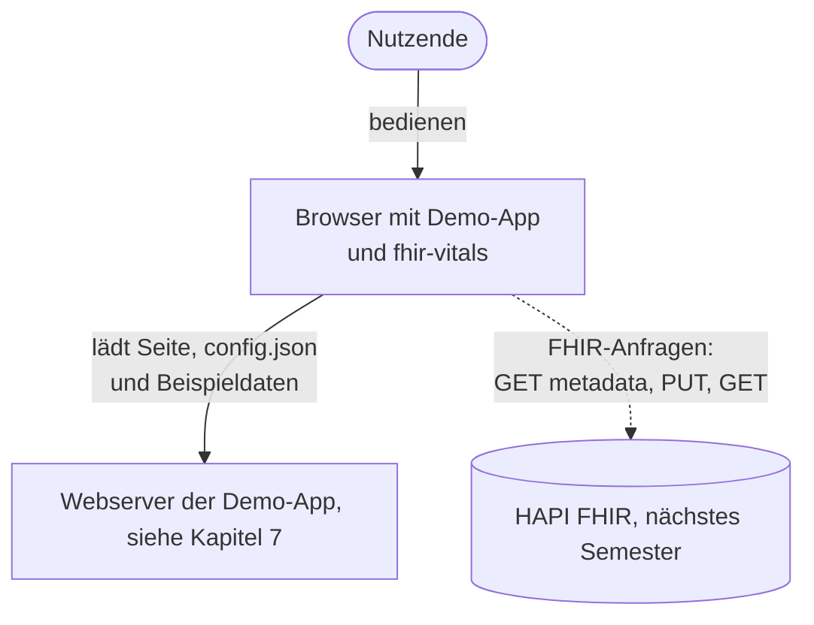

# 3 Kontextabgrenzung

Teil der [Architektur von fhir-vitals](README.md).

Die Demo-App läuft vollständig im Browser und hat kein eigenes Backend.
Alle Anfragen schickt deshalb der Browser.
Gepunktete Pfeile funktionieren erst im nächsten Semester.

Die Anfrage nach `metadata`, der Selbstbeschreibung des Servers, schickt der Browser schon in diesem Semester an `http://localhost:8080`.
Dort läuft noch kein FHIR-Server.
Die Karte „FHIR-Server“ zeigt deshalb „nicht erreichbar“, siehe [Kapitel 6](06-laufzeitsicht.md).

> [!NOTE]
> Nächstes Semester.
> Seite und HAPI FHIR haben verschiedene Ursprünge, also verschiedene Kombinationen aus Protokoll, Rechnername und Port, etwa `http://localhost:4200` und `http://localhost:8080`.
> Der Browser lässt die Seite Antworten von HAPI deshalb nur lesen, wenn HAPI das per CORS erlaubt, siehe [Glossar](12-glossar.md).
> HAPI erlaubt in der Voreinstellung des Images alle Ursprünge.
