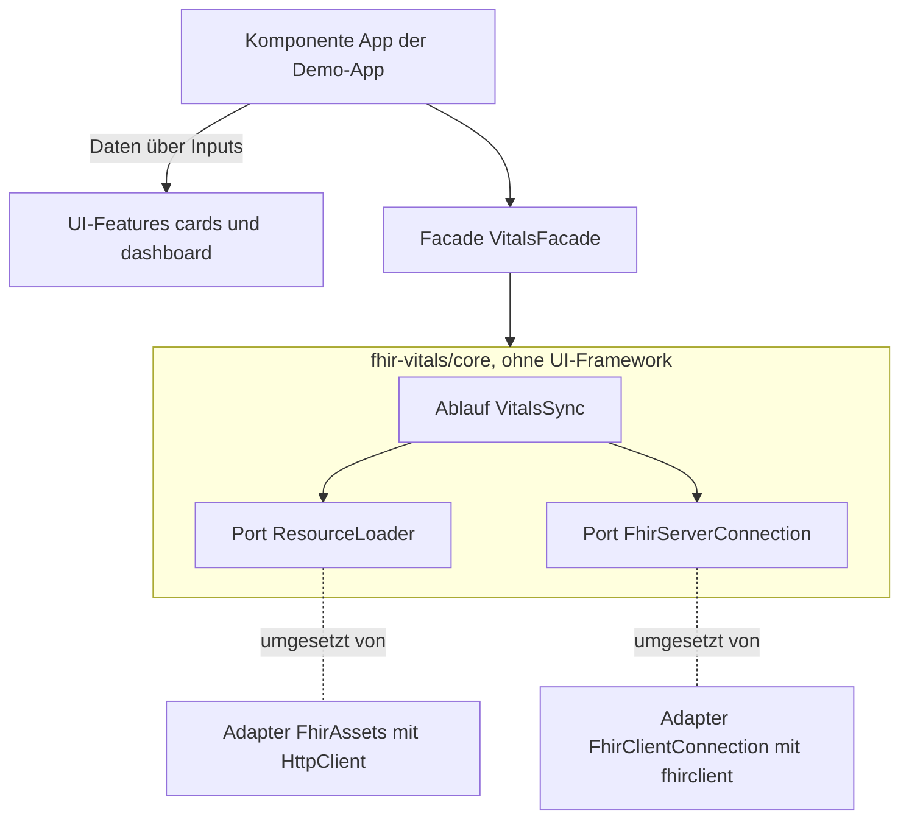

# 4 Lösungsstrategie

Teil der [Architektur von fhir-vitals](README.md).

Die Bibliothek zeigt die Architektur aus Folie 73 des Vortrags „Technologiestack“ an einem einzigen Beispiel, dem Blutdruck.
Die Foliennummer steht unten auf jeder Folie und weicht von der Seitenzahl im PDF ab.
Pfeile zeigen, wer wen nutzt.
Gepunktete Linien zeigen, welcher Adapter welchen Port umsetzt.

- **Facade:** Eine Facade ist ein einfacher Zugang, der die Einzelheiten dahinter verbirgt. Die Komponente `App` der Demo-App holt die Vitalparameter über `VitalsFacade`, ohne FHIR zu kennen. Sie gibt sie über Inputs, also Eigenschaften der Komponenten, an Karten und Dashboard weiter.
- **Ablauf:** `VitalsSync` in `fhir-vitals/core` enthält den ganzen Ablauf der Demo. Er hängt von keinem UI-Framework ab, damit auch eine Oberfläche mit Vue ihn nutzen kann. Seine Schritte zeigt [Kapitel 6](06-laufzeitsicht.md).
- **Port:** Ein Port beschreibt, was der Ablauf von außen braucht, hier `ResourceLoader` und `FhirServerConnection` in `fhir-vitals/core`. Mit einer Portnummer wie 4200 hat der Begriff nichts zu tun.
- **Adapter:** Ein Adapter setzt einen Port mit einer bestimmten Technik um. `FhirAssets` liegt in `fhir-vitals/angular/data` und `FhirClientConnection` in `fhir-vitals/fhir`. Ein anderer Adapter kann später den FHIR-Zugang des Patientenportals nutzen.
