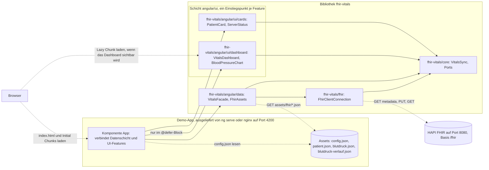

# 5 Bausteinsicht

Teil der [Architektur von fhir-vitals](README.md).

## Projektaufbau

Das Repository ist ein Angular-Workspace, also ein Ordner mit mehreren Angular-Projekten und gemeinsamer Konfiguration.
Assets sind statische Dateien wie JSON oder Bilder, die die App unverändert mit ausliefert.
In der Demo-App liegen sie im Ordner `public`.
Die Absätze nach dem Baum erklären seine Begriffe, etwa Adapter, fhirclient und fetch unter „Schichten der Bibliothek“.
[Kapitel 8](08-querschnittliche-konzepte.md) erklärt unter „Dev-Container und Werkzeuge“ den Begriff Volume.

```text
angular-fhir-vitals/
├── .github/workflows/pages.yml        Workflow: veröffentlicht die Demo-App auf GitHub Pages
├── .devcontainer/devcontainer.json    Dev-Container: Erweiterungen, Einstellungen, Ports und Volume für node_modules
├── .devcontainer/Dockerfile           Image des Dev-Containers mit Node.js 22, Chromium und Java
├── projects/
│   ├── fhir-vitals/                   Angular-Bibliothek: ein npm-Paket mit fünf Einstiegspunkten
│   │   ├── core/                      "fhir-vitals/core": Ports, also Schnittstellen nach außen, Ablauf VitalsSync, Blutdruck und Messverlauf
│   │   ├── fhir/                      "fhir-vitals/fhir": Adapter mit fhirclient und mit fetch
│   │   ├── angular/                   alles, was Angular braucht, selbst kein Einstiegspunkt
│   │   │   ├── data/                  "fhir-vitals/angular/data": Datenschicht mit FhirAssets und VitalsFacade
│   │   │   └── ui/                    die Angular-Oberfläche, selbst kein Einstiegspunkt
│   │   │       ├── cards/             "fhir-vitals/angular/ui/cards": Komponenten PatientCard und ServerStatus
│   │   │       └── dashboard/         "fhir-vitals/angular/ui/dashboard": minimales Dashboard-Beispiel, eine Kachel
│   │   ├── src/public-api.ts          leerer Platzhalter für den Paketnamen "fhir-vitals"
│   │   ├── …/src/public-api.ts        je Einstiegspunkt: was außerhalb sichtbar ist
│   │   ├── …/src/lib/*.spec.ts        Unit-Tests, neben dem getesteten Code
│   │   ├── ng-package.json            Einstellungen für ng-packagr, das die Bibliothek baut
│   │   ├── …/ng-package.json          macht einen Ordner zu einem eigenen Einstiegspunkt
│   │   ├── tsconfig.spec.json         lässt die Tests direkt gegen die Quellen laufen
│   │   └── package.json               Name, Version und peerDependencies, gemeinsam für alle Einstiegspunkte
│   └── demo-app/                      Demo-App
│       ├── public/config.json         Adresse des FHIR-Servers, wird beim Start gelesen
│       ├── public/assets/fhir/        Beispieldaten patient.json, blutdruck.json und blutdruck-verlauf.json
│       ├── src/index.html             HTML-Grundgerüst mit dem Element <app-root>
│       ├── src/main.ts                Startpunkt von Angular
│       ├── src/styles.css             globale Styles: Schrift und Farben der Seite
│       └── src/app/                   die einzige Seite: app.ts, app.html, app.css, app.config.ts, app.spec.ts
├── dist/                              Build-Ergebnisse, nicht im Repository
├── angular.json                       Projekte und Einstellungen für Build, Server und Tests
├── tsconfig.json                      TypeScript-Einstellungen und die Pfadzuordnung für "fhir-vitals"
├── package.json                       npm-Skripte und Abhängigkeiten des Workspace
├── package-lock.json                  genaue Paketversionen für npm ci
├── Dockerfile                         Image der Demo-App in zwei Stufen: Build mit Node.js, Auslieferung mit nginx
├── .dockerignore                      Dateien, die nicht ins Docker-Image kopiert werden
├── compose.yaml                       Dienste demo-app und fhir
├── .gitignore                         Dateien, die nicht ins Repository gehören, etwa node_modules, dist und .env
├── eslint.config.js                   Regeln für ESLint
├── .prettierrc                        Einstellungen für Prettier
├── .editorconfig                      Einrückung, Zeilenenden und Anführungszeichen für Editoren
├── .gitattributes                     einheitliche Zeilenenden für alle Textdateien
├── .nvmrc                             Node.js-Hauptversion für nvm
├── .vscode/extensions.json            empfohlene Erweiterungen für Visual Studio Code
├── .vscode/settings.json              ordnet den FHIR-Beispieldateien das JSON-Schema von FHIR R4 zu
└── LICENSE                            Lizenztext Apache-2.0
```

**Schichten der Bibliothek.**
Eine Kurzfassung der fünf Einstiegspunkte steht in [`projects/fhir-vitals/README.md`](../../projects/fhir-vitals/README.md).
Die Bibliothek trennt Abläufe, Serverzugriff, Angular-Anbindung und Oberfläche in vier Schichten.
Jede Schicht hat eine feste Aufgabe.
Dahinter steht das Prinzip der Trennung der Zuständigkeiten, englisch Separation of Concerns.
Nach diesem Prinzip hat jeder Teil des Codes genau eine Aufgabe und kennt nur das, was er dafür braucht.
Die beiden Schichten, die Angular brauchen, liegen gemeinsam im Ordner `angular/`.
`core` und `fhir` daneben bleiben frei von UI-Frameworks.
Die Ordner `angular/` und `angular/ui/` sind selbst keine Einstiegspunkte, deshalb melden `import … from "fhir-vitals/angular"` und `import … from "fhir-vitals/angular/ui"` beim Build den Fehler `TS2307`.
Auch `fhir-vitals` allein ist nur ein leerer Platzhalter.
ng-packagr verlangt ihn für den Paketnamen und zeigt ihn beim Build als `Built fhir-vitals` an.
Importieren lassen sich nur die fünf Einstiegspunkte.
Der Kern, also `fhir-vitals/core`, enthält mit `VitalsSync` den ganzen Ablauf der Demo ohne UI-Framework, vom Laden der Beispieldaten bis zum Zurücklesen vom Server.
Angular und andere UI-Frameworks übernehmen nur den Zustand von `VitalsSync`.
Ein Port ist eine Schnittstelle, die beschreibt, was der Kern von außen braucht, etwa das Laden einer Ressource.
Mit dem Port aus [README, Abschnitt 3](../../README.md#3-schnellstart), also einer Nummer wie 4200, hat dieser Begriff nichts zu tun.
Ein Adapter setzt einen Port mit einer bestimmten Technik um, etwa mit fhirclient oder mit fetch.
fhirclient ist eine JavaScript-Bibliothek für den Zugriff auf FHIR-Server.
fetch ist die eingebaute Funktion des Browsers für HTTP-Anfragen.
Eine Facade ist ein einfacher Zugang für die Oberfläche, der die Einzelheiten dahinter verbirgt.
Ein Signal ist ein Wert, dessen Änderungen Angular verfolgt.
Ein Input ist eine Eigenschaft einer Komponente, die die einbindende Seite setzt.

**Zuerst die Schicht, dann das Feature.**
Innerhalb einer Schicht kann sich der Code nach Features teilen.
Ein Feature ist ein abgegrenzter Teil mit eigener Aufgabe, etwa die Karten für Patient und Server oder das Dashboard-Beispiel.
Die Ordner bilden diese Reihenfolge ab: oben die Schicht, darunter das Feature.
Alles für die Angular-Oberfläche liegt deshalb unter `angular/ui`, mit einem Einstiegspunkt je Feature.
`fhir-vitals/angular/ui/cards` enthält `PatientCard` und `ServerStatus`, `fhir-vitals/angular/ui/dashboard` das Dashboard-Beispiel.
Angular Material ist genauso aufgebaut, mit Einstiegspunkten wie `@angular/material/card` und `@angular/material/table`.
Die Schichten `core`, `fhir` und `angular/data` sind je ein einziger Einstiegspunkt.
Die folgende Tabelle nennt einige weitere Pakete.
RxJS ist eine Bibliothek für Datenströme.
Angular nutzt sie etwa für die Antworten von HttpClient.
Vue ist wie Angular ein Framework für Webanwendungen im Browser.
ng2-charts bindet Chart.js an Angular an.

| Einstiegspunkt | Inhalt | darf importieren | darf nicht importieren |
|---|---|---|---|
| `fhir-vitals/core` | die Ports `ResourceLoader` und `FhirServerConnection`, der Ablauf `VitalsSync` mit Patient und Messverlauf laden, Adresse lesen, verbinden, prüfen, speichern und zurücklesen, dazu `formatBloodPressure`, `bloodPressureHistory` und die LOINC-Codes | FHIR-Typen aus `fhir/r4` | Angular, RxJS, Vue, fhirclient, `fetch`, gridstack, Chart.js, ng2-charts und alle anderen Teile der Bibliothek |
| `fhir-vitals/fhir` | die Adapter `FhirClientConnection` mit fhirclient und `FetchResourceLoader` mit fetch | `fhir-vitals/core`, fhirclient, FHIR-Typen aus `fhir/r4` | Angular, RxJS, Vue, gridstack, Chart.js, ng2-charts und die übrigen Teile |
| `fhir-vitals/angular/data` | die Angular-Datenschicht: `FhirAssets` als Adapter mit HttpClient, dem Dienst von Angular für HTTP-Anfragen, und `VitalsFacade`, die den Zustand von `VitalsSync` als Signal anbietet | `fhir-vitals/core`, `fhir-vitals/fhir`, Angular, RxJS, FHIR-Typen aus `fhir/r4` | jedes UI-Feature wie `fhir-vitals/angular/ui/cards`, Angular Material, fhirclient direkt, gridstack, Chart.js und ng2-charts |
| `fhir-vitals/angular/ui/cards` | die Komponenten `PatientCard` und `ServerStatus`, beide als Karte von Angular Material. Sie bekommen Daten über Inputs und übersetzen die Statuswerte des Kerns wie `saved` in deutsche Texte. | `fhir-vitals/core`, andere UI-Features über ihren Paketnamen, Angular mit Angular Material, FHIR-Typen aus `fhir/r4` | die Datenschicht, `fhir-vitals/fhir`, fhirclient, HttpClient, `fetch`, gridstack, Chart.js und ng2-charts |
| `fhir-vitals/angular/ui/dashboard` | das minimale Dashboard-Beispiel: `VitalsDashboard` mit einer festen Kachel und `BloodPressureChart` für das Diagramm. Die Messwerte kommen über das Input `history`. | `fhir-vitals/core`, andere UI-Features über ihren Paketnamen, Angular und die vorgeschlagenen Pakete Angular Material, gridstack, Chart.js und ng2-charts | die Datenschicht, `fhir-vitals/fhir`, fhirclient, HttpClient und `fetch` |

Die Demo-App ist die einzige Stelle, die Datenschicht und UI-Features kennt.
Sie verbindet sie.
Schichten und Features importieren einander nur über den Paketnamen, etwa `fhir-vitals/core`.
Ein relativer Pfad in eine andere Schicht scheitert beim Build, meist mit dem Fehler `TS6059`.
Zeigt er von `core` aus nach oben, etwa nach `angular/data`, meldet ng-packagr stattdessen `Entry point fhir-vitals/core has a circular dependency on itself.`
`npm run lint` prüft die Spalte „darf nicht importieren“.
Ein verbotener Import erscheint dann als Fehler mit Begründung, im Kern zum Beispiel `'@angular/core' import is restricted from being used by a pattern. Dieser Teil bleibt frei von UI-Frameworks, damit auch Vue oder andere ihn nutzen können`.
Ein relativer Pfad von einem Feature in ein anderes, etwa `../../../../cards/src/public-api` aus dem Dashboard, meldet `Andere Einstiegspunkte über ihren Paketnamen importieren, nie über einen relativen Pfad`.
Den eigenen Einstiegspunkt importiert ein Feature dagegen relativ.
`import { PatientCard } from "fhir-vitals/angular/ui/cards";` in `angular/ui/cards` meldet `Innerhalb des eigenen Einstiegspunkts relativ importieren`.
Ein UI-Feature bekommt seine Daten über Inputs.
Ein Import von `fhir-vitals/angular/data` im Dashboard meldet deshalb `Die UI importiert nur fhir-vitals/core und andere UI-Einstiegspunkte. Daten kommen über Inputs, verbunden wird in der App`.
Die Datenschicht kennt umgekehrt keine Oberfläche.
Für `@angular/material/card` in `angular/data` meldet ESLint `Die Datenschicht kennt die UI nicht. Angular Material gehört in ein UI-Feature wie fhir-vitals/angular/ui/cards`.
Die vorgeschlagenen Pakete gridstack, Chart.js und ng2-charts sind überall in der Bibliothek außer in `angular/ui/dashboard` verboten.
So hängt nur das Dashboard von ihnen ab.
Ein Import von `chart.js` in `angular/ui/cards` meldet `'chart.js' import is restricted from being used by a pattern. Diese Pakete gehören nach fhir-vitals/angular/ui/dashboard, damit nur das Dashboard von ihnen abhängt`.

**Was ein Einstiegspunkt trennt.**
Die Datei `src/public-api.ts` legt die öffentliche Schnittstelle eines Einstiegspunkts fest, englisch Public API.
Nur was sie exportiert, sehen andere Einstiegspunkte und Apps.
Alles andere bleibt intern, etwa die Formatfunktionen aus `format.ts` im Dashboard-Beispiel.
ng-packagr baut jeden Einstiegspunkt zu genau einer Datei `.mjs` im Ordner `dist/fhir-vitals/fesm2022`.
Diese Datei importiert nur die Pakete, die ihr Einstiegspunkt selbst braucht.
So bleiben die Abhängigkeiten eines Features in diesem Feature.
Nach `npx ng build fhir-vitals` zeigt unter macOS und Linux `grep '^import ' dist/fhir-vitals/fesm2022/fhir-vitals-angular-ui-cards.mjs` nur Importe aus `@angular/core` und Angular Material:

```text
import * as i0 from "@angular/core";
import { Component, computed, input, output } from "@angular/core";
import * as i1 from "@angular/material/card";
import { MatCardModule } from "@angular/material/card";
import { MatButton } from "@angular/material/button";
```

Derselbe Befehl für `fhir-vitals-angular-ui-dashboard.mjs` zeigt neben `@angular/core` und der Karte von Angular Material auch Chart.js, ng2-charts und gridstack:

```text
import * as i0 from "@angular/core";
import { Component, computed, input } from "@angular/core";
import { Legend, LineController, LineElement, LinearScale, PointElement, Tooltip } from "chart.js";
import { BaseChartDirective, provideCharts } from "ng2-charts";
import * as i1 from "@angular/material/card";
import { MatCardModule } from "@angular/material/card";
import { GridstackComponent, GridstackItemComponent } from "gridstack/dist/angular";
```

**Wohin neuer Code gehört.**

- Komponenten, Direktiven und UI-Services gehören in ein UI-Feature unter `angular/ui`, auch wenn sie Angular Material nutzen. Eine Direktive ist ein Baustein ohne eigenes Template, der einem vorhandenen HTML-Element Verhalten gibt. Ein UI-Service ist ein Service nur für die Oberfläche, etwa zum Öffnen eines Dialogs.
- Nutzen mehrere Features denselben Baustein, kommt er in ein eigenes Feature, etwa `angular/ui/shared`. Die anderen Features importieren ihn dann über `fhir-vitals/angular/ui/shared`. `shared` selbst importiert keine anderen Features. Importieren sich zwei Features gegenseitig, etwa `dashboard` und `shared`, bricht `npx ng build fhir-vitals` mit `Entry point fhir-vitals/angular/ui/dashboard has a circular dependency on fhir-vitals/angular/ui/shared.` ab. ESLint meldet das nicht.
- Services, die Daten laden oder den Zustand der Daten halten, etwa Patient, Messungen oder Verbindungsstatus, gehören nach `angular/data`. Reiner Zustand der Oberfläche, etwa ob ein Dialog offen ist, bleibt im UI-Feature. ESLint prüft dabei nur die Importe und nicht, wo ein Zustand liegt.
- Logik ohne Angular gehört nach `core`, ein Adapter für einen Server nach `fhir`.
- Bezeichner, also die Namen von Klassen, Funktionen und Variablen, sind englisch, ebenso Kommentare und Testnamen. Texte der Oberfläche und die Meldungen der ESLint-Regeln sind deutsch. Kommentare begründen, warum der Code etwas tut.

**Ein neues UI-Feature anlegen.**
Die Schritte am Beispiel eines Features `shared`:

1. Den Ordner `projects/fhir-vitals/angular/ui/shared/` anlegen und `ng-package.json` aus `angular/ui/cards` hineinkopieren. Der Pfad unter `$schema` passt ohne Änderung, weil der Ordner gleich tief liegt.
2. Komponenten wie in [README, Abschnitt 4](../../README.md#4-befehle) mit `--path projects/fhir-vitals/angular/ui/shared/src/lib` anlegen. Dann die Datei `src/public-api.ts` anlegen und die Komponenten dort exportieren.
3. In `projects/fhir-vitals/tsconfig.lib.json` und `projects/fhir-vitals/tsconfig.spec.json` unter `paths` den Eintrag `"fhir-vitals/angular/ui/shared": ["./angular/ui/shared/src/public-api.ts"]` ergänzen. Der Eintrag ordnet dem neuen Paketnamen die Quellen des Features zu, siehe „Pfadzuordnung“ weiter unten.
4. In `eslint.config.js` den Namen `"angular/ui/shared"` in die Liste `entryPoints` eintragen. Dann direkt nach `uiFeature("dashboard"),` innerhalb von `defineConfig(…)` den Block `uiFeature("shared", dashboardPackages),` ergänzen. `dashboardPackages` verbietet dem neuen Feature gridstack, Chart.js und ng2-charts.
5. Den Eintrag `"../../ui/**/*.spec.ts"` für die Tests in `angular.json` so lassen. Er erfasst schon jedes Feature unter `angular/ui`.
6. `npx ng build fhir-vitals` ausführen. Dann erscheint zusätzlich die Zeile `✔ Built fhir-vitals/angular/ui/shared`, und `dist/fhir-vitals/package.json` nennt unter `exports` den Eintrag `./angular/ui/shared`. Läuft gerade `npm run watch:lib`, ihn mit `Strg+C` beenden und neu starten. Einen neuen Einstiegspunkt erkennt er erst beim Start. Im Test baute ein laufendes `npm run watch:lib` nach dem Speichern einer Datei in `angular/ui/cards` nur `✔ Built fhir-vitals/angular/ui/cards` neu und das neue Feature erst nach dem Neustart.

Am 06.11.2026 entstand so in einer Kopie des Repositorys ein Feature `shared` mit der Komponente `unit-label`.
`npm run lint` zeigte danach nur die beiden Kopfzeilen.
`npx ng test fhir-vitals --watch=false` meldete `TOTAL: 52 SUCCESS`, also einen Test mehr als der damalige Stand mit 51 Tests.
Ein Import von `fhir-vitals/angular/ui/shared` im Dashboard war erlaubt.
Ein Import von `gridstack` in `angular/ui/shared` meldete `Diese Pakete gehören nach fhir-vitals/angular/ui/dashboard, damit nur das Dashboard von ihnen abhängt`.

**Pfadzuordnung.** Die Demo-App importiert die Bibliothek über ihre Paketnamen, also etwa `import { VitalsFacade } from "fhir-vitals/angular/data";` und `import { PatientCard, ServerStatus } from "fhir-vitals/angular/ui/cards";`.
Genau so sähe der Import im Patientenportal aus, wenn es die Bibliothek als npm-Paket installiert.
Möglich macht das der Eintrag `"fhir-vitals/*": ["./dist/fhir-vitals/*"]` unter `compilerOptions.paths` in `tsconfig.json`, auch für verschachtelte Namen wie `fhir-vitals/angular/ui/cards`.
Er leitet die Paketnamen auf die gebaute Bibliothek im Ordner `dist` um.
Den Eintrag `"fhir-vitals": ["./dist/fhir-vitals"]` daneben hat die Angular CLI beim Anlegen der Bibliothek erzeugt.
Er zeigt nur noch auf den leeren Platzhalter.
Deshalb muss die Bibliothek gebaut sein, bevor die Demo-App startet.
`npm start` und `npm test` erledigen das automatisch.
Die Tests der Bibliothek brauchen keinen Build, weil `projects/fhir-vitals/tsconfig.spec.json` die Paketnamen auf die Quellen umleitet.

**peerDependencies.** peerDependencies sind Pakete, die eine Bibliothek voraussetzt, die aber die einbindende Anwendung selbst installiert.
So nutzen Bibliothek und Anwendung dieselbe Version.
Die Bibliothek führt `@angular/core`, `@angular/common`, `fhirclient` und `@types/fhir` als peerDependencies.
Die Karten und das Dashboard-Beispiel bringen weitere Pakete mit.
Sie sind ein Vorschlag und lassen sich austauschen, siehe [Kapitel 9](09-architekturentscheidungen.md).
Angular Material ist eine Sammlung fertiger Komponenten wie Karten und Tabellen vom Angular-Team.
Sie baut auf dem CDK (Component Dev Kit) auf, einem Baukasten für Verhalten wie Menüs und den Fokus.
Der Fokus ist das Element der Seite, das gerade Eingaben von der Tastatur empfängt.
`PatientCard` und `ServerStatus` in `angular/ui/cards` nutzen Angular Material.
Das Dashboard-Beispiel nutzt es ebenfalls.
Nur das Dashboard-Beispiel nutzt gridstack, Chart.js und ng2-charts.
gridstack ordnet Kacheln in einem Raster aus Spalten und Zeilen an.
Chart.js zeichnet Diagramme, und ng2-charts bindet Chart.js an Angular an.
Für diese Vorschläge führt die Bibliothek zusätzlich `@angular/cdk`, `@angular/material`, `chart.js`, `gridstack` und `ng2-charts` als peerDependencies.
In der `package.json` im Wurzelverzeichnis stehen alle diese Pakete unter `dependencies`, dazu `@fontsource/roboto` für die Schrift der Demo-App.

Seit Version 7 installiert npm peerDependencies automatisch mit.
Eine App mit dem Framework Vue, die nur `fhir-vitals/core` und `fhir-vitals/fhir` nutzt, bekäme so auch Angular, Angular Material, gridstack und ng2-charts.
Deshalb markiert das Feld `peerDependenciesMeta` in `projects/fhir-vitals/package.json` alle Angular-Pakete sowie `chart.js`, `gridstack` und `ng2-charts` mit `"optional": true`.
Optionale peerDependencies installiert npm nicht von selbst.
Eine Angular-App installiert sie selbst, so wie die Demo-App.
`fhirclient` und `@types/fhir` bleiben Pflicht, weil `fhir-vitals/fhir` fhirclient importiert und `core` die FHIR-Typen nutzt.

**Andere UI-Frameworks.**
Vue ist wie Angular ein Framework für Webanwendungen im Browser.
`fhir-vitals/core` und `fhir-vitals/fhir` enthalten keinen Angular-Code.
Im gebauten Paket importiert `fhir-vitals-core.mjs` nichts, und `fhir-vitals-fhir.mjs` importiert nur `fhirclient/browser`.
Eine andere Oberfläche nutzt denselben Ablauf mit `new VitalsSync(new FetchResourceLoader(), connectWithFhirClient)`.
Mit `subscribe()` meldet sie sich für den Zustand an, man sagt auch, sie abonniert ihn.
`VitalsSync` ruft die übergebene Funktion dann bei jeder Änderung auf.
Die Oberfläche überträgt den Zustand in ihre eigene Reaktivität, in Vue zum Beispiel in ein `shallowRef()`, das Gegenstück zu einem Signal.
Eine kleine Vue-App mit genau diesem Aufbau zeigte im Test gegen HAPI Herrn K., den Status `saved` und 104/66 mm[Hg].
Das gebaute JavaScript dieser Vue-App enthielt keinen Code aus Angular.
Die Vue-App gehört nicht zum Repository.
Das Build-Werkzeug Vite baute sie und griff dabei über einen Alias direkt auf die Quellen von `core` und `fhir` zu.
Seit die Angular-Pakete optionale peerDependencies sind, eignet sich auch das gebaute npm-Paket für Vue.
Das zeigte am 06.11.2026 eine zweite Prüfung, ebenfalls außerhalb des Repositorys.
`npm pack` packt ein Paket in eine Paketdatei `.tgz`, wie sie auch die npm-Registry ausliefert.
Aus `dist/fhir-vitals` entstand so `fhir-vitals-0.0.1.tgz`, und npm meldete `package size: 19.3 kB` und `total files: 19`.
Ein neues Projekt installierte sie zusammen mit `vue` und dem Build-Werkzeug esbuild.
Der Befehl war `npm install --strict-peer-deps`.
Die Option `--strict-peer-deps` lässt die Installation scheitern, sobald eine peerDependency nicht passt.
npm meldete `added 32 packages, and audited 33 packages in 1s` und `found 0 vulnerabilities`.
Einen Ordner `node_modules/@angular` gab es danach nicht, und auch gridstack, Chart.js und ng2-charts fehlten.
`fhirclient` und `@types/fhir` installierte npm als Pflicht-peerDependencies von selbst.
Ein kleiner Einstieg in Vue nutzte `VitalsSync`, `bloodPressureHistory`, `FetchResourceLoader` und `connectWithFhirClient`.
Zustand und Messungen hielt er in je einem `shallowRef()`.
esbuild baute daraus die Datei `app.js` mit 322,6 kB aus 20 Modulen.
Das sind die eigene Einstiegsdatei und 19 JavaScript-Dateien aus den Paketen von Vue, aus `fhir-vitals`, `fhirclient` und `js-base64`.
Sie enthielt kein Modul aus Angular, und die Zeichenfolge `@angular` kam darin nicht vor.
Der Befehl dafür lautet `npx esbuild src/main.ts --bundle --format=esm --outfile=dist/app.js`, und esbuild meldet dann `dist/app.js  322.6kb`.
Nach dem Umzug der Komponenten nach `angular/ui/cards` und `angular/ui/dashboard` lief die Prüfung am selben Tag mit dem neu gebauten Paket erneut.
npm meldete dann `package size: 19.6 kB` und `total files: 19`.
Die Zahl der installierten Pakete, die Größe von `app.js` und die 20 Module blieben gleich, und `@angular` kam wieder nicht vor.
Diese Prüfung hat die Vue-App nur gebaut und nicht im Browser gestartet.
Später können `core` und `fhir` trotzdem in eigene Pakete kommen.
Weil alle Schichten einander schon heute nur über Paketnamen importieren, ändern sich dabei im Code vor allem die Importnamen.

## Karten und Grundgerüst der Demo-App

`PatientCard` und `ServerStatus` zeigen ihren Inhalt in `<mat-card appearance="outlined">`, einer Karte von Angular Material mit dünnem Rand.
Die Daten bekommen beide Karten weiterhin nur über Inputs.
Ein Screenreader ist ein Programm, das den Inhalt einer Seite vorliest oder in Braille ausgibt.
Die Überschrift jeder Karte steht in `<h2 mat-card-title>`.
Ein Attribut ist eine Zusatzangabe in einem HTML-Element, etwa `appearance="outlined"` in `<mat-card>`.
Das Attribut `mat-card-title` gibt ihr nur das Aussehen eines Kartentitels.
Für Screenreader bleibt sie eine echte Überschrift `h2`.

Der Knopf „Erneut verbinden“ trägt `matButton="outlined"` und erscheint so als umrandeter Knopf von Angular Material.
Während eines Laufs ist er gesperrt.
Wegen `disabledInteractive` sperrt Angular Material ihn dabei nur mit `aria-disabled="true"`, einem Attribut, das einem Screenreader den gesperrten Zustand meldet.
Das HTML-Attribut `disabled` setzt Angular Material nicht.
So behält der Knopf den Fokus.
Ein Knopf mit `disabled` verliert dagegen den Fokus.
Im Test am 06.11.2026 lag der Fokus danach auf dem Element `body`, also auf der Seite als Ganzes.
Klicks auf den gesperrten Knopf kommen trotzdem an.
Deshalb meldet `ServerStatus` während eines Laufs kein `reconnect`.
Der Absatz mit dem Status trägt `role="status"` und ist damit eine Live-Region, also ein Bereich, dessen neuen Inhalt ein Screenreader von selbst vorliest.
Im Test am 06.11.2026 blieb der Fokus nach einem Klick auf „Erneut verbinden“ auf dem Knopf, und der Status wechselte zu „nicht erreichbar“.

Die Demo-App setzt in `app.html` den Titel „FHIR-Starter“ in eine Toolbar aus `<mat-toolbar>`.
`<header>` um die Toolbar und `<main>` um den übrigen Inhalt sind Landmarken, also Bereiche, zu denen ein Screenreader direkt springen kann.
`app.css` ordnet die Karten in einem CSS-Grid an, also in Spalten, die der Browser selbst verteilt.
Die Längeneinheit rem richtet sich nach der Grundschrift des Browsers.
Bei der üblichen Grundschrift von 16 Pixeln sind 20rem genau 320 Pixel.
Die Angabe `repeat(auto-fit, minmax(min(100%, 20rem), 1fr))` legt so viele Spalten an, wie in die Breite passen.
Jede Spalte ist mindestens 20rem breit.
Ist die Seite schmaler, nimmt die Spalte die ganze Breite ein.
Dafür sorgt `min(100%, 20rem)`.
Im Test am 06.11.2026 standen die Karten bei 1024 Pixeln Fensterbreite nebeneinander und bei 375 Pixeln untereinander.

Ein Theme legt Farben, Schriften und Abstände der Material-Komponenten fest.
Eine CSS-Variable ist ein benannter Wert in CSS, dessen Name mit zwei Bindestrichen beginnt.
`var(…)` liest diesen Wert aus.
Ein Token ist hier eine CSS-Variable, aus der eine Material-Komponente ihre Farbe liest.
Die Farbe der Toolbar setzt `app.css` über das Token `--mat-toolbar-container-background-color`.
Es bekommt den Wert `var(--mat-sys-surface-container)`, einen Farbton aus dem Theme, der etwas dunkler ist als der Hintergrund der Seite.
Auch `styles.css` nimmt Hintergrund und Textfarbe der Seite aus dem Theme.
Angular Material bleibt ein Vorschlag, siehe [Kapitel 9](09-architekturentscheidungen.md).

## Das Dashboard-Beispiel

Das Beispiel ist absichtlich klein.
Es zeigt eine feste Kachel und dient als Startpunkt für das Dashboard, das im Softwareprojekt entsteht.
Die genutzten Bibliotheken sind ein Vorschlag, siehe [Kapitel 9](09-architekturentscheidungen.md).

**Wo es liegt.**
Das Beispiel liegt im Einstiegspunkt `fhir-vitals/angular/ui/dashboard`, Ordner `projects/fhir-vitals/angular/ui/dashboard/`.
Es besteht aus zwei Komponenten.
`VitalsDashboard` legt mit gridstack ein Raster an und zeigt darin genau eine Kachel.
Die Kachel ist eine Karte von Angular Material mit der Überschrift „Blutdruckverlauf“.
Darin zeichnet `BloodPressureChart` den Verlauf mit Chart.js als Liniendiagramm.
Beide bekommen die Messungen über das Input `history`, die älteste zuerst, so wie `VitalsSync` sie im Zustand unter `history` liefert.
Die Demo-App bindet das Beispiel in `app.html` mit `<lib-vitals-dashboard [history]="vitals.state().history" />` ein.

**Eigener Einstiegspunkt und `@defer`.**
Das Beispiel ist ein eigenes Feature mit eigenem Einstiegspunkt.
So hängt nur das Dashboard von gridstack, Chart.js und ng2-charts ab.
`fhir-vitals/angular/ui/cards` und die übrigen Schichten kommen ohne diese Pakete aus.
Im Code der Bibliothek betrifft ein Austausch von gridstack oder Chart.js deshalb nur dieses Feature, siehe [Kapitel 9](09-architekturentscheidungen.md).
Ein Austausch von Angular Material betrifft dagegen auch `angular/ui/cards` und die Demo-App.
In `app.html` steht `<lib-vitals-dashboard>` in einem Block `@defer (on viewport)`.
`@defer` ist ein Block im Template, dessen Inhalt Angular in einen eigenen Lazy Chunk legt.
Mit `on viewport` lädt der Browser diesen Chunk erst, wenn der Platzhalter des Blocks in den sichtbaren Bereich der Seite kommt.
Bis dahin zeigt die Seite „Dashboard wird geladen …“.
Der Lazy Chunk bringt gridstack, Chart.js und ng2-charts mit.
Den Code der Karte von Angular Material lädt der Browser dagegen schon mit den Initial Chunks, weil die Karten „Patient“ und „FHIR-Server“ ihn sofort brauchen.
Im Build für die Auslieferung lud der Browser den Lazy Chunk in einem Fenster von 400 Pixeln Höhe erst, nachdem die Seite bis zum Dashboard gescrollt war.
Mit `npm start` lädt Angular die Pakete des Dashboards dagegen sofort mit, siehe `NG0751` in [README, Abschnitt 5](../../README.md#5-typische-probleme).
Der Block `@defer` ist nicht der Grund für den eigenen Einstiegspunkt.
Die Trennung gilt auch ohne ihn.

**Eine feste Kachel.**
Die Einstellungen des Rasters stehen in `gridOptions` in `vitals-dashboard.ts`.
Das Raster hat 12 Spalten und Zeilen von 80 Pixeln Höhe, mit einem Rand von 8 Pixeln um jede Kachel.
Die Kachel beginnt in Spalte 0 und Zeile 0, ist 8 Spalten breit und 4 Zeilen hoch.
Die Option `staticGrid: true` hält sie fest.
Sie lässt sich deshalb weder verschieben noch in der Größe ändern.
Ist das Raster höchstens 600 Pixel breit, hat es nur eine Spalte, und die Kachel nimmt die volle Breite ein.
Das legt der Eintrag `{ w: 600, c: 1 }` unter `columnOpts.breakpoints` fest.
Wird das Raster danach wieder breiter, ist die Kachel wieder 8 Spalten breit, auch wenn die Seite in einem schmalen Fenster startet.
Dafür sorgt `layout: "none"` unter `columnOpts`.
Ohne diese Angabe streckt gridstack die Kachel dann auf alle 12 Spalten.
Im Test am 06.11.2026 war die Kachel bei einer Fensterbreite von 1024 Pixeln 630 Pixel breit und 320 Pixel hoch.
Bei 560 Pixeln Fensterbreite war sie mit 496 Pixeln so breit wie das Raster.

**Diagramm.**
`BloodPressureChart` meldet die nötigen Teile von Chart.js selbst an, über `provideCharts()` unter `providers` der Komponente.
Deshalb braucht `app.config.ts` keinen Eintrag für Chart.js, und Chart.js bleibt im Lazy Chunk.
Die Zeitachse ist eine Zahlenachse mit Millisekunden.
So braucht Chart.js keinen zusätzlichen Adapter für Datumswerte.
Die Beschriftungen wie `26.05.` kommen von `Intl.DateTimeFormat("de-DE")`.
Beim Zeigen mit der Maus nennt ein Tooltip, also ein kleines Feld über dem Diagramm, Zeitpunkt und beide Werte.
Am 29.05. waren das „29.05.2026, 07:35“, „Systolisch: 110 mm[Hg]“ und „Diastolisch: 71 mm[Hg]“.

**Globale Styles.**
Die Elemente des Rasters, etwa das innere Element jeder Kachel mit der Klasse `grid-stack-item-content`, stehen in den Templates von gridstack und nicht im Template von `VitalsDashboard`.
Die Styles einer Angular-Komponente gelten aber nur für Elemente aus ihrem eigenen Template.
Deshalb gehört `gridstack.min.css` zu den globalen Styles der App.
Die Demo-App lädt in `angular.json` unter `styles` vier Dateien vor ihrer eigenen `styles.css`: `@fontsource/roboto/latin-400.css` und `@fontsource/roboto/latin-500.css` für die Schrift Roboto, `@angular/material/prebuilt-themes/azure-blue.css` und `gridstack/dist/gridstack.min.css`.
`azure-blue.css` ist ein fertiges Theme als CSS-Datei.
Es gilt für alle Material-Komponenten der Seite, also auch für die Karten „Patient“ und „FHIR-Server“, den Knopf und die Toolbar.
Es nutzt die Schrift Roboto.
Das Paket `@fontsource/roboto` liefert diese Schrift als Dateien mit der App aus.
Der Browser lädt sie vom eigenen Server unter `media/` und schickt keine Anfrage an Google Fonts.

**Barrierefreiheit.**
Chart.js zeichnet in ein Canvas, eine Zeichenfläche aus Pixeln ohne lesbaren Text.
Das Canvas hat deshalb das Attribut `role="img"`.
Es meldet einem Screenreader, dass das Canvas ein Bild ist.
Die Textalternative dazu steht im Attribut `aria-label`.
Mit den Daten aus den Assets lautet sie „Blutdruckverlauf: 7 Messungen vom 26.05.2026 bis 01.06.2026, zuletzt 104/66 mm[Hg]“.
„Systolisch“ ist eine blaue durchgezogene Linie mit runden Punkten, „Diastolisch“ eine orange gestrichelte Linie mit quadratischen Punkten.
Die beiden Reihen unterscheiden sich so nicht nur durch die Farbe, wie es Kriterium 1.4.1 „Use of Color“ der WCAG 2.2 verlangt.
Die WCAG (Web Content Accessibility Guidelines) sind die Richtlinien des W3C, des Gremiums für Webstandards, für barrierefreie Webinhalte.
Unter `h1` „FHIR-Starter“ stehen die Überschriften `h2` „Patient“, „FHIR-Server“ und „Dashboard“.
Die Kachel hat die Überschrift `h3` „Blutdruckverlauf“ unter „Dashboard“.
Ist im Betriebssystem die Einstellung für weniger Bewegung aktiv, zeichnet Chart.js das Diagramm ohne Animation.
gridstack animiert die Kachel nie, denn `gridOptions` enthält `animate: false`.
Die Animation von gridstack würde diese Einstellung nicht beachten, denn `gridstack.min.css` berücksichtigt sie nicht.
Ein Klick auf die Legende blendet keine Reihe aus.
`BloodPressureChart` schaltet diese Funktion von Chart.js ab, denn mit der Tastatur ließe sie sich nicht bedienen.

**Was das Beispiel bewusst nicht kann.**
Die Kachel lässt sich nicht verschieben, nicht in der Größe ändern, nicht hinzufügen und nicht entfernen.
Das Beispiel speichert nichts und bietet keine Bedienung per Tastatur für die Anordnung.
Die einzelnen Messwerte nennt nur der Tooltip beim Zeigen mit der Maus.
Die Textalternative nennt nur Anzahl, Zeitraum und letzten Wert.
Mit Tastatur oder Screenreader lassen sich die übrigen Werte deshalb nicht genau lesen.
Diese Teile entstehen im nächsten Semester des Softwareprojekts.
Hinweise dazu stehen in [README, Abschnitt 6](../../README.md#6-weiterarbeiten-in-ww2).

## Wie die Teile zusammenspielen

Durchgezogene Pfeile zeigen, wer wen importiert.
Gestrichelte Pfeile zeigen Anfragen über das Netz.


