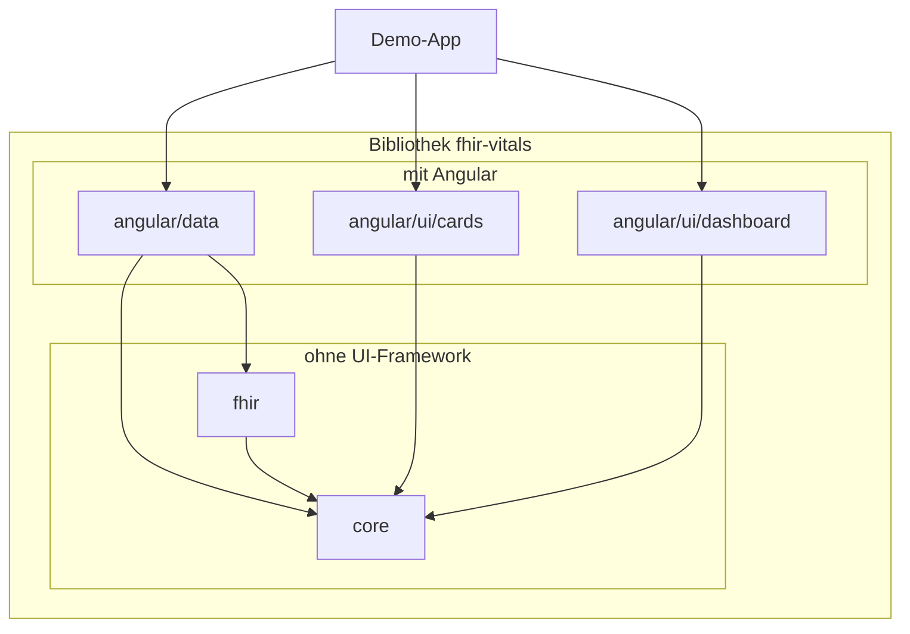
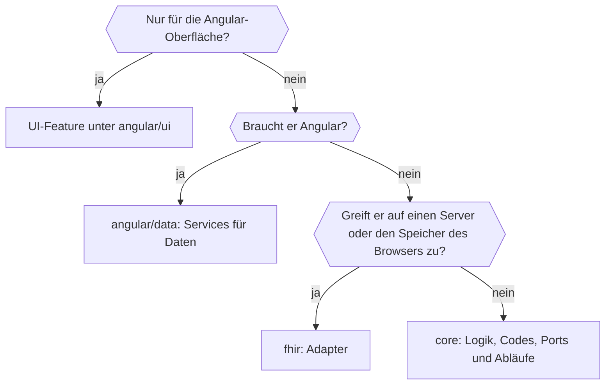

# 5 Bausteinsicht

Teil der [Architektur von fhir-vitals](README.md).

Für den Einstieg genügen die Abschnitte „Überblick“, „Regeln zwischen den Schichten“, „Wohin neuer Code gehört“ und „Karten und Dashboard-Beispiel“.
Die übrigen Abschnitte dienen zum Nachschlagen.

## Überblick

Das Repository ist ein Angular-Workspace mit zwei Projekten, der Bibliothek `fhir-vitals` und der Demo-App.
Die Bibliothek besteht aus fünf Einstiegspunkten, also Teilpaketen mit eigenem Importnamen.
Ein Pfeil bedeutet „importiert“.
Die Kästen der Bibliothek nennen den Ordner unter `projects/fhir-vitals`.
Der Importname beginnt jeweils mit `fhir-vitals/`, etwa `fhir-vitals/core`.



| Teil | Aufgabe | wichtiger Code | wichtige Pakete von außen |
|---|---|---|---|
| `fhir-vitals/core` | Ablauf der Demo, Ports und Auswertung der Blutdruckmessungen | `VitalsSync`, `ResourceLoader`, `FhirServerConnection`, `bloodPressureHistory()`, `formatBloodPressure()`, LOINC-Codes | nur die FHIR-Typen aus `fhir/r4` |
| `fhir-vitals/fhir` | Adapter, die die Ports mit fhirclient und mit fetch umsetzen | `FhirClientConnection`, `FetchResourceLoader` | fhirclient |
| `fhir-vitals/angular/data` | Angular-Datenschicht mit dem Zustand von `VitalsSync` als Signal, also als Wert, dessen Änderungen Angular verfolgt | `VitalsFacade`, `FhirAssets` | Angular, RxJS |
| `fhir-vitals/angular/ui/cards` | Karten „Patient“ und „FHIR-Server“ | `PatientCard`, `ServerStatus` | Angular, Angular Material |
| `fhir-vitals/angular/ui/dashboard` | minimales Dashboard-Beispiel mit einer Kachel | `VitalsDashboard`, `BloodPressureChart` | Angular, Angular Material, gridstack, Chart.js, ng2-charts |
| Demo-App | die einzige Seite, die Datenschicht und UI-Features verbindet | `App` | Angular, RxJS, Angular Material |

Angular Material, gridstack, Chart.js und ng2-charts sind ein Vorschlag, siehe [Kapitel 9](09-architekturentscheidungen.md).

Jeder Einstiegspunkt hat genau eine Aufgabe und kennt nur, was er dafür braucht.
Dieses Prinzip heißt Trennung der Zuständigkeiten.
Die Ordner folgen dem Prinzip „zuerst die Schicht, dann das Feature“.
Eine Schicht ist ein Teil der Bibliothek mit einer festen Aufgabe.
`core`, `fhir` und `angular/data` sind je eine Schicht mit einem Einstiegspunkt.
Die Schicht `angular/ui` teilt sich in Features, also abgegrenzte Teile mit eigener Aufgabe und eigenem Einstiegspunkt, so wie Angular Material mit `@angular/material/card`.
So hängt jedes Feature nur von den Paketen ab, die es selbst braucht.

## Regeln zwischen den Schichten

`npm run lint` prüft diese Regeln:

- Nur die Demo-App kennt Datenschicht und UI-Features. Sie verbindet beide.
- Ein UI-Feature bekommt seine Daten über Inputs, also über Eigenschaften, die die einbindende Seite setzt. Aus der Bibliothek importiert es nur `fhir-vitals/core` und andere UI-Features.
- `core` und die UI-Features greifen nie selbst auf einen Server zu.
- `core` und `fhir` bleiben frei von UI-Frameworks, damit auch Vue oder andere sie nutzen können.
- In der Bibliothek sind gridstack, Chart.js und ng2-charts nur in `angular/ui/dashboard` erlaubt. So hängt nur das Dashboard von ihnen ab.
- Andere Einstiegspunkte importiert der Code nur über ihren Paketnamen, etwa `fhir-vitals/core`, und nie über einen relativen Pfad. Innerhalb des eigenen Einstiegspunkts importiert er relativ.
- Nach außen sichtbar ist nur die Public API, also was ein Einstiegspunkt in `src/public-api.ts` exportiert. Die Formatfunktionen in `format.ts` des Dashboard-Beispiels bleiben so intern.

Einen Verstoß meldet `npm run lint` als Fehler mit Begründung.
Ein Import von `fhir-vitals/angular/data` im Dashboard-Beispiel meldet etwa:

```text
'fhir-vitals/angular/data' import is restricted from being used by a pattern. Die UI importiert nur fhir-vitals/core und andere UI-Einstiegspunkte. Daten kommen über Inputs, verbunden wird in der App
```

Die übrigen Begründungen stehen in `eslint.config.js`.

## Wohin neuer Code gehört



Zur Angular-Oberfläche gehören Komponenten, Direktiven und UI-Services, auch wenn sie Angular Material nutzen.
Eine Direktive gibt einem vorhandenen HTML-Element zusätzliches Verhalten.
Ein UI-Service enthält Logik nur für die Oberfläche, etwa zum Öffnen eines Dialogs.
Auch reiner Zustand der Oberfläche bleibt im UI-Feature, etwa ob ein Dialog offen ist.
ESLint prüft nicht, wo ein Zustand liegt.
Was jede Oberfläche braucht, auch eine mit Vue, gehört nach `core`, etwa die LOINC-Codes und `formatBloodPressure()` für „104/66 mm[Hg]“.
Deutsche Texte und Datumsformate gehören ins UI-Feature, etwa `format.ts` im Dashboard-Beispiel.
Braucht ein Ablauf in `core` einen Server oder den Speicher des Browsers, beschreibt ein Port in `core` den Zugriff.
Ein Adapter in `fhir` setzt ihn um.
Nutzen mehrere Features denselben Baustein, kommt er in ein eigenes Feature wie `angular/ui/shared`, siehe „Ein neues UI-Feature anlegen“.
Dieses Feature importiert keine anderen Features.
Importieren sich zwei Features gegenseitig, bricht `npx ng build fhir-vitals` mit `Entry point fhir-vitals/angular/ui/dashboard has a circular dependency on fhir-vitals/angular/ui/shared.` ab.
ESLint meldet das nicht.
Bezeichner, Kommentare und Testnamen sind englisch.
Texte der Oberfläche und Meldungen der ESLint-Regeln sind deutsch.
Kommentare begründen, warum der Code etwas tut.

## Karten und Dashboard-Beispiel

**Karten.**
`PatientCard` und `ServerStatus` zeigen ihren Inhalt als Karte von Angular Material.
Sie bekommen ihre Daten über Inputs.
`ServerStatus` übersetzt die Statuscodes aus `core` wie `saved` in deutsche Texte.
Einen Klick auf „Erneut verbinden“ meldet `ServerStatus` nur an die Demo-App.
Die Demo-App ruft dann `reconnect()` der `VitalsFacade` auf.
Während eines Laufs ist der Knopf gesperrt.
Dass er dabei den Fokus behält, begründen die Kommentare in `server-status.html` und `server-status.ts`.

**Dashboard-Beispiel.**
Das Beispiel ist absichtlich klein und dient als Startpunkt für das Dashboard des Softwareprojekts.
`VitalsDashboard` legt mit gridstack ein Raster mit einer festen Kachel an.
Darin zeichnet `BloodPressureChart` den Blutdruckverlauf mit Chart.js über ng2-charts.
Beide bekommen die Messungen über das Input `history`, die älteste zuerst.
Die Demo-App bindet das Dashboard in einem Block `@defer (on viewport)` ein.
Im Build für die Auslieferung lädt der Browser gridstack, Chart.js und ng2-charts deshalb erst, wenn das Dashboard sichtbar wird, siehe [Kapitel 6](06-laufzeitsicht.md#was-beim-start-passiert).
Der eigene Einstiegspunkt dient der Trennung der Abhängigkeiten und nicht dem späten Laden.
Das Diagramm hat eine Textalternative für Screenreader und unterscheidet die beiden Reihen nicht nur durch die Farbe, siehe [Kapitel 8](08-querschnittliche-konzepte.md#barrierefreiheit).
Die Einstellungen von Raster und Diagramm begründen die Kommentare in `vitals-dashboard.ts` und `blood-pressure-chart.ts`.

**Was das Beispiel bewusst nicht kann.**
Kacheln lassen sich nicht verschieben, nicht in der Größe ändern, nicht hinzufügen und nicht entfernen.
Das Beispiel speichert kein Layout.
Die Textalternative nennt nur Anzahl, Zeitraum und den letzten Wert.
Die übrigen Messwerte nennt nur der Tooltip beim Zeigen mit der Maus.
Mit Tastatur oder Screenreader lassen sie sich deshalb nicht genau lesen.
Diese Teile entstehen im nächsten Semester, siehe [README, Abschnitt 3.6](../../README.md#36-ausblick-auf-das-nächste-semester).

## Ein neues UI-Feature anlegen

Die Schritte am Beispiel eines Features `shared`:

1. Den Ordner `projects/fhir-vitals/angular/ui/shared/` anlegen und `ng-package.json` aus `angular/ui/cards` hineinkopieren. Der Pfad unter `$schema` passt ohne Änderung, weil der Ordner gleich tief liegt.
2. Komponenten wie mit [B13](../../README.md#41-im-dev-container) anlegen, aber mit `--path projects/fhir-vitals/angular/ui/shared/src/lib`. Dann die Datei `src/public-api.ts` anlegen und die Komponenten dort exportieren.
3. In `projects/fhir-vitals/tsconfig.lib.json` und `projects/fhir-vitals/tsconfig.spec.json` unter `paths` den Eintrag `"fhir-vitals/angular/ui/shared": ["./angular/ui/shared/src/public-api.ts"]` ergänzen. Der Eintrag ordnet dem neuen Paketnamen die Quellen des Features zu.
4. In `eslint.config.js` den Namen `"angular/ui/shared"` in die Liste `entryPoints` eintragen. Dann nach `uiFeature("dashboard"),` den Block `uiFeature("shared", dashboardPackages),` ergänzen. `dashboardPackages` verbietet dem neuen Feature gridstack, Chart.js und ng2-charts.
5. [B9](../../README.md#41-im-dev-container) `npx ng build fhir-vitals` ausführen. Dann erscheint zusätzlich die Zeile `✔ Built fhir-vitals/angular/ui/shared`. Läuft gerade B7 `npm run watch:lib`, ihn mit `Strg+C` beenden und neu starten, denn einen neuen Einstiegspunkt erkennt er erst beim Start.

`angular.json` braucht keine Änderung, denn sein Eintrag für die Tests erfasst schon jedes Feature unter `angular/ui`.
Die Schritte liefen am 06.11.2026 in einer Kopie des Repositorys.

## Die Bibliothek als npm-Paket

### Pfadzuordnung

Die Demo-App importiert die Bibliothek über ihre Paketnamen, etwa mit `import { VitalsFacade } from "fhir-vitals/angular/data"`.
So sieht der Import auch im Patientenportal aus, wenn es die Bibliothek als npm-Paket installiert.
Der Eintrag `"fhir-vitals/*": ["./dist/fhir-vitals/*"]` unter `paths` in `tsconfig.json` leitet diese Namen auf die gebaute Bibliothek im Ordner `dist` um.
Deshalb muss die Bibliothek gebaut sein, bevor die Demo-App startet.
[B2](../../README.md#41-im-dev-container) `npm start` und B3 `npm test` bauen sie vorher von selbst.
Die Tests der Bibliothek laufen dagegen direkt gegen die Quellen.

### peerDependencies

Die Bibliothek setzt Pakete als peerDependencies voraus, also als Pakete, die die einbindende App selbst installiert.
Pflicht sind nur `fhirclient` und `@types/fhir`.
Angular und die vorgeschlagenen Bibliotheken wie Angular Material sind optional, siehe [README der Bibliothek](../../projects/fhir-vitals/README.md#peerdependencies).

### Andere UI-Frameworks

`core` und `fhir` enthalten keinen Angular-Code.
Eine Oberfläche mit Vue oder einem anderen Framework erzeugt den Ablauf deshalb selbst, etwa mit `new VitalsSync(new FetchResourceLoader(), connectWithFhirClient)`.
Mit `subscribe()` abonniert sie den Zustand und überträgt ihn bei jeder Änderung in einen eigenen Wert, dessen Änderungen ihr Framework verfolgt, in Vue etwa in ein `shallowRef()`.
In Angular übernimmt das `VitalsFacade` mit einem Signal.
Eine kleine Vue-App mit diesem Aufbau lief im Test, gehört aber nicht zum Repository.
Sie nutzte das Build-Werkzeug Vite.
Ein Alias in Vite leitete die Importnamen direkt auf die Quellen von `core` und `fhir` um.
Eine zweite Prüfung nutzte statt der Quellen das gebaute Paket.
Am 06.11.2026 packte `npm pack` nach [B9](../../README.md#41-im-dev-container) den Ordner `dist/fhir-vitals` in die Paketdatei `fhir-vitals-0.0.1.tgz` und meldete `total files: 19`.
`npm install --strict-peer-deps` installierte sie zusammen mit Vue und dem Build-Werkzeug esbuild in ein neues Projekt und meldete `added 32 packages, and audited 33 packages in 1s`.
Die Option `--strict-peer-deps` lässt die Installation scheitern, sobald eine peerDependency nicht passt.
Angular, gridstack, Chart.js und ng2-charts fehlten danach.
Weil alle Einstiegspunkte einander nur über Paketnamen importieren, lassen sich `core` und `fhir` später in eigene npm-Pakete auslagern.

## Projektaufbau

Jeder Ordner eines Einstiegspunkts enthält `ng-package.json`, die Datei `src/public-api.ts` und in `src/lib/` den Code mit seinen Unit-Tests `*.spec.ts`.

<details>
<summary>Ordner und Dateien des Repositorys</summary>

```text
angular-fhir-vitals/
├── projects/
│   ├── fhir-vitals/                Bibliothek: ein npm-Paket mit fünf Einstiegspunkten
│   │   ├── core/, fhir/, angular/  Ordner mit den Einstiegspunkten, siehe „Überblick“
│   │   ├── src/public-api.ts       leerer Platzhalter für den Paketnamen "fhir-vitals"
│   │   ├── ng-package.json         Einstellungen für ng-packagr, das die Bibliothek baut
│   │   └── package.json            Name, Version und peerDependencies des Pakets
│   └── demo-app/
│       ├── public/                 Assets: config.json und Beispieldaten unter assets/fhir/
│       └── src/app/                die einzige Seite: app.ts, app.html, app.css, app.config.ts, app.spec.ts
├── angular.json                    Projekte und Einstellungen für Build, Server und Tests
├── tsconfig.json                   Pfadzuordnung der Paketnamen auf dist/fhir-vitals
└── eslint.config.js                Regeln zwischen den Schichten
```

- `package.json` und `package-lock.json`: npm-Skripte, Abhängigkeiten und ihre genauen Versionen
- `Dockerfile`, `.dockerignore` und `compose.yaml`: Image der Demo-App mit nginx, der Dienst `demo-app` und der Dienst `fhir` für das nächste Semester, siehe [README, Abschnitt 3.2](../../README.md#32-demo-app-starten-und-ansehen)
- `.devcontainer/`: Dev-Container, siehe [Kapitel 8](08-querschnittliche-konzepte.md#dev-container-und-werkzeuge)
- `.vscode/`: empfohlene Erweiterungen und die Zuordnung des JSON-Schemas von FHIR R4 zu den Beispieldateien, siehe [Kapitel 8](08-querschnittliche-konzepte.md#die-beispieldaten-und-ihre-codes)
- `.editorconfig`, `.gitattributes` und `.prettierrc`: Einrückung, Zeilenenden und Formatierung
- `.nvmrc`: Node.js-Hauptversion für nvm
- `.gitignore`: Dateien, die nicht ins Repository gehören, etwa `node_modules`, `dist` und `.env`
- `.github/workflows/pages.yml`: veröffentlicht die Demo-App auf GitHub Pages, siehe [README, Abschnitt 4.4](../../README.md#44-für-die-betreuung-github-pages)
- `dist/`: Build-Ergebnisse, nicht im Repository
- `LICENSE`: Lizenztext Apache-2.0

</details>
