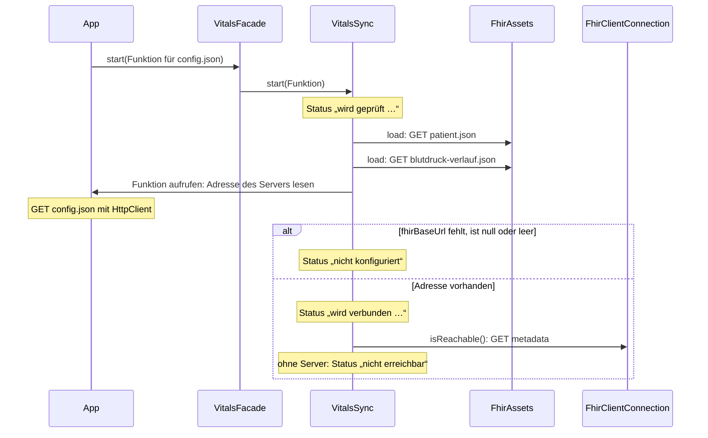

# 6 Laufzeitsicht

Teil der [Architektur von fhir-vitals](README.md).

## Was beim Start passiert

Der Browser lädt die Demo-App über Port 4200, siehe [Kapitel 7](07-verteilungssicht.md).
Danach ruft die Komponente `App` die Methode `start()` der Facade `VitalsFacade` auf und übergibt ihr eine Funktion, die `config.json` liest.
`VitalsSync` ruft diese Funktion später auf, ohne `App` zu kennen.
Den weiteren Ablauf steuert `VitalsSync` aus `fhir-vitals/core` über die Adapter `FhirAssets` und `FhirClientConnection`, siehe [Kapitel 4](04-loesungsstrategie.md).

- **Ohne Server.** Patient und Verlauf kommen aus den Assets, also statischen Dateien der Demo-App. Die Seite zeigt sie deshalb auch ohne FHIR-Server.
- **Zur Laufzeit.** `App` liest `config.json` erst zur Laufzeit und nicht beim Build. So lässt sich die Adresse ohne neuen Build ändern, siehe [D6](../../README.md#42-auf-dem-eigenen-rechner-mit-docker).
- **Zustand.** Nach jeder Änderung meldet `VitalsSync` den Zustand an alle, die ihn mit `subscribe()` abonniert haben. `VitalsFacade` legt ihn in das Signal `state`, also in einen Wert, dessen Änderungen Angular verfolgt. `App` reicht ihn von dort über Inputs an Karten und Dashboard weiter.
- **Fehler.** Scheitert eine andere Anfrage als `metadata`, die Selbstbeschreibung des Servers, zeigt die Karte „FHIR-Server“ die Fehlermeldung. Bleibt eine Anfrage an den Server ohne Antwort, steht dort weiter „wird verbunden …“, siehe [README, Abschnitt 5.2](../../README.md#warum-bleibt-der-status-bei-wird-verbunden).
- **Erneut verbinden.** Einen Klick auf „Erneut verbinden“ meldet `ServerStatus` an `App`, und `App` ruft `reconnect()` der `VitalsFacade` auf. `VitalsSync` wiederholt dann den Ablauf ab der Prüfung der Adresse, ohne `config.json` neu zu lesen. Ist schon das Laden von Patient, Verlauf oder `config.json` gescheitert, wiederholt er auch dieses.
- **Dashboard.** Unter „Dashboard“ steht zuerst „Dashboard wird geladen …“. Im Build aus [B6](../../README.md#41-im-dev-container) lädt der Browser die vorgeschlagenen Bibliotheken gridstack, Chart.js und ng2-charts erst, wenn dieser Text sichtbar wird. Sie liegen in einem Lazy Chunk, also einer JavaScript-Datei, die der Browser später nachlädt. Die ebenfalls vorgeschlagene Bibliothek Angular Material steckt dagegen in den Initial Chunks, also in den Dateien, die der Browser sofort lädt. Die Karten brauchen sie von Anfang an. Der Container aus [README, Abschnitt 3.2](../../README.md#32-demo-app-starten-und-ansehen) liefert denselben Build aus. Mit `npm start` lädt Angular die Pakete des Dashboards sofort mit, siehe `NG0751` in [README, Abschnitt 5.2](../../README.md#was-bedeutet-ng0751-in-der-konsole-des-browsers). Das Dashboard hängt nicht vom FHIR-Server ab.

> [!NOTE]
> Nächstes Semester.
> Antwortet HAPI FHIR, lädt `VitalsSync` die Datei `blutdruck.json`, schreibt Patient und Observation per PUT und liest die Observation zurück.
> Erst dann zeigt die Karte „FHIR-Server“ „verbunden, Patient und Blutdruck gespeichert“ und „Blutdruck vom Server: 104/66 mm[Hg]“.
> Den Patienten schreibt `VitalsSync` zuerst, denn HAPI prüft, ob `subject` der Observation auf einen vorhandenen Patienten zeigt.
> PUT schreibt beide Ressourcen unter ihrer festen ID.
> Ein neuer Start legt deshalb keine zweite Kopie an.
> Den Verlauf aus `blutdruck-verlauf.json` schreibt `VitalsSync` nicht auf den Server.
> Von den Messungen liegt dort nur `blutdruck-01` aus `blutdruck.json`.
> Diese Messung gleicht der letzten des Verlaufs.
