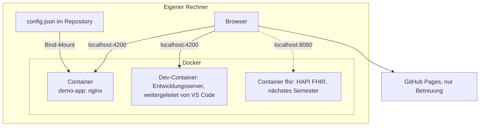

# 7 Verteilungssicht

Teil der [Architektur von fhir-vitals](README.md).

Der Browser läuft immer auf dem eigenen Rechner.
Er lädt die Demo-App unter `http://localhost:4200`.
Auch die Anfragen an den FHIR-Server unter Port 8080 schickt er selbst.
In diesem Semester läuft dort noch kein FHIR-Server.
Docker und VS Code leiten Ports aus den Containern an den eigenen Rechner weiter, etwa Port 80 von nginx als Port 4200.
Gepunktete Pfeile funktionieren erst im nächsten Semester.

Beide Wege zur Demo-App belegen Port 4200.
Deshalb den Container demo-app und den Dev-Container nicht gleichzeitig betreiben, siehe die [Frage zu Port 4200](../../README.md#warum-ist-port-4200-belegt) und die [Frage zur Seite aus dem Dev-Container](../../README.md#warum-lädt-die-seite-aus-dem-dev-container-nicht).
Auch ohne Container wie in [README, Abschnitt 3.5](../../README.md#35-ohne-container-nicht-empfohlen) belegt der Entwicklungsserver Port 4200.
GitHub Pages hat keinen FHIR-Server und betrifft nur die Betreuung, siehe [README, Abschnitt 4.4](../../README.md#44-für-die-betreuung-github-pages).
Wie Demo-App und HAPI FHIR starten, beschreiben [README, Abschnitt 3](../../README.md#3-schnellstart) und [README, Abschnitt 4](../../README.md#4-befehle).
Den Dev-Container beschreibt [Kapitel 8](08-querschnittliche-konzepte.md#dev-container-und-werkzeuge).

> [!NOTE]
> Nächstes Semester.
> Im Dev-Container meint `localhost` den Container.
> Die Seite aus dem Dev-Container erreicht HAPI trotzdem, denn die Anfragen schickt der Browser auf dem eigenen Rechner, siehe die [Frage zu `curl`](../../README.md#warum-erreicht-curl-im-dev-container-hapi-nicht).
> Ein Test dieser Kombination im Browser fehlt noch.
